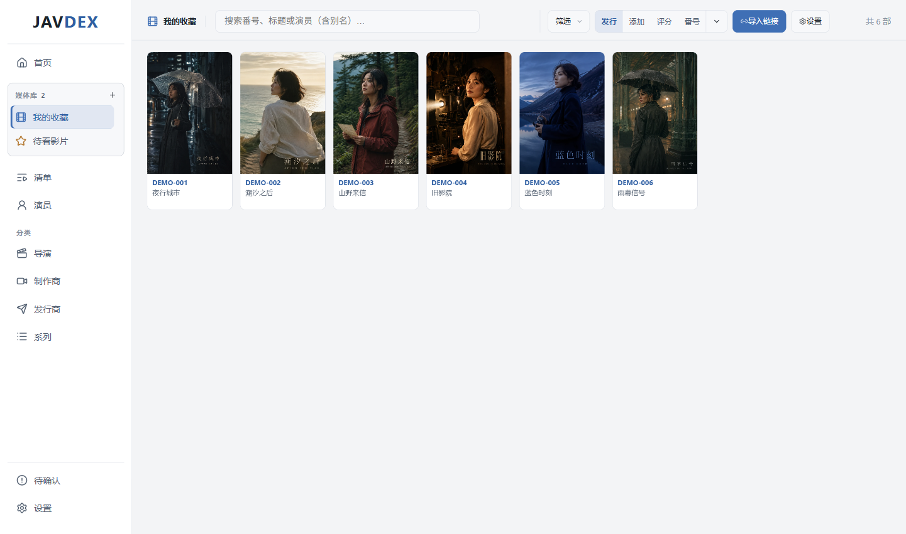
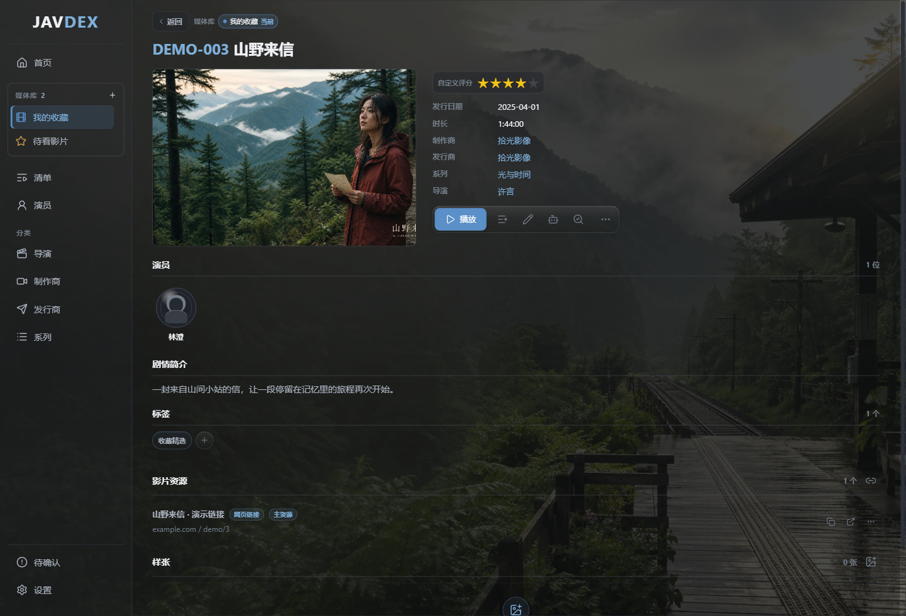

  

<h1 align="center">Javdex</h1>

  <strong>把影片文件和资源链接，整理成自己的影片资料库。</strong>

  本地优先 · 多媒体库 · Windows / macOS / Linux

  
  
  

  <a href="https://github.com/JavdexLabs/Javdex/releases/latest">下载最新版</a>
  &nbsp;·&nbsp;
  <a href="https://javdexlabs.github.io/Javdex/start/">使用文档</a>
  &nbsp;·&nbsp;
  <a href=".github/release-notes/v0.9.0-beta.5.md">0.9.0 Beta.5 发布说明</a>
  &nbsp;·&nbsp;
  <a href="CHANGELOG.md">更新日志</a>
  &nbsp;·&nbsp;
  <a href="https://javdexlabs.github.io/Javdex/product/">产品介绍</a>

Javdex 是一款以番号为核心的本地影片管理工具。扫描目录、补齐封面与资料，按演员、厂商和系列浏览，也可以创建清单、导入网页收藏，并通过 NFO 与其他媒体软件交换资料。

> 本页与使用指南面向 **0.9.0-beta.5 预发布**。Beta.5 的安装包、镜像和升级文件以[对应 Release](https://github.com/JavdexLabs/Javdex/releases/tag/v0.9.0-beta.5)实际发布状态为准；最新正式版仍为 0.8.0，默认下载和更新提醒不切换到 Beta。升级前完整备份，schema 21 不能直接交给旧版打开。

  

本页配图截取自当前软件，影片、人物与图片均为虚构演示资料。

## 整理与浏览媒体库

让分散在不同目录里的影片，有一个统一的浏览入口。

- **按需要分库**：创建多个媒体库，各自设置来源目录、扫描周期和默认刮削来源；首页汇总近期添加、随机发现与跨库搜索。
- **统一管理资源**：扫描本地视频与 STRM 文件，也可添加直链、网页、Magnet 和 ED2K 链接；同一影片可关联多个资源，并选择优先打开的主资源。
- **快速找到影片**：搜索番号、标题或演员，组合筛选与排序，按演员、标签、制作商、发行商、导演和系列继续浏览。

## 在电脑上使用，或交给 NAS 常驻运行

默认在本机保存和管理资料，无需部署服务。也可把资料库、图片和媒体目录放在 NAS 或常开电脑上，通过桌面应用远程管理，通过浏览器浏览与播放。

| 使用方式 | 适合的场景 |
|---|---|
| 桌面本地模式 | 在一台电脑上扫描、整理和播放自己的影片 |
| 独立服务端 + 桌面应用 | 服务机器持续扫描和提供访问，桌面连接后编辑资料、处理待确认和执行刮削 |
| 浏览器访问 | 手机、平板和电视只读浏览、搜索、播放及下载资源 |

服务端可独立运行，无需保持桌面应用开启；刮削插件、AI 采集和网页登录仍在桌面执行。网页不是管理后台，不提供视频转码。服务端与桌面须使用同一版本，当前面向可信局域网。

服务端使用单个 Docker 容器，支持 x86_64 和 ARM64，无需编译源码或安装宿主机更新助手。Beta.5 桌面须配合同版本服务端；按 [服务端部署与托管更新](docs/SERVER_UPDATE.md) 配置数据卷、独立的 `/program` 程序卷及首次配对。业务、播放与更新共用一个 HTTPS 地址，一次配对即可授权，可管理和单独撤销多台可信电脑；网页账号仍独立。媒体挂载与权限说明见 [服务端指南](docs/SERVER_MODE.md#媒体目录权限)。部署示例从对应版本源码获取，安装包和每架构单个 `.javdex-update` 签名升级文件以[对应 Beta.5 Release](https://github.com/JavdexLabs/Javdex/releases/tag/v0.9.0-beta.5)实际附件为准。

首次从 0.8.0 升级须由管理员停服备份、更换支持托管更新的镜像并保留数据。Beta.1–4 采用本版手动令牌、附加组与升级规则也须先更换 Beta.5 基础镜像，业务升级包不会更新管理器；保留 `/data`、`/program` 和图片卷。更高业务版本的镜像会自动升级和验证，同版或更旧版本不降级；升级不创建资料备份，安装开始后失败或中断保持维护状态并要求人工恢复。服务端落后时，客户端可在线获取或离线上传与自身完全同版本的签名升级文件，包含 Beta；桌面正式更新提醒仍只读取正式 Release。“备份与恢复”支持本地与服务端互相导入，保留来源资料库，不自动同步两份资料；安全升级与回退步骤见[升级指南](https://javdexlabs.github.io/Javdex/releases/upgrade/)。

## 在应用内播放，边看边整理

默认使用基于 **libmpv 原生渲染**的内置播放器，本机文件与服务端原文件使用同一播放引擎，远程文件仍在此电脑解码。

- 展开或全屏观看，切换音轨、字幕、章节与倍速，加载本机 SRT/ASS 字幕。
- 收起为底部迷你播放器，保留实时小视频并继续浏览资料库；点击小视频恢复展开，停止后释放底部空间。
- 默认只在此电脑保存续播位置；再次打开有有效进度的资源时，选择继续或从头播放。
- 可在设置中指定外部播放器，或从资源菜单单次选择播放方式；直链、STRM 中的网络目标、网页、Magnet 和 ED2K 等链接继续外部打开。

Linux 内置播放需要 X11／XWayland，并在完整退出后用 `--javdex-x11` 启动。格式支持取决于播放运行库与设备；网页端仍使用浏览器自身的播放能力，不提供转码。设置与故障处理见 [播放影片](docs/USER_GUIDE.md#播放影片)。

## 本地 AI 字幕与文本翻译

在内置播放器中为日语对白生成日中字幕，也可翻译影片标题与简介。语音识别使用 Kotoba Whisper，中文翻译可选 Qwen3 1.7B 或 HY-MT2 7B；字幕识别、字幕翻译和文本翻译分别选择模型与精度。

“设置 → AI 服务 → 本地模型”集中管理模型下载、导入、校验、导出与保存位置，“功能”页决定各功能使用哪个模型。模型权重需要另外下载，安装并就绪后在本机推理，不上传音频或翻译文本。文本翻译也可选择继承应用默认模型，通过已配置的 API 服务执行。

AI 字幕支持中日双语、仅中文或仅日语，可导出已生成字幕。首次生成需要等待，速度与准确度取决于电脑及音频，不保证实时；远程影片仍需要网络连接。支持系统与具体操作见 [AI 日中字幕](docs/USER_GUIDE.md#ai-日中字幕) 和 [本地模型管理](docs/USER_GUIDE.md#本地模型管理)。

## 在手机、平板和电视上访问

开启局域网网页服务，就能在同一网络的设备上用浏览器浏览自己的媒体库，无需另装客户端。

- **换个设备继续挑片**：搜索影片、浏览清单与详情，查看随机发现和近期添加；手机可扫描桌面二维码打开网页，电视支持方向键浏览。
- **轻松连接设备**：使用账号密码登录，或在桌面核对六位配对码后批准；可记住设备，并随时在桌面撤销授权。
- **直接浏览与播放**：播放浏览器支持的本地视频和直连资源，也可下载本地资源。网页只读，资料编辑、扫描和刮削仍在桌面端完成。

本地模式在“设置 → 网络 → 网页服务”开启，默认关闭，桌面应用需保持运行，也可最小化到系统托盘。独立服务端则由服务进程持续提供访问。播放格式取决于设备与浏览器，不提供转码；当前面向可信局域网。具体步骤见 [局域网浏览与播放](docs/USER_GUIDE.md#局域网浏览与播放)。

## 补齐影片资料

把只有文件名的影片，整理成有封面、简介和关联资料的条目。自动获取这些信息的过程，在应用中称为“刮削”。

- 获取标题、简介、发行日期、评分、演员、标签、封面与样张；支持单部处理和批量刮削，批量任务可暂停、恢复或取消。
- 按字段选择资料来源，例如标题和简介使用一个插件，图片使用另一个插件；更新时可选择需要处理的字段及更新方式。
- 随时手动编辑资料、添加相关网页链接，或记录自己的评分。

  

可导入更多刮削插件，也可使用开发助手辅助创建和调试插件。内置 MetaTube 来源需要连接自己的服务，配置方式见 [MetaTube 指南](docs/METATUBE_SETUP.md)。

## 从作品找到演员与系列

演员、厂商、导演和系列都有自己的资料与关联作品，方便沿着感兴趣的人物和分类继续探索。

- 维护演员头像、别名、简介与写真，在演员详情中浏览出演作品。
- 在本地识别人脸并调整头像构图，支持批量处理，也能筛选未检测到人脸的头像进行检查。
- 维护分类资料、别名和系列层级，合并重复的演员或分类记录。

## 用清单整理收藏

清单可以跨媒体库收录影片，用来整理专题、收藏或之后想看的作品。

- 自己创建清单、维护封面和相关链接，把不同媒体库的影片放在一起。
- 内置“收藏”和“稍后观看”，在卡片上即可加入；“稍后观看”可按需开启播放后移除。
- 桌面“最近播放”便于找回刚打开的影片，只保存在当前电脑、按资料库隔离，不同步到服务器或其他设备，也不纳入资料库备份。
- 借助 AI 从网页导入外部清单，匹配资料库中的已有影片；遇到同番号的多个候选时，由你核对选择。
- 尚未收录的条目可按选项创建为无资源影片，先保存资料，之后再添加资源；远程模式会在目标媒体库中创建这些影片。远程模式暂不支持追加到已有清单。清单导入不会下载影片。

## AI 辅助采集，疑问集中确认

在影片或演员详情中使用“Agent 刮削”，粘贴详情页地址，让 AI 从网页提取资料；预览结果、选择字段后再应用。

扫描归属不明、文件名与 NFO 番号冲突、刮削出现多个候选或演员名称冲突时，可到“待确认”集中处理。需要整理已有记录时，也可以合并同番号影片或拆分关联资源。

AI 采集、外部清单导入和插件开发助手需要先配置可用模型服务。普通扫描、浏览和插件刮削不要求配置 AI 模型。

## 让已有资料继续用起来

扫描首次发现资源时，可读取影片旁的本地 NFO，利用已有资料和图片建库；已刮削成功的影片不会被自动覆盖。

已覆盖 **Movie_Data_Capture（MDC）、MDCx、Javinizer 和 JavSP** 的常见 NFO 字段与本地图片命名约定，方便利用这些工具整理过的资料。兼容范围基于固定版本的格式样例验证，详见 [使用指南中的导入说明](docs/USER_GUIDE.md#导入已有资料)。

也可以导出影片资料、封面和可选图片附件，供 Kodi、Jellyfin、Emby、Plex NFO Agent 或 Infuse 使用。导出前可预览文件，默认跳过已有文件。

NFO 导入与导出是一次性操作，不会持续同步，也不等于完整资料库备份。不同软件的设置要求与图片支持范围见 [NFO 兼容性说明](docs/NFO_COMPATIBILITY.md)。

## 本地存储与个性化显示

- **自行保存资料**：本地模式将数据库和图片保存在本机，可迁移图片目录或启用图片加密；远程模式将正式资料和图片保存在自己的服务机器上，桌面设置与采集草稿留在当前电脑。
- **按场景保护显示**：隐私模式可遮盖封面、样张和写真，替换演员头像，并按需关闭图片预览。
- **按喜好调整界面**：选择主题、横竖封面显示和详情背景，调整头像构图。

本地优先指资料的保存方式。联网刮削会访问对应来源，通过 API 执行的 AI 功能会把任务所需内容发送给配置的模型服务；内置离线字幕、本地文本翻译和人脸检测无需上传内容。图片加密仅覆盖图片文件，隐私模式仅改变界面显示。

## 下载与开始使用

从 [官网](https://javdexlabs.github.io/Javdex/) 或 [GitHub Releases](https://github.com/JavdexLabs/Javdex/releases/latest) 下载对应平台的安装包。

| 平台 | 安装包 |
|---|---|
| Windows（x64） | EXE 安装版、ZIP 免安装版 |
| macOS | Apple Silicon DMG、Intel DMG |
| Linux（x86_64） | AppImage、DEB |

首次使用：

1. **创建媒体库**：在“设置 → 媒体库”新建媒体库，选择影片所在目录。
2. **扫描影片**：创建时选择立即扫描，或在媒体库设置中手动启动扫描。
3. **补齐资料**：在“设置 → 刮削来源”选择可用来源，再对影片执行单部或批量刮削。
4. **开始整理与播放**：浏览影片和演员、加入收藏或稍后观看，打开影片使用内置播放器；有待确认项时，核对后再完成关联。

安装与更新方式、链接导入和各项功能的具体步骤见 [使用指南](docs/USER_GUIDE.md)，平台与升级前提见 [0.9.0 发布说明](.github/release-notes/v0.9.0.md)。从 0.8.0 升级前请备份完整数据与图片目录；数据库 schema 19 → 21、模型管理 schema 3 → 4 会在首次使用新版时升级，回退须恢复升级前备份，不能直接用旧版打开升级后的数据。

> 当前安装包尚未进行商业代码签名，系统可能显示发布者或安全提示。请从项目官网或 GitHub Releases 下载。应用可检查版本，但更新需要重新下载安装包。

## 帮助与参与开发

| 我想…… | 查看 |
|---|---|
| 开始使用、管理资源或排查操作问题 | [使用指南](docs/USER_GUIDE.md) |
| 在 NAS 或常开电脑部署、更新服务端 | [服务端部署与托管更新](docs/SERVER_UPDATE.md) · [媒体目录与权限](docs/SERVER_MODE.md#媒体目录权限) |
| 连接自己的 MetaTube 服务 | [MetaTube 配置指南](docs/METATUBE_SETUP.md) |
| 了解 NFO 对其他软件的支持范围 | [NFO 兼容性说明](docs/NFO_COMPATIBILITY.md) |
| 从源码运行、开发插件或参与贡献 | [开发指南](docs/DEVELOPMENT.md) |
| 查看版本变化 | [更新日志](CHANGELOG.md) |

发现问题或有功能建议，欢迎 [提交 Issue](https://github.com/JavdexLabs/Javdex/issues/new)；已有计划和讨论见 [Issues](https://github.com/JavdexLabs/Javdex/issues)。

Javdex 管理你已有的影片文件、手动添加的资源链接和影片资料，不提供、托管或分发媒体内容；桌面端支持内置与外部播放，局域网网页端可使用浏览器播放支持的资源。使用第三方来源时，请遵守所在地法律法规及目标网站条款。第三方项目与许可见 [第三方说明](docs/THIRD_PARTY_NOTICES.md)。

## License

当前 Javdex 源码整体按 [GNU GPL v3 或后续版本（GPL-3.0-or-later）](LICENSE) 发布，项目声明见 [NOTICE](NOTICE)。

此前按 MIT 发布的版本保留原有授权，原版权及许可声明见 [历史 MIT 声明](LICENSES/Javdex-MIT.txt)。第三方代码、模型与图标仍遵循各自许可，见 [第三方说明](docs/THIRD_PARTY_NOTICES.md)。

Copyright (c) 2026 Javdex
