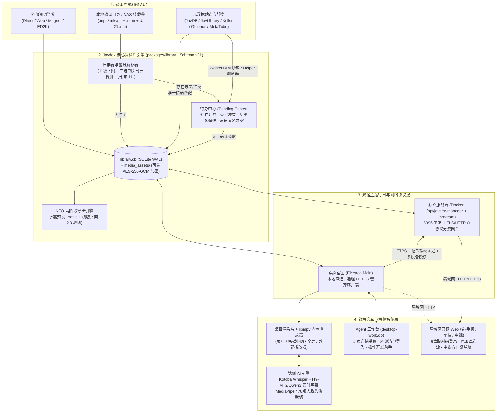

# Javdex 全新官方文档站从零净室设计（Clean-Room Design）蓝图

> **文档用途**：本文档为 Javdex 官方文档站（Astro Starlight）100% 基于软件源码逆向工程推导出的净室重写蓝图与事实基线（Single Source of Truth Baseline）。用于跨上下文持久化保存全部源码技术事实、目录树设计、逐页大纲、图表清单、外链映射与分批执行计划。
> **基线版本**：`0.9.0` | **SQLite Schema**：`CURRENT_SCHEMA_VERSION = 21` | **模型管理 Schema**：`MODEL_MANAGEMENT_SCHEMA_VERSION = 4`

---

## 一、 基于源码推导的产品架构与文档设计哲学

### 1.1 从源码提炼的 Javdex 核心能力矩阵与数据流转模型

通过对 `packages/library`、`packages/http`、`packages/contracts`、`apps/desktop`、`apps/server` 及 `apps/web` 的全链路追踪，Javdex 是一套**“以番号（Code）与业务身份为核心、支持桌面本地与 NAS 容器双宿主、内置原生播放与端侧 AI 推理的影片资料库系统”**，由八大核心子系统构成：

1. **双宿主资料库引擎（Dual-Host Catalog Engine）**：
   - **桌面本地模式（Local Mode）**：Electron 主进程直接挂载本机 `<userData>/library.db` 与 `media_assets/`，工作草稿与 Agent 状态隔离在 `<userData>/desktop-work.db`。
   - **独立服务端模式（Remote Server Mode）**：Docker 容器内由 `/opt/javdex-manager`（`root` 守护网关，监听 `8096` 双协议端口）托管 `/program` 中的业务进程（降权至 `1000:1000`，监听 `127.0.0.1:8098`）。桌面端通过 **TOFU 自签名证书指纹固定（Certificate Pinning）** 与 **64 位一次性配对码（One-Time Token）** 建立多可信设备写入授权（`catalog_writer_credentials`）。
   - **只读局域网网页端（LAN Browser Surface）**：既可在桌面端开启（仅 HTTP），也可由独立服务端同端口提供（HTTP/HTTPS 双协议自动识别），供手机、平板与智能电视（2D 方向键空间导航）免安装浏览、原画直连播放与下载。
2. **多源媒体库与扫描审计引擎（Scanner & Audit State Machine）**：
   - 支持创建多个独立媒体库（`media_libraries`），各自绑定多个本地根目录（`media_library_roots`，写入 `.javdex-root` 标记）并配置独立的扫描策略。
   - 扫描器支持 **12 种本地视频格式**与 **`.strm` 流指针文件**（解析出 `local`/`direct`/`web`/`magnet`/`ed2k` 五类资源），内置纯 JS 二进制文件头时长探测（ISO BMFF / EBML / RIFF / ASF / AMF0）过滤短视频，通过 **11 级番号正则匹配管线**与父目录回退提取番号，并将每个文件的处理结果写入由触发器保护的单调状态机审计表（`library_scan_audit_manifests`：`collecting` -> `sealed` -> `published`）。
3. **集中式“待办中心”冲突消解机制（Pending Center）**：
   - 拒绝静默覆盖或盲目入库，将所有不确定性收敛至 `/pending` 的四大队列：**同番号多资源归属确认**（`pending_scan_groups`）、**文件名与本地 NFO 番号冲突**（`pending_resource_identities`）、**影片刮削多候选/身份冲突**（`pending_video_scrapes`）以及**演员全局唯一名称/别名所有权冲突**（`pending_actress_scrapes` / `pending_actress_name_claims`）。
4. **双层沙箱刮削引擎与字段级组合刮削（Scraper Sandbox & Composite Scrapers）**：
   - 采用 `worker_threads` + `vm.createContext` 双层隔离运行插件，配合独立子进程 Chromium 辅助浏览器（`--javdex-scraper-helper`，支持 Cloudflare/登录态保持与 `requiresPreLogin` 会话预登录）。
   - 支持将影片 15 个字段、演员 14 个字段分别指派给不同插件（`compositeScrapers`），按插件分组单次执行后投影合并。
5. **双向 NFO 生态桥接与横版封面智能裁切（NFO Codec & Export Profiles）**：
   - **扫描自动导入**：自动识别 `mdcx`、`javsp`、`mdc`、`javinizer` 四种存量 NFO 方言及同目录海报/样张/`.actors` 头像。
   - **两阶段校验导出**：提供针对 `通用 / Kodi`、`Jellyfin`、`Emby / Kodi 保守子集`、`Plex NFO Agent (1.43.1+)`、`Infuse` 的 **5 套预设 Profile**，自动对横版封面执行右半幅 `2:3` 竖版海报裁切，并通过 `plan() -> apply()` 快照哈希校验防止并发覆写。
6. **内置 `libmpv` 原生播放器与远程直连流（Native Playback）**：
   - 通过原生插件嵌入 `libmpv` 渲染视口（Linux 下采用独立 `playback-helper` 进程 + `--javdex-x11`），无缝支持本地文件与远程服务端 `PlayGrant` 签名直连流（零转码），支持 `expanded`（展开）、`docked`（底栏迷你小窗，可边看边逛库）、`fullscreen`（全屏）三态无缝切换，以及外部播放器一键回退。
7. **端侧本地 AI 推理与云端 Agent 平台（Local AI & Agent Platform）**：
   - **实时 AI 日中字幕**：按当前播放位置优先调度 `30s` 音频切片（含 `3s` 上下文），本机调用 `ffmpeg` -> `whisper-cli`（`Kotoba Whisper v2.0` + `Silero VAD v6.2.0`）-> `llama-server`（`HY-MT2 7B` 或 `Qwen3 1.7B`），支持 Windows CUDA 12.4 / Vulkan 与 macOS Metal 硬件加速及显存不足自动降级 CPU。
   - **MediaPipe 本地人脸检测**：Web Worker 内运行 `blaze_face_full_range` + `face_landmarker`（478 点）+ `hair_segmenter`，实现演员头像自动构图裁切与“有/无人脸”筛选。
   - **三大云端/Agent 工作负载**：基于 Schema v4 统一管理 12 家内置服务商与 4 种协议（`openai-chat`、`openai-responses`、`anthropic-messages`、`google-generative-ai`），驱动**文本翻译**、**媒体库整理 Agent**（详情页网页采集、外部网页清单导入）与**刮削插件开发助手 Agent**（含沙箱 Dry-Run 机械验收门禁与 MCP Server）。
8. **跨平台备份恢复与托管热更新（Backup & Managed Updater）**：
   - `.javdex-backup` 归档自动剥离本机密钥、将加密图片还原为明文并按 SHA-256 归一化命名，支持桌面与服务端双向恢复、跨操作系统路径分隔符重写、根目录映射及本机直传服务端导入。
   - 服务端支持 Ed25519 签名 `.javdex-update` 升级包在线拉取或 `8 MiB` 断点续传离线上传，由容器内管理器自动完成停服、迁移验证、激活或维护态拦截。



### 1.2 全新文档站信息架构（IA）设计哲学

参考 **Immich**、**Jellyfin**、**Obsidian**、**Raycast** 四大标杆项目，全新文档站遵循以下四项架构准则：

1. **严格对齐 Diátaxis 四象限与真实用户旅程**：
   - **上手与部署（Getting Started / Tutorials）**：解决“这是什么 -> 我该选桌面本地还是 NAS 服务端 -> 下载哪个包 -> 5 分钟跑通建库扫描与刮削”。
   - **核心工作流指南（Core Workflows / How-To Guides）**：严格按数据生命周期编排——「整理文件与扫描 -> 消解待办冲突 -> 刮削与 NFO 互通 -> 演员与分类维护 -> 播放与实时 AI 字幕 -> 局域网多端浏览 -> AI 采集与清单导入」。
   - **运维与速查手册（Operations & Reference）**：将高频查阅但无需通读的硬核事实抽离为结构化速查表——「备份恢复与跨端迁移」「服务端托管更新与故障恢复」「路径与存储加密速查」「环境变量与配置文件全集」「快捷键与操作速查」「常见问题排查」。
   - **插件与开发者中心（Plugins & Development）**：面向进阶玩家与贡献者，完整公开 `.avscraper.json` 插件规范、`ctx` 沙箱 API、内置 AI 插件开发助手 + MCP 工作流，以及工作区架构与本地构建指南。
2. **双模式能力边界前置（Local vs. Server Transparency）**：
   - 在入门篇与各功能页首部统一采用边界矩阵说清“哪些在服务端自动执行（定时扫描、Web 浏览、原文件流传输）、哪些必须在桌面端执行（插件刮削、AI 字幕推理、NFO 导出、Agent 采集）”。
3. **安全红线与不可逆操作显式预警（Safety-First Callouts）**：
   - 针对源码中强制实施的安全约束（如：服务端 `/data` 严禁挂载 NFS/SMB/FUSE、服务端更新不自动备份数据库、安装进入 `installing` 阶段后失败不会自动降级而是进入 `recoveryRequired`、Schema 21 升级后不可被旧版直接打开），统一使用 `:::danger` 与 `:::caution` 在操作步骤前醒目阻断。
4. **零臆测、代码级精确度（Code-Exact Precision）**：
   - 所有正则规则、端口号、超时阈值、文件大小限制、环境变量默认值均直接映射自源码常量。

---

## 二、 源码事实基线清单 (Source Code Truth Baseline)

### 2.1 打包产物与发布矩阵 (`0.9.0`)

依据 `build/packaging.targets.json:4-159`、`electron-builder.config.mjs:39-183`、`.github/workflows/release.yml:105-439` 与 `scripts/server-update-release.mjs:52-130`：

| 类别 | 平台 / 架构 | Target ID / 镜像 | 精确产物命名格式（以 `0.9.0` 为例） | 签名状态与系统运行基线 |
| :--- | :--- | :--- | :--- | :--- |
| **桌面端安装包** | Windows `x64` | `win-nsis` (`enabled: true`) | `Javdex-Setup-0.9.0-x64.exe` | 未进行商业 Authenticode 签名（SmartScreen 需点“仍要运行”）；`oneClick: false` 支持自定义安装目录；内置播放自动附加 `--disable-direct-composition`。 |
| **桌面端免安装** | Windows `x64` | `win-zip` (`enabled: true`) | `Javdex-Setup-0.9.0-x64.zip` | 解压即用目录包（注：`win-portable` 单文件便携版在 `packaging.targets.json` 中为 `enabled: false`）。 |
| **桌面端镜像** | macOS `arm64` (Apple Silicon) | `mac-dmg` (`enabled: true`) | `Javdex-0.9.0-arm64.dmg` | Ad-hoc 签名（`identity: '-'`）且未公证；首次打开若提示已损坏需执行 `xattr -dr com.apple.quarantine /Applications/Javdex.app`。内置播放支持 **macOS 12.0+**；本地 AI 字幕/翻译需 **macOS 13.3+**（Darwin `>= 22.4`，内置签名版 Metal `whisper-cli` 与 `ffmpeg`/`ffprobe`）。 |
| **桌面端镜像** | macOS `x64` (Intel) | `mac-dmg` (`enabled: true`) | `Javdex-0.9.0-x64.dmg` | 同上（`mac-zip` 在 `packaging.targets.json` 中为 `enabled: false`）。 |
| **桌面端镜像** | Linux `x64` (`x86_64`) | `linux-appimage` (`enabled: true`) | `Javdex-0.9.0-x86_64.AppImage` | 通用可执行镜像。**内置播放要求 X11 / XWayland**（`DISPLAY` 非空）且需完全退出后带 `--javdex-x11`（或 `--ozone-platform=x11`）启动；**本地 AI 字幕要求 glibc 2.38+、GCC 14 `libstdc++` 及 `xz-utils`**。 |
| **桌面端安装包** | Linux `x64` (`amd64`) | `linux-deb` (`enabled: true`) | `Javdex-0.9.0-amd64.deb` | Debian/Ubuntu 安装包（安装至 `/opt/Javdex/javdex`，声明 `libc6 (>= 2.35)`、`libgtk-3-0`、`libva2`、`libasound2` 等依赖；`linux-rpm` 为 `enabled: false`）。 |
| **独立服务端镜像** | Linux `amd64` / `arm64` | GHCR 多架构镜像 | `ghcr.io/javdexlabs/javdex-server:0.9.0` | 基于 `node:22-bookworm-slim` + `tini` + `openssl` + `util-linux`；运行时标识 `node22-bookworm-v1`（`SERVER_ENVIRONMENT_VERSION = 1`）；暴露端口 `8096`，挂载卷 `/data`、`/media`、`/program`。 |
| **服务端升级包** | Linux `amd64` / `arm64` | 托管更新单文件包 | `Javdex-server-0.9.0-linux-amd64.javdex-update`<br/>`Javdex-server-0.9.0-linux-arm64.javdex-update` | `JVDXUPD1` 8 字节魔数头 + 4 字节 UInt32BE 长度 + Ed25519 签名 JSON 清单 + `/app` 生产闭包 `.tar.gz`，供桌面端在线拉取或离线断点上传更新容器内 `/program`。 |
| **合规源码归档** | 四平台聚合包 | GPL/LGPL 播放组件源码 | `Javdex-Playback-Sources-0.9.0.tar.gz` | 聚合 `windows-x64`、`macos-x64`、`macos-arm64`、`linux-x64` 四个平台的 `libmpv`/`ffmpeg` 等开源组件源码及 `restore.mjs` 还原脚本。 |
| **校验清单** | 全平台 | SHA-256 摘要表 | `SHA256SUMS.txt` | 汇总上述全部 6 个桌面安装包、2 个 `.javdex-update` 升级包及播放源码包的 SHA-256 哈希值。 |

---

### 2.2 完整环境变量清单 (`process.env`)

#### A. 独立服务端与容器托管网关环境变量 (`apps/server/src/config.ts:75-145`、`apps/server/src/updater/config.ts:41-69`)

| 环境变量名 | 默认值 | 作用域 | 具体行为与约束说明 |
| :--- | :--- | :--- | :--- |
| `JAVDEX_SERVER_CONFIG` | 容器内默认 `/config/server.json` | 服务端 / 管理器 | 未传 `--config <path>` CLI 参数时读取的 JSON 配置文件路径。 |
| `JAVDEX_LISTEN_HOST` | `config.listenHost` 或 `'0.0.0.0'` | 服务端 / 管理器 | 外部监听绑定地址。 |
| `JAVDEX_LISTEN_PORT` | `config.port` 或 `8096` | 服务端 / 管理器 | 外部监听端口（`0` 或 `1024..65535`）。托管容器模式下网关监听此端口，业务子进程被固定重写为 `127.0.0.1:8098`。 |
| `JAVDEX_ACCESS_HOSTS` | `config.accessHosts` | 服务端 / 管理器 | 逗号分隔的允许访问的 `Host`/`Origin` 主机名或局域网 IP 列表（必填且非空）。 |
| `JAVDEX_DATA_DIR` | `config.dataDir`（通常 `/data`） | 服务端 / 管理器 | 数据库与运行状态根目录。**必须为本地文件系统**（代码级拦截 NFS `0x6969` / CIFS `0xff534d42` / SMB `0x517b` / FUSE `0x65735546` / 9P `0x1021997`）且剩余空间 `>= 64 MiB`。 |
| `JAVDEX_IMAGES_DIR` | `<dataDir>/media_assets` | 服务端 / 管理器 | 官方图片存储目录（绝对路径，不可与 `dataDir` 或 `mediaMounts` 重叠）。 |
| `JAVDEX_RUNTIME_DIR` | `'/program'` | 容器管理器 | 托管更新器程序卷目录（存放 `.javdex-program`、`state/` TLS 证书与状态、`releases/` 业务版本闭包），不可与 `dataDir` 或 `imagesDir` 重叠。 |
| `JAVDEX_SEED_DIR` | `'/app'` | 容器管理器 | 镜像内置的只读初始业务种子目录。 |
| `JAVDEX_STATIC_ROOT` | `<serverDir>/web` | 服务端 | 局域网 Web 前端静态资源目录（必须包含 `index.html`）。 |
| `JAVDEX_WEB_USERNAME` | `config.web.username` | 服务端 | 覆盖局域网 Web 登录用户名（正则 `/^[\w.-]{1,64}$/`）。 |
| `JAVDEX_WEB_PASSWORD` | 无（回退使用 `passwordHash`） | 服务端 | 明文密码（`12..128` 字符，不可全空白），启动时在内存中使用 `scryptSync` 派生哈希覆盖 `config.web.passwordHash`。 |
| `JAVDEX_BUSINESS_UID` | `stat(dataDir).uid`（非 0 时）否则 `1000` | 容器管理器 | 管理器通过 `setpriv --reuid` 降权启动业务子进程的 UID。 |
| `JAVDEX_BUSINESS_GID` | `stat(dataDir).gid`（非 0 时）否则 `1000` | 容器管理器 | 管理器通过 `setpriv --regid` 降权启动业务子进程的 GID。 |
| `JAVDEX_BUSINESS_GROUPS` | `/etc/group` 中 `businessUid` 的附加组 | 容器管理器 | 逗号分隔的附加 GID 列表，传给 `setpriv --groups`。 |
| `JAVDEX_INTERNAL_PORT` | `8098` | 容器管理器 | 管理器网关与内部业务进程通信的本地回环端口（`1024..65535`，不可等于外部端口）。 |
| `JAVDEX_UPDATE_STOP_TIMEOUT` | `120`（秒，范围 `5..600`） | 容器管理器 | 更新停服阶段向业务进程组发送 `SIGTERM` 后等待退出的超时秒数（超时后发送 `SIGKILL`；Compose `stop_grace_period` 建议设为 `150s`）。 |
| `JAVDEX_RELEASE_KEYS_FILE` | `'/opt/javdex-manager/release-keys.json'` | 容器管理器 | 验证 `.javdex-update` 升级包 Ed25519 签名的公钥文件路径。 |
| `JAVDEX_GITHUB_API_BASE` | `'https://api.github.com'` | 容器管理器 | 在线检查服务端升级包时请求的 GitHub API 基础地址。 |
| `JAVDEX_GITHUB_REPO` | `'JavdexLabs/Javdex'` | 容器管理器 | 在线检查服务端升级包的目标仓库。 |
| `JAVDEX_BOOTSTRAP_TOKEN` | 无 | 仅裸 Node 宿主 | 长度 `>= 16` 的 ASCII 初始绑定令牌。**在 Docker 托管容器模式下被明确禁止**（容器模式必须使用 `docker exec ... token` 命令）。 |
| `JAVDEX_MANAGER_LOCK_HELD` / `JAVDEX_GATEWAY_TOKEN` / `JAVDEX_PUBLIC_URL` / `JAVDEX_UPDATE_JOB` | 内部注入 | 容器管理器 -> 业务进程 | 管理器与业务子进程之间的内部锁标记、64 位十六进制网关鉴权令牌、规范 HTTPS Origin 及更新验证任务 ID。 |

#### B. 桌面端运行、刮削浏览器与 MCP 环境变量 (`packages/contracts/src/appIdentity.ts:7-15`、`apps/desktop/src/main/scrapers/scrapeBrowser.ts:184-210`、`apps/desktop/src/mcp/javdex-plugin-dev-server.ts:27-74`)

| 环境变量名 | 默认值 | 作用域 | 具体行为与约束说明 |
| :--- | :--- | :--- | :--- |
| `DISPLAY` | 系统 X11 环境变量 | Linux 桌面端 | Linux 内置 `libmpv` 播放必需的 X11/XWayland 显示服务地址（配合启动参数 `--javdex-x11`）。 |
| `XDG_CONFIG_HOME` | `~/.config` | Linux 桌面端 | 决定 Linux 下默认应用数据目录 `${XDG_CONFIG_HOME}/Javdex`。 |
| `JAVDEX_TEST_USER_DATA` / `JAVDEX_USER_DATA` | 无（使用系统默认 `userData`） | 桌面端 / CLI | 覆盖默认 `<userData>` 数据目录路径，用于便携隔离运行或自动化测试。 |
| `JAVDEX_BUNDLED_PLUGINS_ROOT` | 内置 `bundled-plugins` 目录 | 桌面端 | 当 `JAVDEX_TEST_USER_DATA` 激活时，可覆盖内置刮削插件加载根目录。 |
| `JAVDEX_BROWSER_EXECUTABLE` | 无 | 刮削辅助浏览器 | 在非 Electron 环境独立运行刮削器时指定外部 Chromium 可执行文件路径。 |
| `JAVDEX_BROWSER_CHANNEL` | `'chrome'` | 刮削辅助浏览器 | 在非 Electron 环境且未指定可执行文件时使用的 Playwright 浏览器通道。 |
| `AV_PLUGIN_DEV_KIND` | `'video'`（可选 `'actress'`） | MCP 插件开发服务 | `npm run mcp:plugin-dev` 启动时指定开发影片插件还是演员插件。 |
| `AV_PLUGIN_DEV_SITE_NAME` | `'mcp-plugin-dev'` | MCP 插件开发服务 | 目标站点名称。 |
| `AV_PLUGIN_DEV_SITE_URL` | `undefined` | MCP 插件开发服务 | 目标站点主页 URL。 |
| `AV_PLUGIN_DEV_DESCRIPTION` | `undefined` | MCP 插件开发服务 | 插件描述文本。 |
| `AV_PLUGIN_DEV_SUPPORTED_FIELDS` | `''` | MCP 插件开发服务 | 逗号分隔的插件声明支持字段列表。 |
| `AV_PLUGIN_DEV_TEST_TARGETS` | `undefined` | MCP 插件开发服务 | 逗号或换行分隔的测试番号或测试演员名列表（兼容单项 `AV_PLUGIN_DEV_TEST_CODE` / `AV_PLUGIN_DEV_TEST_ACTRESS`）。 |
| `AV_PLUGIN_DEV_WORKSPACE` | `<os.tmpdir()>/javdex-plugin-dev-mcp/<sessionId>` | MCP 插件开发服务 | MCP 插件开发会话的工作区目录路径。 |

#### C. 构建与打包流水线环境变量 (`scripts/dist.mjs:126-162`、`electron-builder.config.mjs:151-160`)

| 环境变量名 | 默认值 | 作用域 | 具体行为与约束说明 |
| :--- | :--- | :--- | :--- |
| `ELECTRON_BUILDER_TARGETS` | 由 `scripts/dist.mjs` 生成 | 桌面打包 | JSON 格式的平台与架构打包目标映射。 |
| `JAVDEX_PLAYBACK_RUNTIME_DIR` | 无 | 桌面打包 | 正式分发打包时注入经过审查的 `libmpv` 原生播放运行库目录（与 `--local-playback` 互斥）。 |
| `JAVDEX_LOCAL_PLAYBACK_DIR` | `out/native-playback` | Windows 本地打包 | 运行 `npm run dist:win:local` 时自动注入本机编译的播放运行库目录。 |
| `JAVDEX_MPV_PREFIX` / `JAVDEX_PLAYBACK_MSYS2_ROOT` | 无 | 播放原生编译 | 编译 `libmpv` 原生扩展时指定头文件/库前缀或 Windows MSYS2 根目录。 |
| `JAVDEX_SERVER_UPDATE_SIGNING_KEY` / `JAVDEX_SERVER_UPDATE_KEY_ID` | 无 | 服务端发布打包 | 生成 `.javdex-update` 升级包时使用的 Ed25519 私钥与密钥 ID。 |

---

### 2.3 各平台数据存储路径、目录拓扑与 SQLite Schema v21

#### A. 各操作系统默认路径速查 (`apps/desktop/src/main/appPaths.ts:10-19`、`apps/desktop/src/main/services/localModels/modelStorage.ts:24-30`)

| 运行环境 | 核心应用数据目录 (`<userData>`) | 默认图片资源目录 (`media_assets`) | 默认本地 AI 模型与运行库目录 (`local-ai`) |
| :--- | :--- | :--- | :--- |
| **Windows 桌面端** | `%APPDATA%\Javdex`<br/>(`C:\Users\<用户名>\AppData\Roaming\Javdex`) | `%APPDATA%\Javdex\media_assets`<br/>（可在“设置 -> 存储 -> 图片资源”中迁移） | **`%LOCALAPPDATA%\Javdex\local-ai`**<br/>(`C:\Users\<用户名>\AppData\Local\Javdex\local-ai`，避免撑爆漫游配置目录；可在设置中迁移) |
| **macOS 桌面端** | `~/Library/Application Support/Javdex` | `~/Library/Application Support/Javdex/media_assets` | `~/Library/Application Support/Javdex/local-ai` |
| **Linux 桌面端** | `${XDG_CONFIG_HOME:-~/.config}/Javdex` | `${XDG_CONFIG_HOME:-~/.config}/Javdex/media_assets` | `${XDG_CONFIG_HOME:-~/.config}/Javdex/local-ai` |
| **Docker 独立服务端** | `/data`（容器数据卷） | `/data/media_assets`（或 `JAVDEX_IMAGES_DIR` 独立挂载卷） | 服务端不运行本地 AI 模型（还需挂载 `/program` 程序卷与 `/media` 媒体卷） |

#### B. `<userData>` 目录完整文件拓扑与备份边界

| 文件 / 子目录 | 用途说明 | 加密方式 | 是否纳入 `.javdex-backup` 资料库备份 |
| :--- | :--- | :--- | :--- |
| `library.db` (`-wal`, `-shm`) | 主资料库 SQLite 数据库（Schema v21，WAL 模式）。 | 明文 SQLite | **是**（剥离设备凭证、待办队列与临时任务后写入 `catalog/library.db`） |
| `desktop-work.db` (`-wal`, `-shm`) | 桌面端本地 Agent 会话、工具账本与采集草稿库（10 张 `agent_*` 表）。 | 明文 SQLite | **否**（仅留在本机） |
| `media_assets/` | 官方封面（`covers/`）、样张（`samples/`）、演员头像（`avatars/`）与原图（`avatar_sources/`）、演员写真（`actress_gallery/`）、清单封面（`playlists/`）、分类图片（`classifications/`）及多尺寸缩略图缓存（`.javdex-derived-images/v1/`，上限 `512 MiB`）。 | 可选 AES-256-GCM（开启后文件后缀为 `.javdexenc`） | **仅正式关联图片纳入**（备份时自动解密为明文并重命名为 `<subdir>/<sha256>.<ext>`；缓存与 `.pending_*` 暂存图片不纳入） |
| `.media_assets_key` | 开启图片加密时生成的 32 字节 AES-256-GCM 主密钥。 | 本机权限保护 | **否**（备份包内图片已还原为明文，目标端按自身加密设置决定是否重新加密） |
| `settings.json` | 全局应用设置（刮削规则、复合刮削映射、延迟等）。 | 明文 JSON | **否** |
| `this-computer.json` | 当前电脑专属设置（本地/远程模式、局域网 Web 开关、防窥模式、最小化到托盘、播放器偏好、AI 字幕开关）。 | 明文 JSON | **否** |
| `ai-configuration.json` + `.secrets.json` | 模型管理 Schema v4 配置（服务商、工作负载模型指派）与加密的 API Key。 | Secrets 经 Electron `safeStorage` 加密 | **否** |
| `scraper-service-secrets.json` | MetaTube 服务 API Token。 | Electron `safeStorage` 加密 | **否** |
| `writer-secrets.json` / `server-update-secrets.bin` / `server-certificates.bin` | 远程服务端写入密钥、配对元数据与已固定的 TLS 自签名证书指纹。 | Electron `safeStorage` 加密 | **否** |
| `playback-progress.json` | 影片续播进度（最多 `5000` 条，播放满 `5s` 记录，距结尾 `30s` 内自动清除）。 | 明文 JSON | **否**（仅保存在本机） |
| `ai-subtitle-cache/<64hex>/` | 实时生成的 AI 日中字幕分片缓存（`<chunkIndex>.json`）。 | 明文 JSON | **否** |
| `scraper_plugins/{video,actress}/` | 用户安装或通过 Agent 创建的自定义刮削插件（`plugin.json` + `index.cjs`）。 | 明文代码 | **否**（可通过 `.avscraper.json` 单独导出） |
| `scraper_resource_cache/` | 插件 `ctx.fetchBuffer` 持久化缓存（如 Gfriends `Filetree.json`）。 | 明文缓存 | **否** |
| `Partitions/scraper/` | 独立刮削辅助浏览器的 Chromium 会话与 Cookie 分区。 | Chromium 存储 | **否** |

#### C. SQLite Schema v21（共 48 张表）七大领域分组 (`packages/library/src/db/schema.ts`)
1. **分类实体域（11 张表）**：`organizations`（片商/发行商，支持父子层级与状态）、`organization_names`、`organization_name_ownership`、`organization_roles`（`maker`/`publisher`）、`organization_links`；`directors`、`director_names`、`director_links`；`series`（支持归属组织与父子系列）、`series_names`、`series_name_ownership`、`series_links`。
2. **媒体库与影片目录域（12 张表）**：`media_libraries`、`media_library_configs`、`media_library_roots`、`videos`（含 `(publisher_organization_id, upper(trim(code)), release_date)` 唯一业务身份索引）、`library_video_memberships`、`video_lifecycle_operations`、`video_resources`（单主资源唯一索引 `idx_video_resources_single_primary`）、`pending_local_file_deletions`（两阶段 `.javdex-trash` 删除账本）、`video_sources`、`video_external_stats`、`video_assets`、`tags` + `video_tag`。
3. **演员与全局名称所有权域（8 张表）**：`actresses`、`video_actress`、`actress_names`、`actress_name_ownership`（`normalized_name` 全局主键）、`pending_actress_name_claims`、`pending_actress_scrapes` + `pending_actress_scrape_conflicts` + `pending_actress_scrape_resources`、`actress_tags` + `actress_tag`、`actress_gallery_assets`。
4. **播放列表与外链域（5 张表）**：`playlists`（含内置 `'我喜欢'`/`favorites` 与 `'稍后观看'`/`watch_later`）、`playlist_video`、`video_links`、`actress_links`、`playlist_links`。
5. **待办中心与扫描审计域（10 张表）**：`pending_scan_groups` + `pending_scan_resources`、`pending_resource_identities`、`pending_video_scrapes` + `pending_video_scrape_sources` + `pending_video_scrape_candidates` + `pending_video_scrape_resources`、`library_scan_runs`、`media_library_scan_state`、`library_unrecognized_files`、`library_root_cleanup_jobs`、`library_scan_audit_manifests` + `library_scan_audit_entries`（触发器保护单调状态机）。
6. **远程协议、多设备授权与上传维护域（11 张表）**：`catalog_identity`、`catalog_writer_credentials`（Schema 21 多可信设备表）、`catalog_one_time_tokens`、`catalog_writer_claims`、`catalog_operation_receipts`、`catalog_image_uploads`、`catalog_image_file_jobs`、`catalog_tasks`、`catalog_maintenance_plans`、`catalog_settings`、`catalog_root_markers`。
7. **Agent 平台与外部清单导入临时域（10 张 `desktop-work.db` 表 + 8 张 `TEMP` 表）**：`agent_runs`、`agent_resource_cleanup`、`agent_operations`、`agent_product_journal`、`agent_execution_history`、`agent_tool_ledger`、`agent_approvals`、`agent_artifacts`、`agent_metadata_drafts`、`agent_metadata_draft_resources`；以及 `playlist_import_*` 内存会话临时表。

---

### 2.4 扫描、番号提取与待办状态机基线

依据 `packages/library/src/scan/codeParser.ts:8-215`、`strmParser.ts:11-192`、`videoDuration.ts:17-293` 与 `scanner.ts`：

1. **受控扩展名与忽略规则**：
   - **本地视频（12 种）**：`.mp4`, `.mkv`, `.avi`, `.wmv`, `.mov`, `.flv`, `.webm`, `.ts`, `.m4v`, `.rmvb`, `.mpg`, `.mpeg`。
   - **流指针文件**：`.strm`（上限 `64 KiB`，读取首个非空非 `#` 注释行，自动归类为 `local` 相对/绝对路径、`direct` 媒体直链、`web` 网页地址、`magnet` 磁力链或 `ed2k` 链接）。
   - **自动忽略目录（`IGNORED_DIRS`）**：所有以 `.` 开头的隐藏目录（含 `.javdex-trash`、`.actors`），系统回收站（`$recycle.bin`、`system volume information`、`.trash`、`.trashes`、`.spotlight-v100`、`.fseventsd`、`@eadir`、`#recycle`、`node_modules`、`.git`），以及样片/花絮/字幕子目录（`sample`, `samples`, `extras`, `trailers`, `featurettes`, `behind the scenes`, `deleted scenes`, `interviews`, `scenes`, `shorts`, `sub`, `subs`, `subtitle`, `subtitles`, `extrafanart`, `extrathumbs`, `javdex-samples`）。
   - **文件名排除关键词（`EXCLUDE_NAME_KEYWORDS`）**：包含 `trailer`、`sample`、`preview`、`宣传`、`预告` 的文件直接记为 `excluded-keyword` 跳过。
   - **最小时长过滤**：默认跳过时长 `< 30` 分钟（可在媒体库设置调整 `min_import_duration_minutes`）的本地视频（记为 `short-video`）；`.strm` 文件与无法解析头部的视频不跳过。
2. **文件名清洗与 11 级番号正则匹配优先级（`parseCode`）**：
   - **前置清洗（`cleanFilename`）**：剥离首尾括号块 `[...]`/`(...)`/`【...】`、剥离域名与论坛前缀（如 `hhd800.com@`、`168x.org@`、`dd456.com@`、`sis001`、`sex8.cc`、`caoliu`、`1024`、`javdb`、`javlibrary`、`javbus`、`dmm`）、剥离画质与编码词（`1080p`、`720p`、`4k`、`2160p`、`fhd`、`hd`、`sd`、`uncensored`、`cen`、`vr`、`x264`、`x265`、`hevc`、`h264`、`h265`、`aac`、`mp4`、`mkv`），并循环剥离尾部中字标记（`-C`、`_C`、`-ch`、`_ch`、`中文字幕`、`中字`、`字幕`）、分集标记（`cd1`、`part1`、`pt1`、`disc1`、`-\d`、`_[A-D]`）与破解后缀（`-4k`、`_uncensored`、`_leak`、`_hack`、`_cracked`、`_uc`、`-U`）。
   - **11 级正则依次匹配**：
     1. `FC2`：`/\b(FC2)[-_ ]?(?:PPV[-_ ]?)?(\d{5,7})\b/i` -> `FC2-PPV-${m[2]}`
     2. `HEYDOUGA`：`/\b(HEYDOUGA)[-_ ]?(\d{4})[-_ ]?(\d{3,5})\b/i` -> `HEYDOUGA-${m[2]}-${m[3]}`
     3. `10MUSUME / PACOPACOMAMA`：`/\b(10MUSUME|PACOPACOMAMA)[-_ ]?(\d{6})[-_ ]?(\d{2,3})\b/i` -> `${m[1].toUpperCase()}-${m[2]}-${m[3]}`
     4. `CARIB / CARIBBEAN / CARIBPR`：`/\b(CARIB(?:BEAN)?(?:PR)?)[-_ ]?(\d{6})[-_ ]?(\d{3})\b/i` -> `CARIB-${m[2]}-${m[3]}`
     5. `1PONDO / 1PON`：`/\b(1PON(?:DO)?)[-_ ]?(\d{6})[-_ ]?(\d{3})\b/i` -> `1PONDO-${m[2]}-${m[3]}`
     6. `TOKYO-HOT`：`/\b(TOKYO[-_ ]?HOT)[-_ ]?([A-Z]\d{3,5})\b/i` -> `TOKYO-HOT-${m[2].toUpperCase()}`
     7. `HEYZO`：`/\b(HEYZO)[-_ ]?(\d{4})\b/i` -> `HEYZO-${m[2]}`
     8. `T28`：`/\b(T28)[-_ ]?(\d{3,4})\b/i` -> `T28-${m[2]}`
     9. `S2M / S2MBD`：`/\b(S2M(?:BD)?)[-_ ]?(\d{3})\b/i` -> `${m[1].toUpperCase()}-${m[2]}`
     10. **数字前缀番号**（如 `300MAAN-123`、`748SP-001`）：`/\b(\d{2,3}[A-Z]{2,6})[-_ ]?(\d{3,5})\b/i`（过滤 `NON_CODE_PREFIXES`）
     11. **标准番号**（如 `SSIS-001`、`IPX00123`）：`/(?<![A-Z0-9])([A-Z]{2,6})[-_ ]?(\d{2,5})(?:[-_ ]?[C])?(?![0-9])/i`（若数字部分为 `00` 开头的 5 位数如 `IPX-00123`，自动规范化为 `IPX-123`）。
   - **父目录回退**：若文件名未提取出番号，自动尝试从直接父目录名提取（只要父目录不是媒体库根目录，且不在 `movies`/`videos`/`jav`/`av`/`downloads`/`media`/`new folder`/`影视`/`视频`/`下载`/`新建文件夹` 等通用目录名黑名单中）。
3. **主资源自动推荐优先级（`recommendPendingScanPrimaryId`）**：
   - 同一影片关联多个资源时，按 `local` (0) > `direct` (1) > `web` (2) > `magnet` (3) > `ed2k` (4) -> 文件体积更大 -> 修改时间更新 -> ID 更小的顺序自动选定主资源。

---

### 2.5 刮削引擎、内置插件与沙箱基线

依据 `apps/desktop/src/main/scrapers/bundledPlugins.ts`、`scraperPluginSandbox.ts:599-784` 与 `apps/desktop/src/main/services/pluginDevAgent/pluginDeveloper.ts`：

1. **内置刮削源矩阵（5 个内置插件 + 1 个宿主源）**：

| 来源名称 | 类型 (`kind`) | 版本 | 支持字段数 | 核心实现机制与默认批量延迟 |
| :--- | :--- | :--- | :--- | :--- |
| **`JavDB`** | `video` | `1.2.0` | **全部 15 个影片字段**（`title`, `summary`, `cover`, `releaseDate`, `maker`, `publisher`, `series`, `director`, `duration`, `actressesFemale`, `actressesMale`, `tags`, `source`, `rating`, `samples`） | 通过辅助浏览器抓取 `javdb.com`，精确匹配番号并并发拉取所有匹配详情页；默认延迟 `3000..5000ms`。 |
| **`JavLibrary`** | `video` | `1.1.0` | **13 个影片字段**（不含 `series` 与 `actressesMale`） | 抓取 `javlibrary.com/cn/`，处理直接跳转或列表精确匹配，将 10 分制评分折算为 5 分制；默认延迟 `3000..5000ms`。 |
| **`MetaTube`** | `video` | `1.0.4` | **14 个影片字段**（不含 `actressesMale`） | 唯一允许声明 `serviceBinding: "metatube"` 的插件，通过宿主 `ctx.service` 调用自建 MetaTube Server API（支持 Bearer Token、可选仅保留首个候选 `keepFirstCandidate`、最多 8 个精确候选、图片代理 `/v1/images/*` 最多 40 张样张）；默认延迟 **`0ms`**。 |
| **`本地 NFO`** | `video` (宿主源) | 内置 | **14 个影片字段**（不含 `source`） | 直接解析本地 `.nfo` 与同目录海报/样张/头像；默认延迟 **`0ms`**。 |
| **`Xslist`** | `actress` | `1.0.2` | **全部 14 个演员字段**（`avatar`, `gallery`, `birthDate`, `nameZh`, `nameEn`, `debutDate`, `heightCm`, `measurements`, `cupSize`, `bloodType`, `zodiac`, `nationality`, `profileSummary`, `aliases`） | 遍历主名与别名搜索 `xslist.org`（自动重写为 `/zh/` 详情页，过滤默认占位头像 `anonymous2.png`）；默认延迟 `3000..5000ms`。 |
| **`Gfriends`** | `actress` | `1.0.0` | **仅 `avatar`（头像）** | 使用 `ctx.fetchBuffer` 持久化缓存（24h TTL，`staleIfError: true`）拉取 GitHub / jsDelivr 上的 `Filetree.json` 并匹配主名与全部别名；默认延迟 **`0ms`**。 |

2. **插件沙箱 (`scraperPluginSandbox.ts`) 技术约束**：
   - 运行在独立 `worker_threads` + `vm.createContext` 中，禁用 `require`/`process`/`fs`/`fetch`/`Buffer`。
   - 超时门禁：顶层加载 `1,000ms`，`validate` 模式 `10,000ms`，`parse` 模式 `300,000ms`（5 分钟）。
   - `ctx` API：`ctx.cheerio`（`cheerio/slim`）、`ctx.fetchPage(url, { readySelector, timeoutMs, settleWhenText })`、`ctx.fetchBuffer(url, { cache })`、`ctx.browser`（`snapshot`/`click`/`type`/`press`/`waitForSelector`/`wait`/`inspect`/`html`/`url`）、`ctx.helpers`（`absoluteUrl`/`normalizeDate`/`normalizeText`/`unique`）。
   - 导出包格式：单文件 `<name>.<kind>.avscraper.json`（`schemaVersion: 1`）。

---

### 2.6 NFO 解析导入与导出写回基线

依据 `packages/library/src/nfo/nfoArtifactCodec.ts:5-594`、`localNfoSourceAdapter.ts:60-282`、`nfoExportProfiles.ts:60-130` 与 `nfoCoverArtwork.ts:30-114`：

1. **解析安全边界与方言识别**：
   - 严格限制单文件 `<= 2 MiB`、XML 深度 `<= 64`、节点数 `<= 50,000`、单字段 `<= 256 KiB`，强制 UTF-8 校验，拒绝 `<!DOCTYPE` 与 `<!ENTITY`（防御 XXE 攻击），根节点必须为 `<movie>`。
   - 自动识别 4 种方言：`mdcx`（含 `<num>` 且含 `<publisher>`/`<series>`/`<originalplot>`）、`javsp`（含 `<uniqueid type="num">`）、`mdc`（含 `<num>`）、`javinizer`（含 `<id>`）。
   - 定位优先级：优先读取同目录 `<stem>.nfo`；仅当目录内所有视频属于同一逻辑番号时才回退读取 `movie.nfo`（否则发出 `ambiguous-movie-nfo` 警告并跳过）。
2. **5 套 NFO 导出预设（Export Profiles）对比**：

| 预设 ID | 界面名称 | 封面文件名 | `<num>` | `<publisher>` | `<ratings>` | `<actor><gender>` | 标签元素 | `<thumb aspect="landscape">` |
| :--- | :--- | :--- | :--- | :--- | :--- | :--- | :--- | :--- |
| `portable-v1` | **通用 / Kodi** | `<stem>-poster.jpg` | ✅ | ✅ | ✅ (`javdex` + 外部源) | ✅ | `<tag>` | ✅ |
| `jellyfin-current` | **Jellyfin** | `<stem>-poster.jpg` | ❌ | ❌ | ✅ | ❌ | `<genre>` | ✅ |
| `emby-kodi-conservative` | **Emby / Kodi 保守子集** | `<stem>-poster.jpg` | ❌ | ❌ | ❌ | ❌ | `<genre>` | ✅ |
| `plex-nfo-1.43.1+` | **Plex NFO Agent (1.43.1+)** | `<stem>-poster.jpg` | ❌ | ❌ | 仅 `imdb`/`themoviedb`/`thetvdb` | ❌ | `<genre>` | ❌ |
| `infuse-current` | **Infuse** | **`<stem>.jpg`** | ❌ | ❌ | ❌ | ❌ | `<genre>` | ❌ |

3. **导出图片附件与横版封面裁切规则**：
   - 当影片封面为横版（`width > height`）时，导出器自动从右半侧居中裁切 `2:3` 竖版海报写为 `<stem>-poster.jpg`（Infuse 为 `<stem>.jpg`），同时保留完整横版原图写为 `<stem>-landscape.jpg`。
   - 可选导出附件：背景图 `<stem>-fanart.<ext>`、样张目录 `javdex-samples/<stem>-001.<ext>`、演员头像目录 `.actors/<Actor_Name>.<ext>`。

---

### 2.7 内置播放器 (`libmpv`) 与全局/播放快捷键基线

依据 `apps/desktop/src/renderer/src/playback/PlaybackPanel.tsx:85-468`、`ImagePreviewLightbox.tsx:292-477`、`windowNavigation.ts:13-57` 与 `apps/web/src/navigation.ts:37-179`：

| 场景 | 按键 / 鼠控操作 | 具体行为 |
| :--- | :--- | :--- |
| **桌面端全局** | `Ctrl + K` (Win/Linux) / `Cmd + K` (macOS) | 打开全局跨库搜索页 (`/search`) 或聚焦搜索框 |
| **桌面端全局** | `Alt + Left` / `Alt + Right` 或 `Cmd + [` / `Cmd + ]` | 页面历史后退 / 前进（同样支持鼠标侧键 `BrowserBack`/`BrowserForward` 与 macOS 双指横滑） |
| **桌面端全局** | `Shift + 左键点击` | 在影片列表或演员列表中进行连续范围多选 |
| **内置播放器** | `Space`（空格） / 单击视频画面 | 播放 / 暂停（播放结束时重新播放；底栏迷你模式下单击小画面恢复展开） |
| **内置播放器** | `ArrowLeft` / `ArrowRight` | 快退 `5 秒` / 快进 `5 秒` |
| **内置播放器** | `Shift + ArrowLeft` / `Shift + ArrowRight` | 快退 `30 秒` / 快进 `30 秒` |
| **内置播放器** | `M` / `m` | 静音 / 取消静音 |
| **内置播放器** | `F` / `f` / 双击视频画面 | 切换全屏模式（`expanded` <-> `fullscreen`，全屏下鼠标静止 `3 秒` 自动隐藏顶栏与底栏） |
| **内置播放器** | `Escape` | 依次关闭“播放设置”抽屉 -> 退出全屏至展开视图 -> 收起至底部迷你播放器（`docked`） |
| **图片预览灯箱** | `ArrowLeft` / `ArrowRight` 或 `100%` 下拖拽 | 切换上一张 / 下一张图片（底部缩略图条支持鼠标滚轮横向滚动） |
| **图片预览灯箱** | `+` / `=` 与 `-` / `_` 或鼠标滚轮 | 放大 / 缩小图片（步进 `0.15x`，范围 `0.5x ~ 5.0x`；放大后拖拽可平移画面） |
| **图片预览灯箱** | `0` 或双击图片 | `0` 重置为 `100%` 居中；双击在 `100%` 与 `200%` 之间切换 |
| **局域网 Web 端** | `/` | 聚焦顶部搜索框 (`#web-search`) |
| **局域网 Web 端** | `ArrowUp` / `Down` / `Left` / `Right` | 智能电视 / 遥控器 2D 空间焦点导航（跨顶栏、侧栏与内容网格移动焦点） |
| **局域网 Web 端** | `Escape` | 从 `<video>` 播放器退回详情页返回按钮，或从详情页返回浏览列表 |

---

### 2.8 本地 AI 模型、实时字幕与云端服务商基线

依据 `apps/desktop/src/main/services/localModels/modelCatalog.ts`、`runtimeAcceleration.ts:27-105` 与 `packages/contracts/src/llmProviders.ts:101-254`：

1. **端侧本地 AI 模型与运行组件**：
   - **语音识别组（`speech`）**：模型 `kotoba`（**Kotoba Whisper v2.0 GGML**，默认量化 `kotoba-q5_0`）；运行组件 `whisper`（`whisper.cpp b5130`）、`ffmpeg`（`8.1.3`）、`vad`（`Silero VAD v6.2.0`）。macOS 安装包已内置签名版 `whisper-cli` 与 `ffmpeg`/`ffprobe`，仅需按需下载模型权重与 VAD。
   - **文本翻译组（`text`）**：模型 `hy-mt2-7b`（**HY-MT2 7B GGUF**，默认 `hy-mt2-7b-q4_k_m`）与 `qwen3`（**Qwen3 1.7B GGUF**，默认 `qwen3-q4_k_m`）；运行组件 `translator`（`llama.cpp b11435`）。
   - **硬件加速与显存预算门禁**：
     - Windows `x64` 支持 **CUDA 12.4** 与 **Vulkan**（仅枚举独立显卡 `uma: 0`）并支持指定具体 GPU；macOS 自动启用 **Metal**；Linux 使用 CPU。
     - 显存安全门禁：`可用显存 = 设备总显存 - 2048 MiB - 已用显存`；ASR 要求 `>= ceil(模型体积 * 3 + 1024) MiB`，翻译要求 `>= ceil(模型体积 * 1.4 + 1024) MiB`。不满足或运行崩溃时**自动无缝回退至 CPU**，绝不中断视频播放。
   - **下载源切换**：支持在 `Hugging Face 官方源 (huggingface.co)` 与 `HF-Mirror 国内镜像源 (hf-mirror.com)` 之间一键切换，支持 `206 Partial Content` 断点续传（保留 7 天）、SHA-256 校验、合成音频/文本冒烟自检，以及 `.bin`/`.gguf` 离线导入与带 `MODEL.json` 导出。
2. **云端/本地 API 模型服务商（Schema v4）**：
   - **12 个内置预设**：本地免密预设 `Ollama` (`http://localhost:11434/v1`)、`LM Studio` (`http://localhost:1234/v1`)；云端预设 `DeepSeek`、`OpenAI`（默认 `openai-responses`）、`OpenRouter`、`Moonshot (Kimi)`、`智谱 GLM`、`SiliconFlow (硅基流动)`、`MiniMax`（`anthropic-messages`）、`Google Gemini`（`google-generative-ai` 原生协议）、`阿里云百炼`、`Anthropic`。同时支持任意自定义服务商。

---

## 三、 全新站点导航体系与目录树设计

### 3.1 顶部导航栏 (Header) 与首页 (`index.mdx`) 版块结构设计

#### A. 顶部导航栏 (Header Navigation)
1. **快速上手** -> `/Javdex/getting-started/overview/`
2. **使用指南** -> `/Javdex/guides/library-and-scanning/`
3. **NAS 与服务端** -> `/Javdex/server/deploy/`
4. **插件与开发** -> `/Javdex/plugins/overview-and-agent/`
5. **下载中心**（高亮 CTA 按钮） -> `/Javdex/download/`
- 右侧常驻：站内全文搜索框（Pagefind）、主题切换器、GitHub 仓库图标链接（`https://github.com/JavdexLabs/Javdex`）与当前版本号徽章（`v0.9.0`）。

#### B. 首页 (`src/content/docs/index.mdx`) 版块设计
1. **Hero 首屏区**：
   - 主标题：**把分散的影片文件与资源链接，整理成你的私人番号资料库**
   - 副标题：本地优先 · 桌面端与 Docker 服务端双模式 · 内置 `libmpv` 原生播放 · 端侧 AI 日中字幕与人脸裁切 · 完整 NFO 生态互通
   - 双主行动按钮：**[立即下载 v0.9.0](/Javdex/download/)**（主按钮） · **[5 分钟快速上手](/Javdex/getting-started/quickstart/)**（次按钮）
2. **运行模式三选一决策矩阵（交互式卡片区）**：
   - 对比「桌面本地模式」「NAS / Docker 独立服务端 + 桌面远程管理」「手机 / 平板 / 电视局域网网页端」。
3. **六大核心工作流巡礼（Starlight `<CardGrid>`）**：
   - ① 智能扫描与待办中心
   - ② 沙箱刮削与字段级组合
   - ③ 内置 `libmpv` 与实时 AI 字幕
   - ④ 演员档案与 MediaPipe 人脸裁切
   - ⑤ 存量 NFO 无缝迁移与多端导出
   - ⑥ 可验证的备份恢复与托管更新
4. **底部快速传送门**：按用户角色（普通桌面用户 / NAS 玩家 / 其他工具迁移用户 / 插件开发者）直达对应章节。

---

### 3.2 左侧边栏 (Sidebar) 分组层级与全新文件树 (`website/src/content/docs/`)

> **路由兼容亮点**：将第 15 页定名为 `server/deploy.mdx`（路由 `/Javdex/server/deploy/`），可直接兼容 `0.9.0` 桌面端二进制包 `ServerUpdatePanel.tsx:213` 中硬编码的“查看官方部署文档”按钮 URL，无需修改桌面源码与单测即可避免 404。

```text
website/
├── src/
│   ├── pages/
│   │   └── download.astro                        # 路由: /Javdex/download/ （全新设计的下载与安装分流中心）
│   └── content/
│       └── docs/
│           ├── index.mdx                         # 路由: /Javdex/ （全新产品首页）
│           │
│           ├── getting-started/                  # 【第一组：开始使用 (Tutorials & Onboarding)】
│           │   ├── overview.mdx                  # 1. 产品定位与架构总览 (核心概念、数据流、隐私与安全边界)
│           │   ├── choose-mode.mdx               # 2. 选择运行模式 (桌面本地 vs 独立服务端 vs 局域网网页能力矩阵)
│           │   ├── installation.mdx              # 3. 桌面端安装与系统配置 (Win/macOS签名放行/Linux X11与AI依赖)
│           │   └── quickstart.mdx                # 4. 5 分钟首次建库向导 (新建库 -> 扫描 -> 刮削 -> 播放闭环)
│           │
│           ├── guides/                           # 【第二组：核心工作流指南 (How-To Guides)】
│           │   ├── library-and-scanning.mdx      # 5. 媒体库管理与文件扫描 (目录规范、番号提取规则、STRM与外部链接)
│           │   ├── pending-and-curation.mdx      # 6. 待办中心与冲突处理 (同番号合并、NFO番号冲突、刮削多候选、演员同名)
│           │   ├── metadata-scraping.mdx         # 7. 元数据刮削与组合来源 (内置源配置、MetaTube接入、预登录与代理)
│           │   ├── nfo-migration-and-export.mdx  # 8. NFO 导入迁移与多端导出 (MDCx/JavSP迁入、5大预设导出、横版封面裁切)
│           │   ├── actresses-and-facets.mdx      # 9. 演员、分类与智能头像裁切 (演员别名所有权、MediaPipe人脸裁切、片商/系列)
│           │   ├── playlists-and-ai-curation.mdx # 10. 播放列表与 AI 辅助采集 (收藏/稍后观看、网页详情Agent采集、外部清单导入)
│           │   ├── playback.mdx                  # 11. 内置播放器与外部播放 (libmpv三态视图、音轨/字幕/倍速、远程原画流)
│           │   ├── ai-subtitles-and-models.mdx   # 12. 实时 AI 字幕与本地模型 (Kotoba+HY-MT2/Qwen3流水线、GPU加速、模型管理)
│           │   ├── lan-web-access.mdx            # 13. 局域网网页浏览与播放 (手机/平板/电视访问、6位配对码、电视遥控器导航)
│           │   └── privacy-and-storage.mdx       # 14. 隐私防窥与图片加密存储 (7项防窥遮罩、AES-256-GCM图片加密、图片目录迁移)
│           │
│           ├── server/                           # 【第三组：NAS 与独立服务端 (Server & Docker)】
│           │   ├── deploy.mdx                    # 15. Docker 服务端部署指南 (三卷模型 /data /program /media、server.json、权限)
│           │   ├── remote-connection.mdx         # 16. 桌面远程连接与多设备授权 (token签发、TOFU证书指纹固定、多设备管理与撤销)
│           │   └── managed-updates.mdx           # 17. 服务端托管更新与维护恢复 (镜像升级 vs .javdex-update、断点上传、维护态恢复)
│           │
│           ├── operations/                       # 【第四组：数据运维与速查手册 (Operations & Reference)】
│           │   ├── backup-and-migration.mdx      # 18. 备份、恢复与跨端迁移 (.javdex-backup规范、跨系统路径映射、本机直传服务端)
│           │   ├── upgrade-and-compatibility.mdx # 19. 版本升级与 Schema 兼容性 (0.8.0->0.9.0升级必读、Schema 21边界、回退规范)
│           │   ├── configuration-reference.mdx   # 20. 路径、配置与环境变量速查 (全平台目录树、环境变量全表、SQLite表概览)
│           │   ├── shortcuts-reference.mdx       # 21. 快捷键与鼠控操作速查 (全局、libmpv播放器、图片灯箱、Web电视端)
│           │   └── troubleshooting.mdx           # 22. 常见问题与故障排查 (安装拦截、Linux黑屏、GPU回退、NFS报错、证书不匹配)
│           │
│           └── plugins/                          # 【第五组：插件生态与开发指南 (Plugins & Development)】
│               ├── overview-and-agent.mdx        # 23. 刮削插件规范与 AI 开发助手 (plugin.json、ctx沙箱API、Agent开发与MCP调试)
│               └── contributing-and-build.mdx    # 24. 源码架构与本地构建指南 (Monorepo边界检查、本地编译、测试矩阵与打包命令)
```

---

## 四、 逐页面详细设计蓝图 (Page-by-Page Specification)

### 0. 下载与安装分流中心：`/download/` (`website/src/pages/download.astro`)
- **页面标题与路由**：`下载 Javdex`（`/Javdex/download/`）
- **目标受众与解决的问题**：让不同操作系统（Windows / macOS Apple Silicon & Intel / Linux）、不同部署形态（个人电脑桌面端 vs NAS/Docker 服务端）以及需要离线升级包的用户，在 10 秒内找到精准匹配的下载产物、校验哈希与首次运行必读命令。
- **绑定的源码文件依据**：`build/packaging.targets.json`、`electron-builder.config.mjs`、`.github/workflows/release.yml`、`scripts/server-update-release.mjs`、`Dockerfile`
- **详细版块大纲**：
  - **H1：下载 Javdex `v0.9.0`**（展示当前正式版版本号、发布日期、GitHub Release 直达链接、`SHA256SUMS.txt` 校验文件下载链接，以及客户端 UA 自动高亮推荐平台）。
  - **H2：第一步：选择你的使用方式**（两栏分流卡片：「仅在个人电脑上使用 -> 下载桌面客户端」vs「在 NAS / 常开服务器上部署 -> 拉取 Docker 镜像 + 下载同版本桌面客户端」）。
  - **H2：桌面客户端下载（Windows / macOS / Linux）**：
    - **Windows (x64)**：主推 `Javdex-Setup-0.9.0-x64.exe`（NSIS 安装版），备选 `Javdex-Setup-0.9.0-x64.zip`（免安装绿色解压版）；附 SmartScreen 未签名放行提示与 Windows 10/11 (64-bit) 系统要求。
    - **macOS (Apple Silicon & Intel)**：分列 `Javdex-0.9.0-arm64.dmg` 与 `Javdex-0.9.0-x64.dmg`；附 Gatekeeper 隔离属性移除命令 `xattr -dr com.apple.quarantine /Applications/Javdex.app`，注明内置播放需 macOS 12.0+、本地 AI 字幕需 **macOS 13.3+**。
    - **Linux (x86_64 / amd64)**：并列 `Javdex-0.9.0-x86_64.AppImage` 与 `Javdex-0.9.0-amd64.deb`；附内置播放必需的 X11 启动参数 `--javdex-x11` 及本地 AI 字幕所需的 `glibc >= 2.38`、`libstdc++`（GCC 14）、`xz-utils` 说明。
  - **H2：独立服务端部署与离线升级包（Docker & `.javdex-update`）**：
    - 提供 `ghcr.io/javdexlabs/javdex-server:0.9.0`（`linux/amd64` 与 `linux/arm64`）拉取命令与部署指南跳转链接。
    - 提供 `Javdex-server-0.9.0-linux-amd64.javdex-update` 与 `Javdex-server-0.9.0-linux-arm64.javdex-update` 下载（注明仅用于已部署 0.9.0+ 容器后的应用内离线升级）。
  - **H2：开源合规源码包与 SHA-256 校验**：
    - 说明 `Javdex-Playback-Sources-0.9.0.tar.gz` 与 `SHA256SUMS.txt` 校验命令。

### 1. 产品定位与架构总览 (`getting-started/overview.mdx`)
- **路由路径**：`/Javdex/getting-started/overview/`
- **绑定源码**：`packages/library/src/db/schema.ts`、`packages/contracts/src/appIdentity.ts`、`apps/desktop/src/main/bootstrap/createDesktopRuntime.ts`
- **章节大纲**：
  - H2：核心设计理念：以番号（Code）为中心的资料库
  - H2：全链路数据流转全景图（Mermaid `G-01`）
  - H2：“本地优先”的真实含义与网络边界

### 2. 选择运行模式 (`getting-started/choose-mode.mdx`)
- **路由路径**：`/Javdex/getting-started/choose-mode/`
- **绑定源码**：`apps/desktop/src/main/web/webAccess.ts`、`apps/server/src/runtime.ts`、`packages/http/src/server.ts`
- **章节大纲**：
  - H2：三种运行与访问形态拓扑图（Mermaid `G-02`）
  - H2：功能执行位置与能力边界对照表
  - H2：如何在本地模式与远程模式之间迁移

### 3. 桌面端安装与系统配置 (`getting-started/installation.mdx`)
- **路由路径**：`/Javdex/getting-started/installation/`
- **绑定源码**：`electron-builder.config.mjs:14-36`、`apps/desktop/src/main/player/playbackDisplay.ts:19-46`、`apps/desktop/src/main/services/localModels/runtimeInstaller.ts:30-47`
- **章节大纲**：
  - H2：Windows 安装与 SmartScreen 放行
  - H2：macOS 安装与 Gatekeeper 放行（含 `xattr` 命令与 macOS 12.0+ / 13.3+ 要求）
  - H2：Linux 安装、X11 播放配置（`--javdex-x11`）与 AI 依赖（`glibc 2.38+` / `xz-utils`）

### 4. 5 分钟首次建库向导 (`getting-started/quickstart.mdx`)
- **路由路径**：`/Javdex/getting-started/quickstart/`
- **绑定源码**：`apps/desktop/src/renderer/src/pages/MediaLibrarySettingsPage.tsx`、`LibraryPage.tsx`、`DetailPage.tsx`
- **章节大纲**：
  - H2：第 1 步：创建或配置你的第一个媒体库
  - H2：第 2 步：运行扫描并查看扫描审计
  - H2：第 3 步：配置刮削来源并补齐封面资料
  - H2：第 4 步：浏览、筛选与内置播放

### 5. 媒体库管理与文件扫描 (`guides/library-and-scanning.mdx`)
- **路由路径**：`/Javdex/guides/library-and-scanning/`
- **绑定源码**：`packages/library/src/scan/codeParser.ts`、`strmParser.ts`、`videoDuration.ts`、`scanner.ts`
- **章节大纲**：
  - H2：多媒体库设计与每库独立配置
  - H2：支持的文件格式与过滤规则（12 种扩展名、`IGNORED_DIRS`、`EXCLUDE_NAME_KEYWORDS`、30 分钟时长过滤）
  - H2：番号（Code）自动提取规则详解（噪音清洗 -> 11 级正则表 -> 5位 `00` 规范化 -> 父目录回退）
  - H2：`.strm` 流文件与多类型资源管理（`local`/`direct`/`web`/`magnet`/`ed2k` 与主资源优先级）
  - H2：扫描审计报告、离线盘保护与 `.javdex-trash` 两阶段删除

### 6. 待办中心与冲突处理 (`guides/pending-and-curation.mdx`)
- **路由路径**：`/Javdex/guides/pending-and-curation/`
- **绑定源码**：`PendingCenterPage.tsx`、`PendingScanPane.tsx`、`PendingResourceIdentityPane.tsx`、`PendingScrapePane.tsx`、`PendingActressConflictPane.tsx`
- **章节大纲**：
  - H2：为什么需要“待办中心”？（Mermaid `G-04`）
  - H2：队列一：同番号多资源归属确认 (`pending_scan_groups`)
  - H2：队列二：文件名与本地 NFO 番号冲突 (`pending_resource_identities`)
  - H2：队列三：影片刮削多候选与业务身份冲突 (`pending_video_scrapes`)
  - H2：队列四：演员名称与别名所有权冲突 (`pending_actress_scrapes`)

### 7. 元数据刮削与组合来源 (`guides/metadata-scraping.mdx`)
- **路由路径**：`/Javdex/guides/metadata-scraping/`
- **绑定源码**：`scraperManager.ts`、`actressScraperManager.ts`、`compositeScrapeRun.ts`、`configuredScraperService.ts`、`scraperPreLogin.ts`
- **章节大纲**：
  - H2：内置影片与演员刮削源能力对比（15/14 字段矩阵表）
  - H2：单部刮削、手动搜索候选与批量刮削任务
  - H2：创建“组合刮削器”（Composite Scrapers，Mermaid `G-05`）
  - H2：接入自建 MetaTube 服务端（URL、API Token、`/v1/providers` 连接测试、`keepFirstCandidate`）
  - H2：刮削代理与辅助浏览器预登录 (`requiresPreLogin`)

### 8. NFO 导入迁移与多端导出 (`guides/nfo-migration-and-export.mdx`)
- **路由路径**：`/Javdex/guides/nfo-migration-and-export/`
- **绑定源码**：`nfoArtifactCodec.ts`、`nfoSidecarLocator.ts`、`localNfoSourceAdapter.ts`、`nfoExportProfiles.ts`、`nfoCoverArtwork.ts`、`nfoExportModule.ts`
- **章节大纲**：
  - H2：存量 NFO 与本地图片自动建库（4 大方言 `mdcx`/`javsp`/`mdc`/`javinizer`、`<stem>.nfo` vs `movie.nfo`）
  - H2：NFO XML 标签解析映射参考表
  - H2：向其他媒体软件导出 NFO 与图片附件（5 套导出预设完整对比表）
  - H2：横版封面 2:3 智能裁切与产出文件结构（Mermaid/SVG `G-06`、两阶段 `plan -> apply`）

### 9. 演员、分类与智能头像裁切 (`guides/actresses-and-facets.mdx`)
- **路由路径**：`/Javdex/guides/actresses-and-facets/`
- **绑定源码**：`actressNameOwnership.ts`、`avatarAutoCrop.worker.ts`、`ActressesPage.tsx`、`OrganizationDetailPage.tsx`
- **章节大纲**：
  - H2：演员档案与全局名称所有权机制
  - H2：基于 MediaPipe 的本地智能头像裁切与人脸筛选（BlazeFace + 478点网格 + 头发分割）
  - H2：合并重复演员与维护写真画廊
  - H2：导演、系列与片商/发行商（Organizations）管理

### 10. 播放列表与 AI 辅助采集 (`guides/playlists-and-ai-curation.mdx`)
- **路由路径**：`/Javdex/guides/playlists-and-ai-curation/`
- **绑定源码**：`PlaylistsPage.tsx`、`PlaylistDetailPage.tsx`、`PlaylistImportContext.tsx`、`LibraryCuratorPage.tsx`
- **章节大纲**：
  - H2：内置清单（我喜欢 / 稍后观看）、自定义清单与本机“最近播放”
  - H2：配置“媒体库整理 Agent”模型服务
  - H2：单页 AI 辅助采集（Agent 刮削）
  - H2：从外部网页批量导入播放列表

### 11. 内置播放器与外部播放 (`guides/playback.mdx`)
- **路由路径**：`/Javdex/guides/playback/`
- **绑定源码**：`libmpvPlayback.ts`、`playbackSession.ts`、`playerService.ts`、`PlaybackPanel.tsx`
- **章节大纲**：
  - H2：内置 `libmpv` 渲染架构与三态视图（`expanded` / `docked` / `fullscreen`）
  - H2：音轨、内嵌/外挂字幕、章节与倍速控制
  - H2：本机续播进度记忆
  - H2：远程资料库原画直连流 (`PlayGrant`)
  - H2：指定外部播放器与故障回退

### 12. 实时 AI 字幕与本地模型 (`guides/ai-subtitles-and-models.mdx`)
- **路由路径**：`/Javdex/guides/ai-subtitles-and-models/`
- **绑定源码**：`aiSubtitleController.ts`、`offlineInference.ts`、`subtitleScheduler.ts`、`localModelManager.ts`、`runtimeAcceleration.ts`
- **章节大纲**：
  - H2：实时 AI 日中字幕是如何工作的？（Mermaid `G-07`）
  - H2：下载、导入与管理本地 AI 模型（Hugging Face vs `hf-mirror.com`、断点续传、导入导出、目录迁移）
  - H2：硬件加速配置与显存预算规则（CUDA 12.4 / Vulkan / Metal / CPU 自动降级公式）
  - H2：在播放器中开启、调节与导出 AI 字幕（双语/单语、字号、导出 `.srt`/`.ass`）
  - H2：使用本地或云端模型翻译影片标题与简介（12 家内置服务商与 4 种协议）

### 13. 局域网网页浏览与播放 (`guides/lan-web-access.mdx`)
- **路由路径**：`/Javdex/guides/lan-web-access/`
- **绑定源码**：`webAccess.ts`、`WebAccessPanel.tsx`、`apps/web/src/main.tsx`、`apps/web/src/navigation.ts`
- **章节大纲**：
  - H2：开启网页服务（桌面本地模式 vs 独立服务端模式）
  - H2：手机扫码连接与两种登录认证方式（6位配对码 vs 账号密码）
  - H2：移动端、平板与智能电视浏览体验（含电视遥控器 2D 方向键导航）
  - H2：浏览器播放兼容性与局域网安全边界

### 14. 隐私防窥与图片加密存储 (`guides/privacy-and-storage.mdx`)
- **路由路径**：`/Javdex/guides/privacy-and-storage/`
- **绑定源码**：`AppearanceSettingsPanel.tsx`、`StorageSettingsPanel.tsx`、`assetCrypto.ts`
- **章节大纲**：
  - H2：防窥模式（Privacy Mode）与 7 项细粒度遮罩
  - H2：图片资源 AES-256-GCM 磁盘加密 (`.javdexenc`)
  - H2：迁移本地图片存储目录

### 15. Docker 服务端部署指南 (`server/deploy.mdx`)
- **路由路径**：`/Javdex/server/deploy/`（直接兼容 `ServerUpdatePanel.tsx:213`）
- **绑定源码**：`Dockerfile`、`deploy/docker-compose.example.yml`、`deploy/javdex-server.example.json`、`apps/server/src/filesystem.ts`、`apps/server/src/updater/config.ts`
- **章节大纲**：
  - H2：服务端容器双层架构与三卷模型（Mermaid `G-08`：`/opt/javdex-manager` + `/program` + `/data` + `/media`）
  - H2：挂载目录与文件系统硬性要求（`/data` 禁用 NFS/SMB/FUSE、`:rw` 媒体卷 `.javdex-root` 要求、UID/GID `1000:1000`）
  - H2：标准 `docker-compose.yml` 与 `/config/server.json` 配置详解
  - H2：启动容器与健康检查验证

### 16. 桌面远程连接与多设备授权 (`server/remote-connection.mdx`)
- **路由路径**：`/Javdex/server/remote-connection/`
- **绑定源码**：`apps/server/src/updater/index.ts:65-147`、`connectionPairing.ts`、`pinnedFetch.ts`、`catalogWriter.ts:198-342`
- **章节大纲**：
  - H2：单端口双协议网关机制 (`8096` HTTPS vs HTTP)
  - H2：签发一次性配对码并连接第一台电脑
  - H2：TLS 自签名证书首次信任与指纹固定 (TOFU Pinning，Mermaid `G-09`)
  - H2：授权多台可信电脑与撤销设备 (`catalog_writer_credentials` 与 `writer_epoch` 围栏)

### 17. 服务端托管更新与维护恢复 (`server/managed-updates.mdx`)
- **路由路径**：`/Javdex/server/managed-updates/`
- **绑定源码**：`updateManager.ts`、`processDeployment.ts`、`upgradeDiscovery.ts`、`updateClient.ts`
- **章节大纲**：
  - H2：理解两种服务端更新路径（应用内 `.javdex-update` vs 更换 Docker 镜像自动升级）
  - H2：方式一：在桌面端执行在线更新或离线断点上传（`8 MiB` 分块续传与 Ed25519 验签）
  - H2：方式二：什么时候必须更新 Docker 镜像？
  - H2：更新状态机、安全边界与 `recoveryRequired` 维护态恢复（Mermaid `G-10`）

### 18. 备份、恢复与跨端迁移 (`operations/backup-and-migration.mdx`)
- **路由路径**：`/Javdex/operations/backup-and-migration/`
- **绑定源码**：`catalogBackup.ts`、`catalogBackupArchive.ts`、`catalogBackupTransforms.ts`、`backupHandlers.ts`
- **章节大纲**：
  - H2：`.javdex-backup` 备份包包含什么、不包含什么？
  - H2：创建备份与缺失图片确认机制 (`awaitingImages`)
  - H2：三步恢复向导与跨平台路径重映射（Mermaid `G-11`：`local` / `mount` / `omit`）
  - H2：远程模式专属：一键“从本机资料库直接导入”
  - H2：恢复安全保障：自动保护性备份 (`protecting`)

### 19. 版本升级与 Schema 兼容性 (`operations/upgrade-and-compatibility.mdx`)
- **路由路径**：`/Javdex/operations/upgrade-and-compatibility/`
- **绑定源码**：`migrations.ts`、`legacyServerConnection.ts`、`modelManagement.ts`
- **章节大纲**：
  - H2：核心兼容性铁律（同版本约束、Schema 21 不可逆）
  - H2：桌面端从 `0.8.0` 升级至 `0.9.0` 指南
  - H2：Docker 服务端从 `0.8.0` 升级至 `0.9.0` 专项步骤（新增 `/program` 卷、严禁 `down -v`、HTTP 连接自动迁移至 HTTPS）
  - H2：如何安全回退至旧版本

### 20. 路径、配置与环境变量速查 (`operations/configuration-reference.mdx`)
- **路由路径**：`/Javdex/operations/configuration-reference/`
- **绑定源码**：`apps/server/src/config.ts`、`apps/server/src/updater/config.ts`、`appPaths.ts`、`schema.ts`
- **章节大纲**：
  - H2：各操作系统与容器默认路径总表
  - H2：`<userData>` 与 `/program` 目录文件字典
  - H2：服务端 `/config/server.json` 字段规范表
  - H2：完整环境变量速查表
  - H2：SQLite 数据库 Schema v21 表结构概览（48 张表）

### 21. 快捷键与鼠控操作速查 (`operations/shortcuts-reference.mdx`)
- **路由路径**：`/Javdex/operations/shortcuts-reference/`
- **绑定源码**：`globalSearchShortcut.ts`、`windowNavigation.ts`、`PlaybackPanel.tsx`、`ImagePreviewLightbox.tsx`、`apps/web/src/navigation.ts`
- **章节大纲**：
  - H2：桌面端全局导航与列表多选快捷键
  - H2：内置播放器 (`libmpv`) 键盘与鼠控快捷键
  - H2：图片预览灯箱 (Lightbox) 缩放与浏览控制
  - H2：局域网 Web 端与智能电视方向键导航

### 22. 常见问题与故障排查 (`operations/troubleshooting.mdx`)
- **路由路径**：`/Javdex/operations/troubleshooting/`
- **绑定源码**：`filesystem.ts`、`playbackDisplay.ts`、`serverCertificateTrust.ts`、`runtimeInstaller.ts`
- **章节大纲**：
  - H2：安装与启动问题
  - H2：内置播放与 AI 字幕问题
  - H2：服务端部署与远程连接问题
  - H2：扫描与刮削问题

### 23. 刮削插件规范与 AI 开发助手 (`plugins/overview-and-agent.mdx`)
- **路由路径**：`/Javdex/plugins/overview-and-agent/`
- **绑定源码**：`scraperPluginSandbox.ts`、`scraperPluginService.ts`、`pluginDeveloper.ts`、`pluginRunAcceptance.ts`、`javdex-plugin-dev-server.ts`
- **章节大纲**：
  - H2：插件包结构与导入导出格式（`plugin.json` + `index.cjs` 与 `.avscraper.json`）
  - H2：沙箱运行时与 `ctx` API 完整参考
  - H2：使用内置“刮削插件开发助手 Agent”与机械验收门禁（Mermaid `G-12`）
  - H2：使用外部 MCP Server (`npm run mcp:plugin-dev`)

### 24. 源码架构与本地构建指南 (`plugins/contributing-and-build.mdx`)
- **路由路径**：`/Javdex/plugins/contributing-and-build/`
- **绑定源码**：`package.json`、`scripts/dist.mjs`、`scripts/configure-packaging.mjs`
- **章节大纲**：
  - H2：Monorepo 工作区拓扑与架构边界检查
  - H2：本地开发环境准备与启动
  - H2：类型检查、代码规范与测试矩阵
  - H2：桌面端与服务端打包构建命令

---

## 五、 图表重绘与 UI 视图规划清单

### 5.1 可由 Agent 直接绘制的图表清单（Mermaid / SVG / Starlight 组件）

| 序号 | 图表名称 | 图表类型 | 嵌入目标页面 |
| :--- | :--- | :--- | :--- |
| **G-01** | Javdex 全链路数据流转全景图 | Mermaid `flowchart TB` | `getting-started/overview.mdx` |
| **G-02** | 本地模式 vs 独立服务端拓扑对比图 | Mermaid `flowchart LR` | `getting-started/choose-mode.mdx` |
| **G-03** | 视频文件扫描与番号提取判定流水线 | Mermaid `flowchart TD` | `guides/library-and-scanning.mdx` |
| **G-04** | 待办中心四大冲突队列状态机 | Mermaid `stateDiagram-v2` | `guides/pending-and-curation.mdx` |
| **G-05** | 字段级组合刮削（Composite Scraper）合并图 | Mermaid `sequenceDiagram` | `guides/metadata-scraping.mdx` |
| **G-06** | 横版封面右半幅 2:3 竖版海报自动裁切几何图 | 内联 SVG / Mermaid | `guides/nfo-migration-and-export.mdx` |
| **G-07** | 实时 AI 日中字幕 30s 分片调度与推理流水线 | Mermaid `sequenceDiagram` | `guides/ai-subtitles-and-models.mdx` |
| **G-08** | Docker 服务端双层进程与三卷挂载架构图 | Mermaid `flowchart TB` | `server/deploy.mdx` |
| **G-09** | 远程配对、TOFU 证书固定与多设备 Epoch 围栏时序图 | Mermaid `sequenceDiagram` | `server/remote-connection.mdx` |
| **G-10** | 服务端托管更新九阶段状态机与回退边界图 | Mermaid `stateDiagram-v2` | `server/managed-updates.mdx` |
| **G-11** | 跨平台备份恢复与根目录路径重写流程图 | Mermaid `flowchart LR` | `operations/backup-and-migration.mdx` |
| **G-12** | 插件开发助手 Agent 循环与机械验收门禁图 | Mermaid `flowchart TD` | `plugins/overview-and-agent.mdx` |

### 5.2 需补充的真实 UI 视图清单

| 编号 | 界面名称（对应前端路由） | 建议嵌入页面 | 画面展示重点说明 |
| :--- | :--- | :--- | :--- |
| **UI-01** | 媒体库主视图 + 底栏迷你播放器 (`/media-libraries/:id/videos`) | `index.mdx`、`getting-started/quickstart.mdx` | 左侧导航栏、顶部多维筛选框、竖版海报网格及底部 `docked` 迷你小窗。 |
| **UI-02** | 影片详情页与多资源管理面板 (`/media-libraries/:id/videos/detail/:videoId`) | `guides/library-and-scanning.mdx` | 封面与背景、可点击分类徽章、样张画廊、多资源列表与“设为主资源”菜单。 |
| **UI-03** | 待办中心：四大冲突消解视图 (`/pending`) | `guides/pending-and-curation.mdx` | 四个标签页切换、影片多候选字段级并排对比、演员同名冲突三步消解面板。 |
| **UI-04** | 组合刮削器配置弹窗与 MetaTube 设置 (`/settings/plugins/video`) | `guides/metadata-scraping.mdx` | 按字段分配来源的 `CompositeConfigModal` 弹窗、MetaTube 连接测试面板。 |
| **UI-05** | NFO 批量导出与计划预览面板 (`/settings/storage/export`) | `guides/nfo-migration-and-export.mdx` | 5 种导出预设选择器、图片附件勾选项、`plan()` 目标文件变更预览列表。 |
| **UI-06** | 演员列表人脸筛选与智能头像裁切弹窗 (`/actresses` + `EditActressModal`) | `guides/actresses-and-facets.mdx` | “有人脸/无人脸”筛选器及 MediaPipe 自动构图预览框。 |
| **UI-07** | 内置播放器展开态与 AI 实时字幕设置抽屉 (`PlaybackPanel` `expanded`) | `guides/playback.mdx`、`guides/ai-subtitles-and-models.mdx` | 画面中日双语字幕效果、右侧音轨/字幕/倍速/AI字幕设置抽屉。 |
| **UI-08** | 本地 AI 模型管理与硬件加速面板 (`/settings/models/local`) | `guides/ai-subtitles-and-models.mdx` | CUDA/Vulkan/Metal 选择、`hf-mirror` 切换、模型下载/校验状态卡片。 |
| **UI-09** | 远程资料库连接、可信设备管理与服务端更新面板 (`/settings/storage/mode`) | `server/remote-connection.mdx`、`server/managed-updates.mdx` | HTTPS 地址与配对码输入、可信设备撤销列表、`.javdex-update` 升级状态面板。 |
| **UI-10** | 刮削插件开发助手 Agent 工作台 (`/settings/plugin-dev`) | `plugins/overview-and-agent.mdx` | Agent 工具调用流、代码预览与 `Install Ready` 机械验收安装按钮。 |

---

## 六、 源码外链同步清单与分批执行计划

### 6.1 源码与 `README.md` 硬编码外链清单

| 序号 | 文件路径与行号 | 当前硬编码 URL | 处理方案 |
| :--- | :--- | :--- | :--- |
| **1** | `apps/desktop/src/renderer/src/components/settings/ServerUpdatePanel.tsx:213` | `https://javdexlabs.github.io/Javdex/server/deploy/` | 因新文档第 15 页直接采用 `server/deploy.mdx`（路由 `/Javdex/server/deploy/`），天然兼容，无需改动源码与单测。 |
| **2** | `apps/desktop/src/renderer/src/components/settings/ServerUpdatePanel.test.tsx:397` | `https://javdexlabs.github.io/Javdex/server/deploy/` | 同上，天然兼容。 |
| **3** | `scripts/server-update-ui-check.mjs:132` | `https://javdexlabs.github.io/Javdex/server/deploy/` | 同上，天然兼容。 |
| **4** | `README.md:2`, `README.md:20`, `README.md:158` | `https://javdexlabs.github.io/Javdex/` | 根地址保持不变（第 158 行下载引导可保持或指向 `/Javdex/download/`）。 |
| **5** | `README.md:26` | `https://javdexlabs.github.io/Javdex/start/` | Phase 4 同步更新为 `https://javdexlabs.github.io/Javdex/getting-started/quickstart/` |
| **6** | `README.md:32` | `https://javdexlabs.github.io/Javdex/product/` | Phase 4 同步更新为 `https://javdexlabs.github.io/Javdex/getting-started/overview/` |
| **7** | `README.md:67` | `https://javdexlabs.github.io/Javdex/releases/upgrade/` | Phase 4 同步更新为 `https://javdexlabs.github.io/Javdex/operations/upgrade-and-compatibility/` |

### 6.2 分批执行计划（Phase 1 ~ Phase 4）

- [ ] **Phase 1：站点骨架重构、全新首页 (`index.mdx`)、下载中心 (`/download/`) 与「第一组：开始使用」**
  - 清理 `website/src/content/docs/` 旧文档与旧静态图，更新 `website/site.config.mjs` / `astro.config.mjs` 导航配置。
  - 重写 `website/src/pages/download.astro` 下载与安装分流指引页。
  - 撰写 `index.mdx` 及 `getting-started/{overview,choose-mode,installation,quickstart}.mdx`（共 5 页 + `/download/`）。
- [ ] **Phase 2：「第二组：核心工作流指南 (`guides/`)」（共 10 篇深度指南）**
  - 撰写 `library-and-scanning.mdx`、`pending-and-curation.mdx`、`metadata-scraping.mdx`、`nfo-migration-and-export.mdx`、`actresses-and-facets.mdx`、`playlists-and-ai-curation.mdx`、`playback.mdx`、`ai-subtitles-and-models.mdx`、`lan-web-access.mdx`、`privacy-and-storage.mdx`。
- [ ] **Phase 3：「第三组：NAS 与独立服务端 (`server/`)」与「第四组：数据运维与速查手册 (`operations/`)」（共 8 篇）**
  - 撰写 `server/{deploy,remote-connection,managed-updates}.mdx` 与 `operations/{backup-and-migration,upgrade-and-compatibility,configuration-reference,shortcuts-reference,troubleshooting}.mdx`。
- [ ] **Phase 4：「第五组：插件生态与开发指南 (`plugins/`)」、外链同步与全量构建验收**
  - 撰写 `plugins/{overview-and-agent,contributing-and-build}.mdx`。
  - 同步更新 `README.md` 与 `website/scripts/` 相关校验测试。
  - 运行 `npm run pages:build:offline`、`npm run pages:check` 与 `npm run pages:test` 全面验收。
