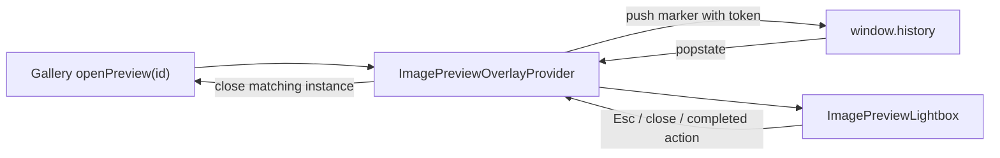

# 图片预览与历史栈修复设计

本文说明 `ImagePreviewLightbox` 为什么依赖浏览器历史栈、macOS 闪退问题的成因，以及在保留原有返回交互的前提下如何修复。

> 实施状态：原图片预览修复已落地，实例使用唯一 token，Lightbox 通过 Portal 渲染到 `document.body`。2026-10-03 内置播放接入后，历史写入迁入应用级 `OverlayHistoryProvider`；第 1–10 节保留第一轮修复的诊断与方案，第 11 节描述当前扩展，不代表新增手势／安装包验收已完成。

## 1. 原有功能意图

Lightbox 是覆盖当前详情页的临时界面，不是一个独立业务页面，但桌面应用仍需要支持用户已有的“返回”习惯：

- 按 `Esc` 关闭预览；
- 点击关闭按钮关闭预览；
- 点击鼠标返回键关闭预览；
- macOS 双指返回手势关闭预览；
- 系统或浏览器“后退”先关闭预览，而不是离开当前影片/演员详情；
- 主动关闭预览后，不能在历史栈里留下一个需要再次后退的空条目。

原始实现通过打开预览时执行 `history.pushState()`，给当前 URL 增加一个临时历史项；用户后退时触发 `popstate` 并关闭预览；点击关闭按钮或按 Esc 导致组件卸载时，再调用 `history.back()` 消费临时历史项。

该设计的核心意图是正确的：**Lightbox 是详情页之上的一层，因此返回操作应先弹出这一层。** 问题不在是否使用历史栈，而在历史栈写操作与 React 组件生命周期绑定得过紧。

## 2. 原始实现的问题

相关代码位于 `apps/desktop/src/renderer/src/components/ImagePreviewLightbox.tsx`：

```ts
useEffect(() => {
  window.history.pushState({ avImagePreview: true }, '', window.location.href)

  const onPopState = () => onClose()
  window.addEventListener('popstate', onPopState)

  return () => {
    window.removeEventListener('popstate', onPopState)
    if (isImagePreviewHistoryState(window.history.state)) {
      window.history.back()
    }
  }
}, [onClose])
```

### 2.1 Effect 清理不等于用户关闭

Effect cleanup 可能由多种原因触发：

- 用户确实关闭 Lightbox；
- React StrictMode 的开发期副作用检查；
- `onClose` 引用变化导致 Effect 重建；
- Fast Refresh；
- 父组件重挂载；
- 路由树重组。

这些情况中只有第一种应该修改历史栈。当前代码把所有 cleanup 都当作真实关闭，因此会产生错误的 `history.back()`。

### 2.2 StrictMode 与异步 `popstate` 竞态

Renderer 入口启用了 `React.StrictMode`。开发环境首次挂载 Effect 时可能经历：

```text
第一次 setup：pushState(marker A)，注册 listener A
模拟 cleanup：移除 listener A，history.back()
第二次 setup：重置 suppress ref，pushState(marker B)，注册 listener B
第一次 back 的异步 popstate 到达 listener B
listener B 调用 onClose()
```

在 macOS Electron/Chromium 中，`history.back()` 与 `popstate` 的消息调度更容易落在第二次 setup 之后，因此表现为 Lightbox 出现一帧后立即关闭。Windows 上没有复现并不代表逻辑安全，只说明事件时序不同。

### 2.3 布尔 marker 无法区分预览实例

当前历史状态只有：

```ts
{ avImagePreview: true }
```

它无法判断收到的 `popstate` 属于哪一次打开，也无法区分旧 cleanup、当前预览和其他 overlay 的历史操作。

### 2.4 多个历史栈使用者缺少协调

项目中的 `PluginDevLeaveGuard` 也会调用 `pushState()` 并监听 `popstate`。两个组件分别直接操作全局历史栈，缺少统一的优先级和所有权规则。未来新增 modal 返回行为后，冲突概率会进一步增加。

## 3. 修复目标

修复后必须保持：

1. 系统后退、鼠标返回键和 macOS 返回手势关闭当前预览。
2. Esc、关闭按钮、删除当前图片和“设为背景”后的关闭正常工作。
3. 关闭预览不会离开当前详情路由。
4. 切换缩略图不会新增历史条目。
5. StrictMode、Fast Refresh 和父组件重渲染不会产生 `history.back()`。
6. 连续快速打开、关闭、再打开时，旧 `popstate` 不得关闭新实例。
7. 与 `HashRouter`、详情返回栈和 `PluginDevLeaveGuard` 共存。

## 4. 推荐架构

将历史栈所有权从 `ImagePreviewLightbox` 移到稳定的 `ImagePreviewOverlayProvider`，新增一个 history-backed overlay 协调器。Lightbox 只负责显示和调用 `requestClose()`，组件 cleanup 不再修改历史栈。



### 4.1 每次打开使用唯一 token

历史状态必须保留 React Router 已有字段，并附加唯一实例 token：

```ts
interface ImagePreviewHistoryMarker {
  token: string
  kind: 'image-preview'
}

const nextState = {
  ...window.history.state,
  avOverlay: {
    kind: 'image-preview',
    token: crypto.randomUUID()
  }
}
```

不能用固定布尔值，也不能覆盖 `window.history.state` 中 HashRouter/React Router 使用的 `key`、`idx` 或 `usr` 字段。

### 4.2 在打开动作中创建历史项

`pushState()` 应由明确的 `openPreview()` 用户动作触发，而不是由 Lightbox mount Effect 触发：

```ts
function openPreview(assetId: number): void {
  const token = crypto.randomUUID()
  pushOverlayHistoryMarker(token)
  setPreview({ assetId, token, phase: 'open' })
}
```

事件处理函数不会被 StrictMode模拟执行，因此不会产生重复 marker。

### 4.3 Provider 只安装稳定的 `popstate` listener

Provider 可以在 Effect 中注册和移除 listener，因为 listener cleanup 不修改历史栈：

```ts
useEffect(() => {
  const onPopState = (event: PopStateEvent) => {
    const current = previewRef.current
    if (!current) return

    const marker = readImagePreviewMarker(event.state)
    if (marker?.token === current.token) return

    closePreviewState(current.token)
  }

  window.addEventListener('popstate', onPopState)
  return () => window.removeEventListener('popstate', onPopState)
}, [])
```

listener 使用 ref 读取当前实例，避免因回调引用变化反复安装。

### 4.4 区分“历史后退关闭”和“主动关闭”

关闭入口统一进入 Provider：

```ts
type PreviewCloseSource = 'history' | 'escape' | 'button' | 'action' | 'route'
```

- `history`：历史项已经被用户弹出，只清理 React 状态，不能再次 `history.back()`。
- `escape/button/action`：若栈顶仍是当前 token，则调用一次 `history.back()`；等待匹配的 `popstate` 清理 UI，或先把 UI 标为 `closing` 防止重复操作。
- `route`：优先清理 overlay 状态；路由导航流程负责自己的历史变化，不能额外后退到上一个业务页面。

建议主动关闭时以 `popstate` 作为最终提交点：

```ts
function requestClose(source: PreviewCloseSource): void {
  const current = previewRef.current
  if (!current || current.phase === 'closing') return

  if (source === 'history' || source === 'route') {
    closePreviewState(current.token)
    return
  }

  if (historyHasToken(current.token)) {
    markClosing(current.token)
    window.history.back()
  } else {
    closePreviewState(current.token)
  }
}
```

需要增加短超时兜底，例如 300 ms 内没有收到 `popstate` 时仅关闭 UI；兜底不能再执行第二次 back。

### 4.5 忽略过期事件

所有异步回调必须核对 token：

```ts
if (eventToken && eventToken !== previewRef.current?.token) return
```

旧实例产生的 `popstate`、定时器或异步图片操作不能关闭新实例。

## 5. Portal 调整

历史竞态是本次闪退的首要原因，但 Lightbox 当前仍渲染在详情页 DOM 内。详情区域包含 container containment、滚动容器和多层 `overflow: hidden`，macOS 的合成层实现对 `position: fixed + backdrop-filter` 更敏感。

修复时应同时使用 `createPortal` 将 Lightbox 渲染到 `document.body`：

```tsx
return createPortal(lightbox, document.body)
```

Portal 不改变历史功能，但可以保证：

- `position: fixed` 始终相对应用视口；
- 不受详情容器裁剪和 stacking context 影响；
- macOS 与 Windows 的合成行为更一致；
- z-index 只需要与全局 toast/modal 协调。

## 6. 与现有模块的职责划分

建议调整为：

```text
useImagePreviewById
  - 保存当前 assetId
  - 根据 items 解析 index
  - 不直接调用 History API

ImagePreviewOverlayProvider / useHistoryBackedImagePreview
  - 创建唯一 token
  - pushState
  - 监听 popstate
  - 区分关闭来源
  - 协调 route change

ImagePreviewLightbox
  - 图片切换、缩放、拖拽和工具栏
  - 通过 Portal 渲染
  - 调用 requestClose(source)
  - cleanup 不操作历史栈
```

第一轮预留 `kind`，供未来多个观看 overlay 使用共享协调器；当前实现已按第 11 节合并图片与播放观看历史。普通确认弹窗和 leave guard 不因此变成返回栈条目。

## 7. 不推荐方案

### 删除 History API

能消除闪退，但会丢失 macOS 手势和鼠标返回键关闭预览的原功能，不满足本次目标。

### 关闭 React StrictMode

只能隐藏开发期复现，无法消除 Effect 重建、Fast Refresh 和异步 `popstate` 的竞态。

### 在 cleanup 中增加延时或平台判断

例如 `setTimeout(history.back)` 或 `process.platform !== 'darwin'` 都依赖时序，无法建立历史项所有权，且会制造新的跨平台差异。

### 只增加 suppress 布尔值

布尔值无法识别预览实例。第二次 setup 会重置它，旧事件仍可能命中新实例。必须使用唯一 token。

## 8. 测试方案

### 单元测试

对 history 协调器注入可控适配器，覆盖：

1. 打开一次只 push 一个 marker。
2. Effect setup/cleanup 两次不改变历史长度。
3. 用户后退只关闭 UI，不再次 back。
4. Esc/按钮关闭只 back 一次。
5. 旧 token 的事件不关闭新预览。
6. 当前 marker 已丢失时主动关闭不 back。
7. marker 合并时保留 Router state。
8. route source 关闭不额外 back。

### 组件测试

- 点击样张打开预览。
- 切换缩略图不增加历史项。
- Esc 和关闭按钮行为一致。
- “设为背景”完成后正确关闭。
- 删除当前资源时正确关闭。

### macOS 手工回归

必须在开发构建和正式打包构建分别验证：

1. 连续快速打开/关闭样张 20 次，无闪退。
2. 双指返回关闭预览但保留详情页。
3. 鼠标返回键关闭预览但保留详情页。
4. 预览关闭后再次返回，才离开详情页。
5. 打开预览后切换多张图片，再返回仍只关闭一次。
6. 深色/浅色主题下 Portal 层级、背景和工具栏正常。

Windows 至少回归鼠标返回键、Alt+Left、Esc 和关闭按钮；Linux 回归 Alt+Left 与 Esc。

## 9. 实施顺序

1. 为 history 操作建立可注入适配器和纯状态机测试。
2. 将打开/关闭历史管理迁入 `ImagePreviewOverlayProvider`。
3. 删除 Lightbox 内的 history Effect 和 suppress ref。
4. 将 Lightbox 改为 Portal。
5. 回归影片样张、演员写真、影片封面和演员头像四个入口。
6. 完成 macOS 开发/打包双环境测试后再合并。

## 10. 验收标准

修复完成必须同时满足：

- macOS 点击图片预览不再闪退；
- 返回手势仍优先关闭预览；
- 主动关闭不会跳离当前详情；
- 一个预览实例只对应一个临时历史项；
- Lightbox mount/unmount cleanup 中不存在 `pushState()`、`back()` 或 `forward()`；
- 所有历史事件以实例 token 判断所有权；
- 完整类型检查、路由测试和跨平台手工回归通过。

## 11. 当前共享观看历史（2026-10-03）

`interaction/overlayHistory.ts` 持有一个可注入 history port 和临时层栈；`OverlayHistoryProvider` 是稳定应用级入口。图片 Context 保留预览启用状态、计数和 hook API，但不再独立监听 popstate、运行 back/fallback 或持有第二份历史栈。内置播放的 `playbackHistory.ts` 最初通过同一入口分别管理展开、全屏和选项 token；播放返回规则已由下述 2026-10-16 调整取代。

marker 只包含 `{kind, token}`，保留 Router 字段；图片层额外兼容旧图片 marker。系统关闭、显式关闭和业务路由离开分别处理，cleanup 仅放弃所有权，不导航。显式关闭旧条目的遍历未结算时，新打开动作排队；fallback 只检查已变化的历史，不追加第二次 back。

设置和插件离开保护由唯一 `NavigationGuardProvider` 组合，不再使用插件的 push/pop trap。同 URL 观看后退不触发草稿确认，真正离开路由才依次询问；在途观看遍历结算后才能继续业务跳转。调用方合同见 [路由文档](ROUTING_DESIGN.md#overlay-history)。

自动回归覆盖图片入口、同 URL 观看层、主动关闭子层、快速关开、父子在途关闭、草稿保护组合与结构化复制。macOS 真实应用已验证播放选项／全屏／展开逐层返回，以及设置草稿取消和放弃返回；现代双指手势、物理鼠标返回键、图片与播放的完整手工共存矩阵仍待验收，不从这些自动回归推断通过。

### 2026-10-16：系统后退等同收起，Esc 保持逐层关闭

播放器改为单一观看历史项，全屏与播放设置不再增加独立历史步数；系统后退一次直接收起到底栏，继续当前会话并保留业务页面。Esc 仍由原有交互层先关闭设置、再退出全屏、最后收起。Windows、macOS 和 Linux 原生输入将 Esc 与历史后退分别上报，避免原生视频焦点下的 Esc 误用新的后退规则。字幕模型设置等主动业务导航仍等待观看历史遍历完成。

最初调整仅同步了单元测试，未同步原生验收脚本；该阶段没有执行新规则的原生验收，上文逐层返回的历史验收不能作为本规则证据。

### 2026-10-16：返回实测缺陷排查与修复

定向复现确认四处问题：前进重访已消费 marker 后重新展开会多留一个空返回步骤；重载界面的初始播放快照没有接管已有 marker；组件重建留下旧回调，可能将收起指令送给旧会话；macOS 全屏 style bit 提前设置，原生画面初次获得焦点后，又被动画结束时的 AppKit 交接覆盖。

Beta.6 的共享协调器复用无人持有的当前 marker 槽位，不叠加空项；播放初始快照通过 `adopt` 仅接管当前同类标记，不写历史。组件 cleanup 放弃所有权并清空旧状态，不发起返回或控制。下节 Beta.7 进一步修复嵌套父层恢复。macOS 监听当前窗口全屏动画完成通知，再请求一次原生焦点，销毁时注销；不会在后续帧持续抢占 Tab 焦点。

验证使用隔离资料库 `/tmp/javdex-playback-acceptance-back.Xwwk1c` 和本轮生成的 90 秒合成视频，不读取用户影片。实际 macOS 开发应用已完成：展开返回收起、底栏后续返回业务列表、前进后重新展开不残留空步、界面重载后返回收起、全屏自动焦点与 ⌘[ 收起、Tab 进入全屏原生进度控件，以及 Esc 关闭设置／退出全屏／收起。全屏焦点缺陷已在修复前稳定观察到，修复后无需先点画面即可返回，播放进度继续；截图在 `/tmp/javdex-playback-back-investigation.3vpPfZ/native-back-docked.jpg`。

本轮完整 `npm test` 退出 0（Electron 3966 项，3948 通过、0 失败、18 平台／环境跳过，含此前运行环境功能改动）；新增边界用例后另跑观看历史、播放面板、图片预览、交互层与离开保护定向回归，78 项全部通过。最终类型检查、定向 ESLint、`npm run build` 与本机 `npm run playback:native:build` 通过。浏览器回归夹具 `scripts/ui-regression/playback-history.html` 使用实际 HashRouter 和播放面板，播放 RPC 为模拟，仅验证路由、历史与交互；原生证据来自上述真实合成视频实例。`scripts/playback-acceptance.mjs` 已改为新的一次收起语义，并在动画完成后检查焦点，但本轮仅验证语法，未整套执行该脚本。不将这些结果视为 Windows/Linux 原生窗口、物理鼠标返回键、现代双指手势、正式安装包、全部格式或硬解验收。

### Beta.7 嵌套观看恢复

组件重建会放弃旧回调，但不能删除仍在浏览器历史中的父层位置。`avOverlayParents` 因此仅保存同路由匿名 `kind/token` 链，旧单 marker 仍可读取；无效、重复或超限父链不用于恢复。协调器按记录顺序重新绑定无人持有的同类位置，不接管别人的活跃回调。挂载与普通订阅仍不导航、不增加历史，已消失的匿名子层在用户返回时与当前恢复的观看层一并消费。

播放交互分支使用稳定所有者恢复旧相对次序，图片原先在播放上方或下方都保持不变；没有旧次序的初始恢复才放在现存弹层之下。普通播放时钟不重新排列，早于初始快照的通知等基线确定后再决定是否新增历史，显式打开新会话仍按正常动作处理。关闭子层的异步返回不阻止接管仍存活且未关闭的父层；匿名父层和子层都只在用户关闭时消费。

浏览器夹具使用真实播放面板、图片组件与 HashRouter，通过测试控制入口构造嵌套和重建。普通背景点击仍受模态隔离，该夹具不证明生产页面每种嵌套入口或原生平台验收；完整本轮结果见 [Beta.7 审计](reviews/v0.9.0-beta.7-release-audit.md)。

### Windows 原生鼠标侧键重复导航

原生视频与控件此前在 `WM_XBUTTONDOWN` 派发历史导航，却将 `WM_XBUTTONUP` 留给默认窗口处理。Windows 的 `DefWindowProc` 会把松开事件转换成 `WM_APPCOMMAND` 并交给父窗口，产生第二次后退；一次点击因此可能同时消费播放观看层与外层业务历史。

两个原生输入入口现在共用侧键处理：消费按下、松开和双击消息，仅在松开时派发一次前进或后退。这样收起不会在按键仍按住时移动视频窗口，也不会由未处理的松开事件再次生成系统导航；不改变 Esc、历史协调器或底栏的页面导航规则。

源码差异检查通过。本机随后执行 `npm run playback:native:build`，Windows x64 编译、构建自带的核心与滑杆检查以及开发 DLL 闭包准备均退出 0；Electron 43.4.1 实际加载新 addon 并核对入口通过。产物为 `out/native-playback/playback.node`，SHA-256 为 `020b3dc18170d1ace27a6fcb57484a807a961ba8fd1a73dc29c6a47f05f47f7d`，旧 addon、构建日志与加载回执保留在 `out/native-playback-side-key-234490acefce4fc4ae54a64aa8375473/`。未执行物理侧键验收或生成安装包；用户需完整退出、重启开发版后实测。此前浏览器、macOS 与 Beta.7 验收记录不作为本项修复的 Windows 实测证据。

### 原生小窗再次展开后的返回无效

用户继续实测发现收起后点击视频小窗恢复，侧键不再响应。独立、不可见的 Electron 43.4.1 实例复现：第一次返回至详情后，通过没有页面用户手势的脚本模拟原生展开，真实历史游标为 1、总项数为 2；`canGoBack()` 为 false，但 `canGoToOffset(-1)` 为 true。原生点击不会激活 Chromium 页面；UI Back/Forward 的历史跳过规则不能用于本应用精确的观看层栈。

统一窗口导航改为 `canGoToOffset(±1)` 与 `goToOffset(±1)`，沿真实历史逐项移动，保留前置任务阻止与事件否决。Esc 和播放会话逻辑未修改。定向导航回归 4 项通过；将实际导航模块打包进隔离 Electron 夹具后，在有／无前置业务页面的两组场景各连续展开、返回 4 次，全部保留详情；已收起后继续返回原业务页面也通过。基线与修复回执在 `out/playback-reexpand-history/report.json`、`fixed-report.json`；主进程使用仓库现有 electron-vite 配置单独重建成功，日志为该目录的 `main-build.log`。本轮未操作用户当前播放会话、执行物理侧键验收或生成安装包；需完整重启开发版后由用户继续实测。


### 2026-10-16：观看生命周期收敛与遍历失败恢复

`playbackHistory` 统一持有初始快照与提前通知的结算、订阅释放、观看 token 和激活身份。播放面板消费一次更新中的快照与激活信息，不再单独保存恢复标记；交互层使用同一观看 token 作为激活 key，全屏、设置和普通时钟不产生新激活。

共享历史保留短 fallback，并增加 2 秒截止检查。调用抛错或游标始终未移动时，等待以失败结束，不重发后退；排队的新观看面取消，已关闭条目退为匿名位置供下一次显式打开复用。字幕设置与路由保护只在完成后继续，失败显示反馈并保留当前路由和草稿，路由离开取消旧等待。截止时间不表示浏览器遍历可以被撤销；迟到事件继续检查实时游标，不能仅凭旧事件内容结算新的遍历。

持久化的回归命令为 `npm run test:playback:navigation`，使用隐藏 Electron 窗口、真实 HashRouter／PlaybackPanel／共享历史及窗口导航入口，播放 RPC 为合成状态。Windows 使用 `npm run test:playback:navigation -- --native` 额外加载实际 `out/native-playback/playback.node`，以 Win32 消息定向发送完整侧键按下／松开及小窗点击，验证原生画面与全屏控件处理、无重复父窗口 app-command、连续 5 轮收起恢复、同一会话和业务返回。辅助进程验证窗口归属，只向自身夹具的子窗口发消息，不移动鼠标或抢占前台。

本轮两种命令均在 Windows／Electron 43.4.1 通过，包含普通 Chromium UI Back 不可用但精确前一项可达的恢复场景。证据写入独立系统临时目录的 `report.json`。合并远程观测修订后，提交前复查了播放会话、窗口导航、观看历史、播放面板、交互层、路由保护、图片预览与模态行为，共 158 项定向测试全部通过；完整类型检查与适用文件的 ESLint 通过，renderer 生产构建在前一阶段通过。该夹具不加载影片、不验证解码与实际鼠标硬件，不替代用户物理侧键验收，也不代表 macOS/Linux 原生窗口或安装包验收。
