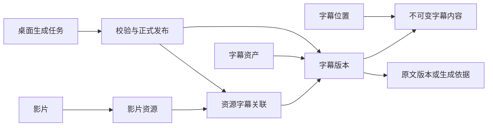
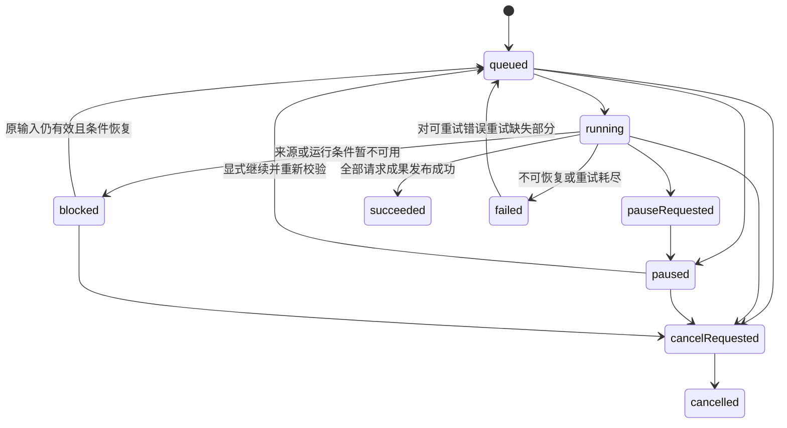

# 字幕管理实施计划

状态：待实施。日期：2026-10-29。代码基线：`74feb6a12624445d97d309f277e19a85e176e6e4`，资料库 schema 21、管理协议 1。本计划不表示功能已实现或验收通过，不修改现行发布合同。

目标是在现有扫描、资料库、内置播放和本地模型架构上，建立“发现、登记、绑定、生成、选用、维护”的完整字幕生命周期。遍历提供文件事实，数据库保存字幕身份和适用关系，播放器消费已授权且适用的字幕。

## 1 范围与实施原则

本轮计划覆盖本机与远程资料库的字幕目录、外挂自动发现、内嵌字幕登记、手动导入和选择、持久 AI 任务、多语言成果、批量管理、备份恢复。桌面负责播放与 AI 推理，服务端负责资料、扫描和受控文件访问。

初始外挂格式为已有 SRT、ASS；后续增加 VTT、SSA 必须同时补解析、导入、播放和导出测试。内嵌字幕按播放器实际能力展示，图像字幕可登记和选用，不进入文本翻译管线。本计划不包含 OCR、云端音频识别、在线字幕下载、字幕逐句编辑器、任意两份字幕自动对轴、浏览器字幕播放、外部播放器自动注入字幕或服务端推理。上述能力不能因数据模型可表达而显示为已支持。

必须保持的约束：

1. 字幕关联具体影片资源及修订，不按影片 ID、番号或路径独立判定适用性。
2. 一个资源可以关联多份字幕；同一字幕默认只绑定明确目标，跨资源复用必须确认。跨媒体库复用执行显式复制，不共享可变目录记录。
3. 自动发现不能覆盖人工绑定、语言修正、忽略和当前播放选择。
4. 字幕可用性、匹配状态和完整性分别表达。文件不存在、目录离线、尚未匹配、只生成一部分不是同一状态。
5. 正式字幕与缓存分开；清缓存不删除正式成果，取消任务不回滚已发布成果。
6. 文件操作、媒体授权和模型调用只在可信宿主执行。Renderer 不提交任意路径、URL、模型路径或 mpv 命令。
7. 三平台沿用同一播放行为；失败、缺失和不支持必须可见，不静默换片源、模型或在线服务。

## 2 现状与改动依据

| 现有位置 | 当前行为 | 本计划的接入方式 |
| --- | --- | --- |
| [扫描器](../packages/library/src/scan/scanner.ts)、[文件工作集](../packages/library/src/scan/scanFileInventory.ts) | 统一遍历、根目录校验、有界工作集；目录读取已可收集 NFO | 同轮读取收集字幕，独立工作集与登记，不把字幕加入影片资源队列 |
| [资源表](../packages/library/src/db/schema.ts)、[迁移](../packages/library/src/db/migrations.ts) | `video_resources` 持有资源归属和来源；当前 schema 21 | 新增字幕表及明确的外键、并发版本；不复用图片表 |
| [播放授权](../packages/library/src/catalog/catalogPlay.ts)、[播放来源](../apps/desktop/src/main/player/playbackSource.ts) | `locatorRevision` 包含位置等信息；本机还有物理文件复检 | 复用授权和保守失效，另外记录可复核的绑定依据 |
| [mpv 共用核心](../apps/desktop/src/main/player/native/mpvCore.h) | `sub-auto=no` | 保留，由应用统一发现并授权加载 |
| [手动字幕入口](../apps/desktop/src/main/player/desktopPlayback.ts) | 系统选择器加载 SRT/ASS 到当前会话 | 保留临时使用，增加导入托管和资源绑定 |
| [AI 调度](../apps/desktop/src/main/player/aiSubtitles/subtitleScheduler.ts)、[缓存](../apps/desktop/src/main/player/aiSubtitles/subtitleCache.ts) | 30 秒区间、当前位置优先、识别与翻译可分别复用或失效；生命周期依附播放 | 抽出推理阶段和缓存适配；新增独立持久任务调度 |
| [字幕文档](../apps/desktop/src/main/player/aiSubtitles/subtitleDocument.ts)、[桌面协议](../packages/contracts/src/desktop/aiSubtitles.ts) | `japanese/chinese`、固定中日显示组合 | 改为语言无关文档及明确的能力列表 |
| [后台任务协议](../packages/contracts/src/protocol/tasks.ts)、[刮削检查点队列](../apps/desktop/src/main/services/checkpointedSequentialBatchQueue.ts) | 已有任务快照；检查点队列仍耦合刮削和浏览器 | 复用任务展示合同和恢复原则，不直接把字幕塞进刮削队列 |
| [远程合同](SERVER_MODE_CONTRACT_INVENTORY.md) | AI 读取依赖播放会话代理；备份保存正式图片、排除工作记录 | 新增任务读取租约、字幕传输和备份成员 |

`locatorRevision` 不是内容哈希：改名、移动也可能变化。第一期保守地将修订变化标为需要重新验证；只有已有资源迁移流程提供身份连续性证据时才更新绑定。不能以同名、同时长、同大小或局部哈希单独证明同一媒体时间轴。

## 3 领域关系与状态



- 字幕资产是一个媒体库内可管理的逻辑对象，不隶属于影片。没有绑定时仍可作为待匹配或待清理对象存在。
- 字幕版本固定内容、语言元数据、完整性和来源依据；修改文件、纠正语言或重新生成建立新版本。旧版本的外部文件可能已不存在，保留记录不代表保留了文件副本。
- 字幕内容表示不可变字节或一个确定的内嵌流；版本通过 content ID 引用它。语言纠正可以创建新版本并复用同一内容，不把仍可读的旧版本变成缺失。
- 字幕位置说明从哪里读取内容；同一内容可同时有托管副本和外部引用。移动更新位置，不直接改绑定。相同内容被复用不代表两个资产或两条适用关系可以自动合并。
- 资源字幕关联固定所用字幕版本、资源修订、匹配依据及时间偏移。偏移不写回源文件。
- 原文与译文是独立资产；译文版本引用原文版本。双语是显示或导出组合，不是唯一存储形式。
- 本机选用偏好独立于共享关系；“关闭字幕”不是取消后台任务。

| 维度 | 值 | 语义 |
| --- | --- | --- |
| 位置可用性 | `available / missing / offline / invalid / unchecked` | 最后观测，不替代使用前复检 |
| 匹配状态 | `confirmed / needsReview` | 绑定已确认或适用依据变化；未确认建议存独立候选表，查询投影为 candidate |
| 绑定生命周期 | `active / retired` | 自动缺失清理退休关系，保留 ID 和历史以便文件恢复；与匹配状态独立 |
| 完整性 | `unknown / partial / complete` | 外部文件通常未知；AI 根据全部区间覆盖确定 |
| 资产生命周期 | `active / trashed` | 无关联不自动进入回收；用户可显式清理 |
| 版本来源 | `external / embedded / imported / aiRecognition / aiTranslation` | 导入、来源与可用格式分别表达 |

外部字幕不能仅按最后一条对白的时间推断完整性。合法、已匹配的外部 `unknown` 字幕允许自动选用，并显示“完整性未知”；明确 `partial` 的结果只允许用户主动选择或在实时字幕模式展示。`complete` 表示生成覆盖完成，不表示识别或翻译质量经过人工确认。

## 4 数据库结构

### 4.1 通用约定与归属

下面为目标结构，迁移编号在实施时按当时最新正式 schema 分配，不预占 22。列未标 `?` 均为 `NOT NULL`；ID 使用 UUID `TEXT`，现有库、根目录和资源 ID 沿用 `INTEGER`。时间使用 UTC ISO 字符串，JSON 列必须 `CHECK(json_valid(...))` 并经共享严格 schema 校验。布尔值为 `INTEGER CHECK IN (0,1)`，计数非负，修订正整数。

正式字幕表位于资料库数据库，天然处于一个 `catalogId` 下。资产按媒体库隔离；所有对子表的关联同时校验 `library_id`，避免另一个媒体库的相同整数 ID 被混用。任务与本机偏好显式保存 `serverId? + catalogId`，不能只按本机路径隔离。

给 `video_resources` 增加 `UNIQUE(library_id,id)`，用于复合外键，不改原有资源业务身份。字幕资产增加乐观并发版本 `generation/revision`；恢复资料库必须沿用现有新 `catalogId` 与代次隔离语义。

### 4.2 正式字幕表

| 表 | 字段 | 主键与约束 |
| --- | --- | --- |
| `subtitle_assets` | `id TEXT, library_id INTEGER, title TEXT, origin TEXT, current_revision_id TEXT, lifecycle TEXT, user_modified INTEGER, generation INTEGER, revision INTEGER, created_at TEXT, updated_at TEXT` | `PK(id)`；`UNIQUE(library_id,id)`；库外键 `RESTRICT`；`origin/lifecycle` 枚举约束；初始 `generation=revision=1`；人工建立或编辑置 `user_modified=1` |
| `subtitle_contents` | `id TEXT, library_id INTEGER, kind TEXT, format TEXT, content_key TEXT, content_digest TEXT?, size_bytes INTEGER?, source_json TEXT?, created_at TEXT` | `PK(id)`；`UNIQUE(library_id,id)`、`UNIQUE(library_id,content_key)`；库 FK RESTRICT；字节内容必须有摘要及大小，内嵌内容必须有不可变来源快照；字段组合由 CHECK 限定 |
| `subtitle_revisions` | `id TEXT, library_id INTEGER, asset_id TEXT, content_id TEXT, sequence INTEGER, text_kind TEXT, encoding TEXT?, completeness TEXT, coverage_json TEXT?, cue_count INTEGER?, is_forced INTEGER, is_sdh INTEGER, is_commentary INTEGER, parent_revision_id TEXT?, publication_key TEXT?, provenance_json TEXT, created_at TEXT` | `PK(id)`；`UNIQUE(library_id,id)`、`UNIQUE(library_id,asset_id,id)`、`UNIQUE(asset_id,sequence)`；非空 `(library_id,publication_key)` 唯一；资产复合 FK 为延迟 NO ACTION，内容及父版本复合 FK RESTRICT |
| `subtitle_revision_languages` | `revision_id TEXT, language_tag TEXT, ordinal INTEGER, role TEXT, evidence TEXT` | `PK(revision_id,language_tag)`；`UNIQUE(revision_id,ordinal)`；版本外键 `CASCADE`；`role=primary/secondary`；`evidence=manual/filename/container/model/unknown` |
| `subtitle_locations` | `id TEXT, library_id INTEGER, content_id TEXT, kind TEXT, root_id INTEGER?, root_identity TEXT?, relative_path TEXT?, path_key TEXT?, external_identity TEXT?, managed_key TEXT?, container_resource_id INTEGER?, container_revision TEXT?, stream_key TEXT?, observed_size INTEGER?, observed_mtime_ms REAL?, availability TEXT, observation_revision INTEGER, last_observation_seq INTEGER, last_checked_at TEXT?` | `PK(id)`；内容复合 FK RESTRICT，内嵌资源复合 FK CASCADE，根复合 FK RESTRICT；位置联合唯一及分类型 CHECK 见下文 |
| `resource_subtitles` | `id TEXT, library_id INTEGER, resource_id INTEGER, resource_revision TEXT, asset_id TEXT, subtitle_revision_id TEXT, match_method TEXT, match_state TEXT, review_reason TEXT?, lifecycle TEXT, retirement_reason TEXT?, evidence_json TEXT, offset_ms INTEGER, is_default INTEGER, user_modified INTEGER, revision INTEGER, confirmed_at TEXT?, created_at TEXT, updated_at TEXT` | `PK(id)`；`UNIQUE(library_id,resource_id,asset_id)`；资源 FK CASCADE，资产和所属版本 FK RESTRICT；偏移范围初始为 ±60000ms；`user_modified` 自动建立为 0、人工建立或修改置 1；retired 只允许 `retirement_reason=missingAuto` 且 `is_default=0` |
| `subtitle_match_candidates` | `id TEXT, library_id INTEGER, resource_id INTEGER, resource_revision TEXT, asset_id TEXT, subtitle_revision_id TEXT, reason TEXT, evidence_json TEXT, revision INTEGER, observation_seq INTEGER, created_at TEXT, updated_at TEXT` | `PK(id)`；`UNIQUE(library_id,resource_id,subtitle_revision_id)`；资源 FK CASCADE，资产及所属版本 FK RESTRICT；`reason=ambiguousName/newVersion/resourceChanged`；不能用于播放 |
| `subtitle_discovery_exclusions` | `id TEXT, library_id INTEGER, root_id INTEGER, root_identity TEXT, source_identity TEXT, content_digest TEXT, scope TEXT, resource_id INTEGER?, created_at TEXT` | `scope=source/resource`；同一来源版本的全局忽略或单资源匹配忽略分别使用部分唯一索引；资源及根归属复合校验 |

`format` 首期取 `srt/ass/cues-v1/embedded`；`text_kind=text/image/unknown`。未知语言使用 `und`；语言标签规范化后写入，BCP 47 标签及语言别名映射由共享纯函数负责。多语言行按显示顺序排列，不用逗号拼接字符串。

每个正式版本至少有一条语言记录、恰好一个 primary；primary 的至多一个用部分唯一索引约束，其余数量和语言一致性在发布事务校验。版本、内容和版本语言记录发布后不可 UPDATE；补充或纠正元数据建立新版本，删除仅由受控 purge 事务执行。mutable availability 只在位置上保存。

`current_revision_id` 为 NOT NULL，用 `(library_id,id,current_revision_id)` 的 `DEFERRABLE INITIALLY DEFERRED` 外键指向版本 `(library_id,asset_id,id)`。先分配资产和版本 UUID，再在同一事务插入带未来版本 ID 的资产、内容和版本；提交时校验存在及归属。不依赖“可空外键在提交时自动禁止 NULL”这种 SQLite 不提供的行为。语言修正创建新版本并复用 content ID，旧版和新版都能通过同一位置读取；当前指针、绑定采用新版和派生关系分别控制。

内容不放在 SQLite 行内：SRT/ASS 保存原始字节，AI 文档先按固定 `cues-v1` 序列化。`kind=bytes` 的 content key 由格式、原始字节 SHA-256 和字节数确定；不把去样式或换行规范化后的文本哈希当作文件完整性摘要。`kind=embedded` 的 key 由媒体库、容器资源、资源修订和流身份确定，source_json 保存这一不可变快照，格式为 embedded，不冒充已提取文件。流标题和语言不单独构成唯一标识。

内嵌内容的来源快照是历史证据，不建立会级联删除正式版本的资源 FK；可访问的内嵌 location 才引用真实资源。删除容器后内容和资产可以留作不可用历史。未通过大小或基本格式检查的新文件先作为刷新诊断记录，不建立假的可播放资产；已有文件损坏时保留旧内容引用、将位置标为 invalid，不把未知新字节解释成旧版本。

位置分三种，必须通过 SQL CHECK 限定字段组合：

- `external`：必须有根目录、根身份、相对路径、path key 和源文件身份；托管键及容器字段为空。path key 复用宿主既有路径身份规则，不能一律转小写或一律区分大小写。首期长期引用仅支持已授权根目录，根外手选文件使用临时加载或复制导入。
- `managed`：只有 `managed_key` 必填；根目录、外部路径和容器字段为空。键由宿主生成，不能是绝对路径或包含 `..`。
- `embedded`：必须有 `container_resource_id/container_revision/stream_key`；外部和托管字段为空。关联只能指向该容器资源及修订，不允许复用到另一资源；提取后另建导入资产。

外部位置按 `(library_id,root_id,root_identity,path_key)` 唯一；托管位置按 `(library_id,managed_key)` 唯一；内嵌位置按 `(library_id,container_resource_id,container_revision,stream_key)` 唯一。外部文件内容改变时，位置在 CAS 通过后指向新 content，旧版本仍引用旧 content 并可能无可读位置；纯语言/用途修正不改变位置。一个 managed key 不能代表两个不同内容。不同资产共享内容不自动共享绑定，资产进入 trashed 后也不能通过内容去重被重建或复活。

关联的 `match_method=exactName/manual/embedded/generated`。`confirmed` 既可来自无歧义的确定规则，也可来自人工确认，`evidence_json` 必须说明区别。候选单独存储，因此同一资产的旧版 confirmed 绑定与新版候选可以并存，不违反一资源一资产唯一约束。用户确认候选后原子建立或更新绑定并移除该候选；其他候选重新校验，不自动确认。`review_reason` 在 needsReview 时必填，在 confirmed 时为空；只有资源身份、内容适用性或人工复核要求变化才进入 needsReview，单纯文件缺失、离线不改变匹配结论。

确认或重新绑定已退休关系时更新原行，设置 lifecycle=active、清空 retirement_reason，并置 user_modified=1；不得因唯一约束存在就创建另一个资产来绕过。自动同内容恢复则保持 user_modified=0，递增绑定修订并保留原 ID。这些动作都重新检查当前资源、内容和忽略规则。

必要索引与一致性规则：

1. 对 `resource_subtitles(library_id,resource_id,match_state)`、`subtitle_revision_languages(language_tag,revision_id)`、`subtitle_locations(library_id,availability,id)`、`subtitle_assets(library_id,lifecycle,updated_at,id)` 建分页或过滤索引。
2. 部分唯一索引保证每个资源最多一个 `is_default=1`；CHECK 要求默认项 lifecycle=active。is_default 表示用户保存的意图，不表示现在可用；设置默认命令要求当时 confirmed 且可用，之后缺失或待复核不抹掉该意图。查询派生 `effectiveDefault = is_default && selectable`，不可用时为 false。用户新设默认才原子清除原偏好。
3. `(library_id,asset_id,subtitle_revision_id)` 必须引用同一资产的版本；父版本不得形成自环或循环。父链验证在事务内执行，不允许依赖 UI。
4. 修改绑定、退休/恢复、默认、偏移等递增绑定 revision 和既有资源集合 R；资产/版本修改递增字幕 S。每次接受的位置观测递增 observation_revision，用于阻止陈旧清理，即使字节和 mtime 未变；不因此递增 R/S。可选性变化发送目录事件，纯观测心跳可不发 UI 事件。
5. 删除资源级联删除关联、资源专属忽略和内嵌位置，不级联删除资产或其他资源的关系。根目录和媒体库删除走显式生命周期服务，外键 `RESTRICT` 防止绕过文件清理。
6. 无关联资产保留为待清理项；不据此保留已被删除的影片记录，也不改变既有清单引用保护语义。

7. 资产删除必须先处理 current pointer 与版本的环形引用：同事务删除候选、绑定和资产及版本，current FK 延迟校验；版本到资产的 FK 使用 `ON DELETE NO ACTION DEFERRABLE INITIALLY DEFERRED`，而非会立即阻止删除的 RESTRICT。跨资产父版本引用仍 RESTRICT，必须先处理派生者。内容只有在没有任何正式版本引用、位置用途或读租约保护时才可回收。禁止靠关闭 foreign_keys 完成清理。
8. `subtitle_discovery_exclusions` 的 scope=source 要求 resource_id IS NULL，scope=resource 要求非空。分别建立空值和非空分支的部分唯一索引，不能依赖 SQLite UNIQUE 对 NULL 的去重；根和资源的库归属均在复合 FK 中校验。

`publication_key` 是生成 work key 对应的成果键，只有首次生成发布的版本持有，用于跨设备、跨 operation ID 的最终去重；普通导入和后续手动元数据版本为空。占用过期、任务历史清理之后仍可从正式版本找到已有成果。默认同输入复用；用户要求强制重做时，创建带显式 regeneration ID 的新任务和成果键，旧版本保持。绑定检查、唯一键插入和操作回执在同一事务内完成。

文件来源身份与资产来源的映射单独持久化为 `subtitle_discovery_sources(id TEXT PK, library_id INTEGER, asset_id TEXT, root_id INTEGER, root_identity TEXT, source_identity TEXT, location_id TEXT?, revision INTEGER)`，源身份元组 UNIQUE；资产复合 FK RESTRICT、位置 FK SET NULL（使用全局唯一位置 ID，并由事务校验同库）。这样相同字节被多个资产复用时，扫描不会仅靠 content ID 猜测文件原来属于哪个资产；同一路径确认身份连续性后更新源映射，已退休绑定和语言修正也不会生成重复资产。人工彻底删除资产时必须同事务删除或转换来源映射为显式忽略，不能留下悬空映射。

### 4.3 文件事务与生成占用表

这些表属于运行记录，不随资料库备份导出。

| 表 | 字段与约束 | 用途 |
| --- | --- | --- |
| `subtitle_file_jobs` | `id PK, operation_id UNIQUE, kind=publish/delete, state=prepared/filesReady/committed/done/failed, manifest_json, created_at, updated_at` | 文件与 SQLite 不能同事务提交，记录暂存键、目标摘要、预期引用及恢复阶段；不存任意用户路径 |
| `subtitle_uploads` | `id PK, owner_device_id, writer_epoch, library_id, resource_id, resource_revision, purpose, format, expected_bytes, received_bytes, expected_digest, staging_key UNIQUE, state=receiving/ready/consumed/failed, consumed_operation_id?, expires_at, created_at, updated_at`；资源复合外键；`0<=received_bytes<=expected_bytes` | 受控断点上传及幂等消费；没有完整校验不可 ready；consumed 与正式发布同事务提交；过期未消费文件通过文件任务回收 |
| `subtitle_generation_claims` | `work_key PK, library_id, resource_id, resource_revision, state=free/held, holder_device_id?, holder_job_id?, fence INTEGER>0, expires_at?, phase?, progress_json?, updated_at`；资源复合外键；held 时持有者和期限必填，free 时为空 | 服务端协调相同生成工作；认领和续期原子执行，过期接管增加 fence，发布必须持有有效 fence；资源删除清理占用 |

生成占用不等于媒体读取授权。更换或撤销可信设备必须终止其授权并释放或失效其占用；任何旧 fence 的发布被拒绝。工作键覆盖固定输入及模型策略，不能仅按“影片＋语言”锁定。

表中 UUID、摘要、时间、状态和计数使用与正式表相同的类型及 CHECK 约定。claim 行过期后保留 fence 计数，释放清空持有状态而非删除计数；如做过期历史压缩，必须保留每个工作键的单调 fence 或改用不可复用的随机授权代，禁止删行后从 1 重启让旧持有者重新有效。

### 4.4 桌面任务数据库与本机偏好

新增独立桌面工作数据库 `subtitle-jobs.sqlite`，位于应用工作数据目录，使用自己的 `user_version`，不放在可随意清理的缓存目录，不进入资料库备份。其文件通过现有宿主路径服务定位，不硬编码平台绝对路径。

| 表 | 字段与约束 |
| --- | --- |
| `subtitle_jobs` | `id PK, batch_id?, server_id?, catalog_id, library_id, resource_id, resource_revision, input_json, config_json, request_key, state, phase, revision, progress_seq, attempt, blocked_reason?, last_error_json?, created_at, updated_at`；非终态 `request_key` 部分唯一；JSON 冻结请求、音轨、语言和模型摘要，不含授权凭据 |
| `subtitle_job_units` | `id PK, job_id FK CASCADE, kind=recognize/translate, language_tag, source_unit_id?, source_revision_id?, work_key, state, result_revision_id?, error_json?`；`UNIQUE(job_id,id)`、`UNIQUE(job_id,kind,language_tag)`；`(job_id,source_unit_id)` 为延迟 NO ACTION 自引用 FK；翻译须且只能选同任务原文 unit 或已有正式版本，识别两者均为空 |
| `subtitle_job_chunks` | `unit_id FK CASCADE, chunk_index, start_ms, end_ms, input_digest, state=pending/running/done/failed, artifact_key?, artifact_digest?, attempt, error_code?`；`PK(unit_id,chunk_index)`；`end_ms>start_ms>=0`；done 的结果即使无对白也必须有有效 manifest |

任务表中的资源和正式版本是外部引用，不设置跨数据库外键；每次恢复、读取及发布必须重新向权威资料库验证。`input_json/config_json` 包含文档格式版本。实时工作默认只写缓存；用户转为整片任务时建立独立任务并复用已验证片段。

任务状态：`queued/running/pauseRequested/paused/blocked/cancelRequested/succeeded/failed/cancelled`。`phase` 单独为 `prepare/extract/recognize/translate/publish`。现有 `CatalogTaskSnapshot` 尚无暂停、阻塞状态：P2 明确扩展共享任务枚举、解析器、展示穷举及 `catalog_tasks` CHECK，不把暂停伪装为成功或失败。字幕快照 `owner=desktop`；服务端不成为推理任务的执行者。

本机偏好使用版本化配置，键为 `serverId? + catalogId + libraryId + resourceId + resourceRevision`，值为 `mode=auto/off/specific`、选中绑定及版本、显示语言组合、字号和可选会话偏移。共享偏移修改必须显式执行关联更新；普通播放调整默认仅本机。清除播放偏好不删除字幕，换资源版本不继承指定选择。

### 4.5 刷新观测和清理工作记录

现有 `library_scan_audit_*` 外键绑定 `library_scan_runs`，其 section CHECK 和发布状态机也面向整轮媒体库扫描，不能把一次播放刷新直接写成新的 section。本计划保留媒体库扫描存储不变，字幕维护使用独立记录，复用有界分页和审计展示组件；整轮扫描通过 parent_scan_id 关联字幕刷新，不制造一次虚假的全库扫描。

| 表 | 字段与约束 | 用途 |
| --- | --- | --- |
| `subtitle_refresh_runs` | `seq INTEGER PRIMARY KEY AUTOINCREMENT, id TEXT UNIQUE, library_id INTEGER, resource_id INTEGER?, resource_revision TEXT?, scope_kind TEXT, scope_json TEXT, parent_scan_id TEXT?, task_id TEXT, state TEXT, writer_epoch INTEGER, created_at TEXT, finished_at TEXT?` | 服务端/本机权威宿主分配顺序；scope_kind 为 root/resource；资源作用域必须有修订；state 为 queued/running/completed/failed/cancelled；记录请求授权与冻结范围 |
| `subtitle_refresh_scopes` | `run_id TEXT FK CASCADE, scope_key TEXT, root_id INTEGER, root_identity TEXT, directory_key TEXT, state TEXT, completed_at TEXT?, error_code TEXT?`；`PK(run_id,scope_key)` | 每个目录的完整枚举证明；state 为 enumerating/complete/failed/cancelled；只有 complete 可支持本范围缺失核对 |
| `subtitle_refresh_events` | `run_id TEXT FK CASCADE, event_seq INTEGER, payload_json TEXT, created_at TEXT`；`PK(run_id,event_seq)` | 与业务变更同事务追加的有界事件日志；包括 matched/invalidated/reconciled/finished 和解析诊断 |
| `subtitle_reconcile_items` | `task_id TEXT, item_key TEXT, run_id TEXT, location_id TEXT?, binding_id TEXT?, guard_json TEXT, state TEXT, reason TEXT?, before_json TEXT?, after_json TEXT?, updated_at TEXT`；`PK(task_id,item_key)`；task FK CASCADE | 有界分页清理工作集及逐项审计；state 为 pending/running/done/skipped/failed；目标 ID 是历史快照，不因目标删除级联抹去审计 |

运行和 scope 中的资源、根、parent_scan_id 是冻结历史引用，不以外键延长资源或扫描历史生命周期；使用前必须查当前实体与身份。task_id 指向现有 catalog_tasks，维护任务 owner=catalog；资料库删除流程取消任务并显式清理这些工作记录。上述表不进入资料库备份。每条 JSON 记录有统一字节上限，task snapshot 只保存计数、游标和错误摘要，不内嵌全部条目。

`subtitle_locations.last_observation_seq` 保存最近接受的刷新 seq，observation_revision 为每次接受观测的 CAS 版本，独立于 S/R。登记和清理不能用时间戳大小代替顺序：较旧 run 不覆盖较新已提交观测；同一 run 的较晚复检仍需 CAS。位置指向内容、根身份、来源映射或可用性变化都必须递增 observation_revision。目录完整与否只表示检查范围，不是“文件内容仍未改变”的永久证明。

清理 guard 至少固定 catalogId、授权代次、resourceRevision、根身份、scope_key、run seq、location ID/observationRevision/content ID、binding ID/revision/subtitleRevisionId 及资产 S。正式执行前重新授权、复检原路径和全部可用替代位置，再在短事务中 CAS；任一条件变化都 skipped 并安排刷新。R 的其他无关变更不能靠反复重放原批次解决，逐项重新读取当前版本后形成新决定。

同一失效位置和绑定在非终态任务中合并处理，唯一工作键包含目标和观测修订；重启将 running 项退回待复检，不直接继续删除。清理待办先持久化再确认已安排，避免进程在发布 invalidated 后崩溃导致永久漏清理。自动退休不是永久忽略，只有显式用户忽略才写 exclusions。

## 5 模块职责与依赖方向

下表中的新增路径为建议目标，不代表当前已有文件。

| 模块或路径 | 职责 | 不承担的职责 |
| --- | --- | --- |
| `packages/contracts/src/subtitles.ts` | 语言、来源、完整性、公开摘要、规范化 cue 文档 schema | Node 文件、DB、模型调用 |
| `packages/contracts/src/manage` 与 `protocol/subtitles.ts` | 严格输入、操作元数据、并发版本、上传/读取授权 DTO、错误码 | 实际授权或磁盘路径解析 |
| `packages/contracts/src/desktop/subtitles.ts` | 本机选择器、任务、播放器选择、能力及事件 | 向 Renderer 暴露原文全文或文件路径 |
| `packages/library/src/db/subtitleRepo.ts` | 正式目录查询、版本、绑定、分页、外键一致性 | 扫盘、推理、UI 状态 |
| `packages/library/src/subtitles/discovery.ts` | 消费目录条目，增量检查、匹配与缺失核对 | 另起全库递归、自动修改人工决定 |
| `packages/library/src/subtitles/reconcile.ts` | 消费失效候选、复核文件与绑定修订、清理自动关系、写审计和任务恢复 | 删除外部文件、覆盖人工决定、因目录不可达推断缺失 |
| `packages/library/src/subtitles/parser.ts` | 有界解析 SRT/ASS、编码及元数据检查 | ASS 原始样式重写、渲染、图像 OCR |
| `packages/library/src/subtitles/subtitleStore.ts` | 托管文件、摘要校验、原子发布、读租约、恢复与 GC | 图片缩略图、任意源文件删除 |
| `packages/library/src/catalog/catalogSubtitles.ts` | 权威查询和命令、版本检查、操作回执、事务 | Electron 选择器、模型运行 |
| 现有 `CatalogBackend` 本机/远程适配 | 同一字幕应用接口，映射本机服务或管理协议 | Renderer 直接访问数据库 |
| `apps/desktop/src/main/services/subtitles` | JobStore、JobRunner、分段任务、推理仲裁、结果发布、独立来源租约 | 复制服务端权威字幕目录 |
| `apps/desktop/src/main/player` | 会话选择权、mpv 轨道映射、实时时间轴、故障恢复 | 整片任务存活条件、正式资产目录 |
| `apps/desktop/src/main/player/subtitleRefresh.ts` | 播放打开时发起资源级异步刷新、订阅增量匹配结果、校验会话与选择代次、请求自动加载 | 自行遍历路径、直接改数据库或执行文件清理 |
| `services/localModels` | 模型配置、租约、设备能力及 CPU 回退 | 字幕绑定、用户语言偏好 |
| `apps/server/src` 与现有 HTTP 路由装配 | 授权管理操作、受控上传/下载、根目录扫描、生成占用 | FFmpeg 转码、ASR 或翻译推理 |
| `packages/http/src` | 客户端传输、字幕文件流、任务读取代理及撤销 | 字幕业务规则或直接 DB 访问 |
| Renderer 详情、播放器和字幕列表 | 展示摘要、用户操作、任务反馈和 URL 状态 | 计算权威匹配结果、持久化任务真相 |

推理实现从 `player/aiSubtitles/offlineInference.ts` 等位置逐步抽出到服务层；保留薄的实时会话适配器。原生字幕显示和选择代次继续复用，不重建三套平台字幕逻辑。`MediaAssetStore` 仍专用于图片，不接收字幕。

## 6 自动发现与关系生命周期

### 6.1 扫描管线

1. 在现有 `readIndexedDirectory` 的一次目录读取中，分别向视频、NFO、字幕工作集追加条目。保持当前文件工作集行数与字节预算，字幕同样使用有界批次和可取消让出。
2. 仅在授权根下发现同目录及配置的 `Subs/Subtitles` 子目录。符号链接必须经过真实路径和根身份检查；不能因目录名是 Subs 就扩大访问范围。
3. 文件稳定后读取：比较读取前后大小、修改时间和文件身份，变化则延后；先按预算校验大小再解析、计算摘要。损坏文件登记可见错误，不阻断视频扫描。
4. 先完成视频及待确认扫描资源的识别，再做字幕匹配。没有正式资源时保留未关联资产；待确认资源分配成功后触发局部再匹配，不提前建立虚假影片资源。
5. 只对成功完成、根身份未变化的扫描范围核对缺失。整根扫描按完成的根处理；定向扫描只处理明确完成的目录，不把未访问子目录当缺失。通过 refresh scopes 记录完整目录枚举；字幕子目录不存在时，需要其父目录成功枚举及同身份复检支持，不能将任意 ENOENT 视为安全缺失。
6. 新增、更新、候选和缺失按小事务发布；取消允许已确认的新增保留，但未完成范围不得做缺失清理。扫描崩溃后的旧 run ID 不得作为完整覆盖证据。

优先级为人工关系、完整文件主名匹配、约定子目录内完整主名匹配、候选推荐。只剥离已知语言和用途后缀，保留分卷、清晰度和剪辑信息。一个字幕有多个可能资源、同名多扩展名视频或模糊番号必须待确认；同一资源有多种语言字幕本身不构成归属歧义。语言未知不妨碍确定文件对应关系。

资源级刷新也先完整读取相关目录条目并建立视频文件主名索引，包含尚未入库的邻近视频，之后才确认 exactName；不能只看当前目标就假定它是唯一匹配。无需等待其他字幕内容解析或全库扫描完成。目录条目无法完整读取时可复检既有绑定，但不得新增依赖“唯一同名”的自动确认，也不能核对缺失。人工被退休或资产被回收的记录、ignored 来源先过滤，再生成建议。

共享字幕目录需要精确匹配；独立字幕根目录、用户自定义正则匹配不在首期范围。扫描器不打开所有视频探测内嵌轨道，内嵌在播放时登记，用户可发起有界低优先级批量探测。

### 6.2 特殊来源与更新

- STRM：旁挂字幕绑定 STRM 资源及当前目标修订；目标改变即需要复核。不遍历 URL 相邻路径。当前内置来源解析只接受 `kind=local`，STRM/直链可管理关系，但 AI 和内置选用须由播放能力判定，不能借字幕功能扩大支持范围。
- 内嵌：用容器修订和稳定流描述建立 stream key；当无法确定探测流与 mpv 轨道对应时，不自动选错轨，回退到会话手动选择。
- 手动导入：根外文件由系统选择器授权，用户选择仅本次使用或复制托管；若有多个资源，先选择目标资源。路径不经 Renderer 回传。
- 忽略：可忽略该来源版本或它对某个资源的推荐；摘要改变后允许重新提示，人工绑定不被重新建议覆盖。
- 更新：发现新字幕版本不覆盖旧版本绑定；允许显式采用新版，重新校验资源修订并保留偏移的用户决定。
- 移动：已验证为同一物理资源的改名/迁移可以原子更新位置与绑定依据；无法证明连续性则待复核。不能将 `resourceLocatorRevision` 改为忽略路径来绕过授权校验。
- 删除：移除关联、清理托管副本和删除外部原文件是不同动作。本计划不提供删除外部原文件。移除资源不自动删除其他资源正在使用的字幕。

资源跨媒体库移动时，现有资源移动预览必须列出字幕关系。选择携带字幕则先在目标库复制资产及所需版本、重建父版本映射，再原子迁移资源并重建绑定；源资产被其他资源引用时保留。外部位置只在目标根授权及身份验证成立时重建，否则保留待复核关系或由用户选择复制托管。不能直接更新绑定的 library_id 绕过复合外键。影片合并和资源拆分按实际保留的资源身份维护关系，不按影片元数据复制字幕。

### 6.3 发布和清理事务

文件发布顺序为：登记唯一受控暂存键和 `prepared` 操作 → 写入暂存文件及摘要 → 校验并落位到新托管键 → `filesReady` → 同一 DB 事务校验资源/授权/fence、插入内容/版本/位置与绑定、写操作回执并标记 `committed` → 清理暂存并标记 `done`。如此进程在写入前或写入途中退出也有可恢复记录。

崩溃恢复以数据库引用和操作回执为准：文件已落位但未提交则成为待回收孤立文件；事务已提交则不得删除正式文件。响应丢失时按同一 operation ID 查询回执，不重复发布。重复内容允许复用只读 blob，文件不原地覆盖。

用户主动删除资产或托管文件时，先预览引用、字节数和影响，再用预览摘要提交。用户移除托管副本后，只有没有正式版本引用、播放读租约、活跃任务及备份读租约时才删除物理文件。资产被译文父版本引用时不能直接硬删除；先明确清理派生关系或保留来源记录。普通无关联资产不自动回收，物理文件自动 GC 仅处理已确认废弃的暂存与孤立 blob。播放刷新发现的失效目录关系按下一节自动核对清理，不要求用户逐项确认。

资产 trash 只改 lifecycle 并隐藏其可选项，保留版本、绑定和来源，不能被扫描重新激活；显式 restore 只恢复管理可见性，仍按文件、修订和原匹配状态判断能否播放。purge 才硬删除目录记录并进入文件 GC，须通过完整引用预览。位置副本移除只删除该位置，不顺带删除资产或其他位置；无可读位置时版本仍可作为来源历史。无 TTL 自动 purge 人工内容。

物理 GC 与新发布/读租约获取使用同一托管内容锁：先复核全局引用并登记删除意图，拒绝新的复用进入正在删除的键，再删除；若仍需发布相同内容，使用新键或在删除完成后重新落位。读租约按内容/托管键持有，不能只锁某个 binding ID。资源关联退休不释放活跃内容租约，进程退出按现有生命周期回收；已经提交的同内容正式版本不能被并发 GC 删除。

### 6.4 开始播放时异步刷新和失效清理

每次打开一个新的播放资源会话，在来源授权通过、资源修订确定并已发出打开命令后，立即并行启动一次资源级字幕刷新。视频加载、首帧、音频和续播选择不等待刷新；已有可用字幕先按当前选择加载。该刷新不改变“真实画面输出且时钟推进后才记录开始播放”的现行合同。

暂停后继续、跳转、切换展示和 GPU/CPU 宿主恢复不重复触发；停止后重新打开属于新会话，应重新检查。只合并仍在进行中且覆盖所需范围的刷新；完成结果不作为下一次打开的刷新缓存。合并键包含 serverId/catalogId/libraryId/resourceId/resourceRevision、根配置及身份代次、刷新范围和策略版本；不会把别库、不同子目录范围或不同授权代的请求混为一轮。每个消费者有自己的 refreshId，服务端共享 runId；用户可主动重新刷新，但不启动第二轮全库扫描。

流程固定为：

1. 主进程建立 `serverId?/catalogId/libraryId/resourceId/resourceRevision/sessionId/refreshId` 消费上下文，立即读取已登记关系，同时发起 subtitles.discover。用户意图版本在每次准备加载时读取，不能把刷新开始时的 selectionRevision 永久锁死；目录刷新仍可继续发现，显示始终服从最新意图。
2. 本机由库服务、远程由服务端检查该资源所在目录及约定字幕子目录，并复检该资源已有绑定的合法位置。根外手动导入的影片只复检已授权字幕和内嵌轨道，不因文件选择授权就取得整个父目录的扫描权限；此类资源仍可临时加载字幕或显式配置媒体库根。
3. 在本目录视频候选枚举完整、归属无歧义后，每个确定匹配通过内容、位置、资源修订校验和数据库提交立即发布；不必等待其他字幕解析或清理。匹配早于目标媒体的 file-loaded 确认时，只保存待选结果，必须等待对应会话和宿主确认打开的是本资源才发出 sub-add/选轨，不能把新字幕加到仍在卸载的旧影片。
4. 当前仍为 auto 模式且没有有效显示或正在加载的候选时，在当前已验证可用结果中按 9.1 排序，立即加载并按当前时钟显示。不等待更高偏好语言的慢解析；一旦成功，本轮不再因后来出现更高排名而切换。当前位置没有 cue 时保持无文字，不能把第一条字幕强行显示在错误时间。
5. 自动模式下已有可用字幕时，本轮刷新不反复换轨；原字幕已失效才选择下一份合适结果。手动指定、临时字幕、实时 AI 或明确关闭期间，刷新只更新列表，不抢占显示。指定字幕暂不可用后又验证可用，可恢复同一绑定和版本；不能替用户换成另一份字幕。
6. 增量回调核对消费上下文；每个加载尝试另外捕获最新 userIntentRevision、loadAttemptId 和 hostGeneration。用户改选、关闭、调整显示组合或主动重试使旧加载失效；自动加载不递增用户意图版本。换片、停止、断开使旧消费失效；宿主恢复仅重建选用状态，按新 hostGeneration 处理已有结果，不重扫。
7. 失效候选独立进入 `subtitleReconcile` 后台清理任务，不阻塞新增字幕立即加载。任务在事务前复核文件事实、绑定版本和引用，按下表清理，发布清理计数和原因。

| 检查结果 | 自动清理动作 | 保留内容与限制 |
| --- | --- | --- |
| 根在线且身份一致，已完成目标范围检查，确认外挂文件缺失 | 位置记 missing；无其他可用位置时，从可选列表移除，将符合自动清理条件的关联置 retired/missingAuto | 保留绑定 ID、confirmed 结论、内容和版本；不删外部文件、不新增忽略；清理发生在可选集合和活动关联，不硬删来源历史 |
| 缺失关系或资产有人工确认、元数据、共享偏移或默认设置等修改 | 保留 active 关联和既有 match_state，当前 selectable/effectiveDefault=false | 保留用户默认和参数；同资源修订及同内容恢复后自动恢复可用，无须重复人工确认；已有其他 review_reason 不自动清除 |
| 同一版本另有可用托管副本或外部位置 | 仅标记失效位置，切换读取位置 | 不移除有效绑定和默认，不重复加载正在正常显示的内容 |
| 视频修订变化 | 关联 needsReview/resourceChanged，不自动更新绑定修订 | 所有字幕均须复核，不能因存在同名或托管副本继续套用 |
| 字幕内容被替换或解析损坏 | 位置改指已验证的新内容或记 invalid；旧绑定仍引用旧内容；仅在旧内容无可用位置时不可选，新版独立成为候选 | 若旧内容还有有效副本，旧绑定仍可用；不强制把旧绑定改成新版，也不把内容替换当缺失清理 |
| 已读取的字幕仍在当前播放器内有效，但磁盘文件随后缺失 | 更新目录并安排清理；尊重当前播放读取租约 | 不为清理强制清空当前有效画面；之后重新加载或新会话不能再选失效位置 |
| 正式托管字幕文件缺失 | 标记损坏并移出可选集合，发出修复提示 | 保留正式资产和引用，不以清理掩盖数据丢失 |
| 根离线、权限不足、请求超时、网络中断、目录身份改变或扫描取消 | 更新可用性或本次刷新错误，不执行缺失关联清理 | 不把“无法检查”当“已删除”；继续使用已经验证可用的字幕 |

自动退休只适用于 active、confirmed、match_method=exactName、绑定和资产 user_modified 均为 0，且能证明至少一个原位置确实缺失、该绑定内容的全部位置均 missing 的外挂关系。零位置集合不能用“全部满足”推导为缺失，需保留关系并提示修复；内容被替换、手动移除最后副本也不形成 missingAuto 依据。任一位置 offline/unchecked/invalid 不满足该退休依据；生成、导入、内嵌、资源修订不符、trashed 资产和人工决定均不自动退休。修改语言、用途或标题时置资产标志；人工确认、采用版本、共享偏移和默认修改时置绑定标志。标志不因用户后来把值改回而自动清零。

清理使用现有 catalog task，kind=subtitleReconcile，逐项工作与审计使用 4.5 的独立表，不扩写已封存的媒体库扫描审计。位置缺失是共享事实，失效事件应通知引用该内容的其他资源；每个关联的退休分别检查修订和引用，不能因当前资源失效就无条件清理其他资源。

清理提交发生版本冲突或文件重新出现时跳过该项并刷新，不强行重试删除。失效条目的处理状态立即反馈；清理失败可以重试，但不影响视频和已匹配字幕。新发现、可选关系失效和清理完成分别发送目录事件，不能等清理成功才通知新字幕可用。

文件系统与 SQLite 不能形成跨系统原子快照。复检到提交间仍可能有外部创建文件，因此自动清理必须可逆：只退休有完整证据的自动关联；新一轮成功发现同资源修订、同内容摘要、同来源映射且无忽略时恢复同一 binding ID。内容不同建立新版候选；人工 needsReview 或 trashed 状态不能由文件重现清除。scope 取消前已完成的观测可保留，但该轮未提交的缺失清理取消；独立已提交清理不回滚，下一轮依事实恢复。

### 6.5 并发刷新和显示状态

媒体库全量扫描、手动局部刷新和播放刷新共享来源索引与位置 CAS，按资源串行提交匹配结果，但不在数据库事务中执行网络、哈希或长文件 IO。唯一约束冲突时整个创建事务回滚，读取胜出的来源/资产，不能留下重复空资产。旧观测不得覆盖新内容、用户忽略、用户修改或已生效的来源迁移。

加载状态区分 desiredSelection、pendingLoad 和 activeDisplay，视频时钟暂未落在 cue 上不代表 activeDisplay 无效。一个会话同一时刻只有一个 pendingLoad；确认成功后才切换 activeDisplay 并释放旧 lease。失败保留旧有效显示，并对本轮相同内容版本记失败，尝试下一候选而非事件到来就无限重试；手动重试或内容/授权条件变化可清除该失败记录。

外部及远程文件在主进程取得有界、摘要匹配的只读快照后，才把私有读取路径交给播放宿主，快照受内容读租约保护。这样校验后源文件被改写也不会让 libmpv 从同一路径读到另一版本。快照只是可清理的读取缓存，不是自动保存正式字幕；内嵌流继续依赖现有媒体会话授权与流匹配。暂停刷新只刷新当前字幕画面，不移动视频时钟，不改变暂停状态。

尚无匹配时是 autoWaiting，不是用户 off。用户在刷新中 off 后又切回 auto，控制器重新读取当前索引与最新结果；不能因最初意图代过期而永远不选，也不能重放 off 前的旧加载。字幕匹配可在续播选择期间完成，只有宿主就绪才加载，维持暂停及续播 UI，不通过 seek 绕过续播守卫。

本机偏好选择了原本自动发现的绑定时，目录可以退休该自动关系，但本机保留特定 binding ID 和版本的选择；同内容恢复时同 ID 可重新选用。退休本身不破坏已加载的有效字节。媒体资源修订变化或授权撤销则属于整体来源失效，不能援用“已有字幕在内存”继续使用已撤销来源。

消费者停止仅释放自己的订阅。只有 run 没有播放、手动或全库扫描消费者时才取消；单个设备不能用 task cancel 取消其他消费者仍依赖的共享运行。创建该轮的授权失效时取消该轮及未提交清理，其余有效消费者重新按自己的有效授权请求，不能继承撤销的写入许可。

## 7 接口契约

### 7.1 公共标识与并发约束

以下 TypeScript 为计划中的接口形状，不是可直接应用的代码补丁。只读 DTO 不含路径、URL、凭据、模型路径或字幕正文；字幕内容通过主进程到主进程的受控流读取。路径诊断使用既有授权详情能力，不在列表快照泄漏。

```ts
interface SubtitleResourceRef {
  libraryId: number
  resourceId: number
  resourceRevision: string
}

interface SubtitleMutationInput {
  operationId: string
  catalogId: string
  expectedVersions: ExpectedVersions // 新增 S；既有 R、G 等按操作保留
}

interface SubtitleBindingSummary {
  bindingId: string
  bindingRevision: number
  assetId: string
  subtitleRevisionId: string
  languages: string[]
  origin: SubtitleOrigin
  format: SubtitleFormat
  matchState: 'confirmed' | 'needsReview'
  lifecycle: 'active' | 'retired'
  availability: SubtitleAvailability
  completeness: 'unknown' | 'partial' | 'complete'
  offsetMs: number
  isDefault: boolean
  effectiveDefault: boolean
  selectable: boolean
  unavailableReason?: string
}

interface SubtitleCandidateSummary {
  candidateId: string
  candidateRevision: number
  assetId: string
  subtitleRevisionId: string
  reason: 'ambiguousName' | 'newVersion' | 'resourceChanged'
  selectable: false
}
```

`ExpectedVersions` 新增 `S`，表示单个字幕资产的 `generation/revision`，并扩展 `VERSION_SCOPES`、manage 元数据和解析器。`R` 继续保护成员及资源集合；`G` 保护根配置，实时物理文件校验仍独立执行。多个资产的批量操作使用预览清单中的逐项版本，不把单个 S 当整批版本。

更新资产语言/用途后，已有绑定仍指向旧版本；响应必须返回受影响绑定及采用新版所需版本。批量采用新版允许用户明确选择目标绑定，不能只修改 current 指针就声称所有资源已更新。

绑定变更携带 `bindingRevision`，资源变更校验当前 `resourceRevision`。正式发布在提交点检查资源、目录状态、可信设备、授权代次和生成 fence。冻结、恢复、撤权后的在途写入不能提交。相同 operation ID 和相同请求返回原回执；相同 ID 不同请求拒绝。已提交但响应丢失不等于未执行。

### 7.2 资料库查询与命令

本机和远程均由 `CatalogBackend.subtitles` 暴露相同语义。管理操作按现有 operation registry 接线，不另建 Renderer 专属直连 API。

| 操作 | 主要输入 | 输出与语义 | 授权及版本 |
| --- | --- | --- | --- |
| `subtitles.list` | `libraryId, resourceId?, language?, origin?, matchState?, availability?, completeness?, cursor?, limit` | 稳定游标分页摘要、下一游标；无正文 | manageRead |
| `subtitles.get` | `assetId` | 当前版本、历史元数据、位置摘要、绑定、派生引用、S | manageRead |
| `subtitles.listForResource` | `SubtitleResourceRef` | 独立 bindings/candidates、实际能力、R 及可选原因；不触发全库扫描 | manageRead，资源身份复核 |
| `subtitles.discover` | `libraryId, scope: {rootId} 或 {resourceId, resourceRevision}, reason=manual/scan/playbackOpen, requestId` | 返回共享 runId/taskId、独立 consumerId、事件 cursor；提交后增量发布，失效项派生清理任务 | manageWrite，R/G 按范围；request/consumer ID 不构成服务端授权 |
| `subtitles.refreshGet` | `runId, afterSeq, limit` | 增量事件、nextSeq、状态；日志过期返回 resetRequired，随后重查资源索引 | manageRead，当前作用域与有效授权 |
| `subtitles.refreshRelease` | `runId, consumerId` | 只释放调用设备自己的消费者；最后一个释放才取消共享任务 | manageWrite，校验订阅归属 |
| `subtitles.bind` | `resourceRef, assetId, subtitleRevisionId, candidateId?, candidateRevision?, confirm, offsetMs?` | 确认候选或显式绑定；同事务写 user_modified=1、清理所确认候选及返回 R/S | manageWrite，R/S；必要时 G |
| `subtitles.updateBinding` | `bindingId, bindingRevision, subtitleRevisionId?, offsetMs?, isDefault?` | 原子修改；设默认同时清除同资源原默认 | manageWrite，R/S |
| `subtitles.unbind` | `bindingId, bindingRevision, suppressRediscovery` | 用户显式移除关联；suppressRediscovery 默认 true 并写来源版本忽略；false 表示允许重新自动发现；不删文件 | manageWrite，R/S；区别于自动 retired |
| `subtitles.updateMetadata` | `assetId, title?, languages?, flags?` | 标题更新 S；版本元数据变化新建版本并返回待采用信息 | manageWrite，S |
| `subtitles.ignoreDiscovery` | `locationId, observedDigest, resourceId?` | 写该来源版本的忽略；不允许客户端提交任意路径 | manageWrite，S，资源级还需 R |
| `subtitles.previewRemoval` | `assetIds 或 locationIds, mode=trashAsset/purgeAsset/removeLocation` | 引用影响、删除字节、受保护项、摘要、过期时间 | manageRead |
| `subtitles.remove` | `previewDigest, removeManagedFiles` | 按预览模式回收资产、硬删目录或仅移除位置；变化则重新预览；绝不删除外部文件 | manageWrite，清单逐项版本 |
| `subtitles.restore` | `assetId` | 从 trashed 恢复管理可见性，重新验证文件；不自动确认候选或改变当前选择 | manageWrite，S |
| `subtitles.uploadCreate` | `format, bytes, sha256, purpose=import/generated, resourceRef` | purpose 受限 upload ID、分块规则和有效期 | manageWrite，R |
| `subtitles.uploadInspect` | `uploadId` | 已接收长度、摘要、解析结果及可提交状态 | manageRead，仅授权归属 |
| `subtitles.importCommit` | `uploadId, resourceRef, languages?, bind=true` | 新资产、版本和绑定；幂等消费 upload | manageWrite，R；采用新位置需 G |
| `subtitles.publishGenerated` | `uploadId, resourceRef, workKey, fence, provenance, parentRevisionId?` | 校验完整性后发布版本和绑定，不改变当前选择 | manageWrite，R；父资产需 S |
| `subtitles.fileGrant` | `bindingId, subtitleRevisionId, purpose=play/export/translate` | 主进程专用短期读取句柄及摘要 | manageRead；使用前复核资源、位置、权限 |
| `subtitleClaims.acquire/renew/release` | `workKey, resourceRef, jobId, fence?` | 占用、执行设备、期限；冲突返回 existing claim | manageWrite；服务端时间与原子 fencing |
| `subtitleSources.grant/renew/release` | `resourceRef, jobId, workKey, fence, purpose=subtitleInference` | 任务独立读取句柄 | manageRead；受当前可信设备授权及有效 claim 范围限制 |

手动复制导入和 AI 发布使用独立字幕上传用途，不复用图片上传类型假装图片。拟增加受控字节传输端点 `PUT /manage/v1/subtitles/uploads/:id?offset=` 与 `GET /manage/v1/subtitles/files/:handle`；任务媒体流走独立 task-source 句柄或对现有代理增加明确的 owner 类型，不能靠永久保留一个假播放会话实现。

没有绑定的资产允许详情及管理导出，但不获得播放句柄；此时单独的 `subtitles.assetFileGrant(assetId, revisionId, purpose=export)` 校验库及资产权限，不绕过播放绑定检查。文本翻译使用已确认绑定，纯字幕跨资源翻译可在后续独立用例开放。

新增错误码进入现有结构化错误集合：`SUBTITLE_NOT_FOUND`、`SUBTITLE_UNAVAILABLE`、`SUBTITLE_PARSE_FAILED`、`SUBTITLE_FORMAT_UNSUPPORTED`、`SUBTITLE_LANGUAGE_UNSUPPORTED`、`SUBTITLE_MATCH_REQUIRED`、`SUBTITLE_VERSION_CONFLICT`、`RESOURCE_CHANGED`、`SUBTITLE_TASK_CONFLICT`、`SUBTITLE_LEASE_EXPIRED`、`SUBTITLE_INCOMPLETE`、`SUBTITLE_STORAGE_FULL`。既有授权、冻结和版本冲突错误继续沿用，不重命名。错误说明包含可执行的下一步，不携带秘密或正文。

### 7.3 桌面任务与播放接口

| 桌面接口 | 输入与结果 | 关键语义 |
| --- | --- | --- |
| `subtitleJobs.preview` | 明确资源列表或冻结查询、源音轨、源语言、目标语言 → 逐项计划、跳过原因、digest | 默认当前主资源；用户可选其他资源；不能暗中处理全部版本 |
| `subtitleJobs.create` | `previewDigest, mode=recognize/translate/recognizeAndTranslate, modelSnapshot` → job IDs | 重新验证预览；冻结模型引用并由宿主解析实际摘要；禁止 Renderer 提交模型路径 |
| `subtitleJobs.list/get` | 资料库作用域、分页或 job ID → 快照 | 显示执行设备、阶段、覆盖、错误；不传 cue 正文 |
| `subtitleJobs.pause/resume/cancel/retry` | `jobId, expectedJobRevision` → 新快照 | retry 保持输入配置，仅重试失败/缺失区间；更换模型或资源必须新任务 |
| `subtitleFiles.pick` | 当前会话或 resource ref、用途 → 临时 handle 或导入结果 | 系统选择器完成授权；对话框关闭后重新核对会话和资源 |
| `playback.subtitleOptions` | `sessionId` → 可选绑定、会话内嵌轨道、临时字幕、实时 AI 项 | 统一候选列表，轨道映射只在主进程 |
| `playback.selectSubtitle` | `sessionId, expectedUserIntentRevision, selection` → accepted userIntentRevision | `selection=auto/off/binding/temporary/realtime`；意图接受与实际加载确认分开；自动加载另用 loadAttemptId |
| `playback.setSubtitlePresentation` | `sessionId, displayLanguages, fontSize?, offsetMs?` | 字号按实际格式能力；原文＋译文组合限可关联的共同时间轴 |
| `subtitles.export` | 资产/版本或明确部分结果、格式 → 系统另存结果 | 主进程读取和转换；部分结果明确标注，覆盖已有文件走系统确认 |

事件分为 subtitleCatalogChanged、subtitleJobChanged、现有 playback snapshot。每个事件带资料库身份与单调 revision/sequence；远程刷新事件使用 runId/resourceId/resourceRevision，桌面映射到各自 refreshId，不以第一个消费者的 ID 代表所有订阅。change 为 matched/invalidated/reconciled/finished，含受影响绑定 ID 与清理摘要。matched 必须在业务提交后可读，不等 finished；API 先订阅游标再读取增量，或用返回 cursor 补读，避免任务在客户端开始监听前完成而漏选字幕。

subtitle_refresh_events 与业务写入同事务提交。已连接推送可作为即时提示，refreshGet 是补读依据；无推送时桌面主进程以一次最多 15 秒的可取消长轮询等待新事件，服务端有事件即返回，不等待整轮完成。每轮事件最多保留最近 10000 条，结束后保留 24 小时；游标过期必须 resetRequired 并重查当前索引，不能把断线当“没有发现”。快照读取和游标衔接使用同一数据库读视图或先取 cursor 再读并重放，重复事件幂等。任务结束只表示发现完成，清理任务可以仍在运行。

普通进度发布合并限频，不逐 cue 向 Renderer 推送；移除监听不取消独立生成任务。消费者释放是主进程生命周期动作，断线后由有限租期回收订阅，不能永远阻止共享刷新取消。已退休关系的历史清理由独立用户维护决定，不与 24 小时事件保留策略绑定。

刷新消费者租期初始 120 秒，主进程每 30 秒续期，长轮询可合并续期；到期只释放该 consumer，不直接取消其他消费者的 run。恢复连接后查询当前状态并重建订阅，不复用已经过期的 consumer ID。

任务预览保存在桌面工作存储，含过期时间、查询摘要和具体资源版本，最长 10 分钟；创建时逐项复核。单次批量最多 1000 个资源，超出要求分批，不截断目标。预览列表分页返回，不能将整库 ID 和正文塞入一个 IPC 消息。独立 `subtitle_job_plans` 表记录 `id PK, digest UNIQUE, payload_json, expires_at`，过期可清理，不进入资料库备份。

首期导入解析支持严格 UTF-8 和有 BOM 的 UTF-16；其他编码无法可靠解析时返回可读错误，不用替换字符静默生成新版本。后续编码选择需同时扩展导入参数和重解析操作；播放器当前能显示某种编码不自动构成目录解析支持。

### 7.4 能力与初始限制

桌面能力接口按来源和运行时返回 `manage/read/discover/import/select/generate/translate`、支持格式、源/目标语言及拒绝原因。远程只表示服务端可存储管理，不表示服务端可推理。管理协议发布新版本或能力协商时必须明确拒绝不兼容端点；继续遵守客户端与服务端应用版本匹配合同，不能只靠尝试调用后吞掉 404。

初始资源限额作为待实现的统一常量，P0 固定并测试：单份文本字幕或 cue 文档 32 MiB，最多 200000 条 cue，单条文本最多 16 KiB UTF-8，上传块最多 4 MiB，列表默认 100/最大 200 条，摘要响应上限 1 MiB。超限明确失败，不截断后宣称完整。生成结果达到文档上限时保留检查点并报告超限，不发布假完整文件。

生成占用初始有效期 60 秒、每 20 秒续期；过期后必须重新认领，旧 fence 失效。字幕文件句柄初始有效期 5 分钟、任务媒体句柄 10 分钟并可续期，断开或撤权立即取消在途流。时限由宿主时间判定，测试用可注入时钟，不依赖真实等待。任务媒体句柄初始每设备最多 2 个、每资料库最多 16 个，超额排队，不挤占既有独立播放额度；过期和释放都必须回收计数。

## 8 AI 任务与多语言成果

### 8.1 任务状态机



所有命令验证任务修订，失败任务取消也允许直接进入 cancelled。配置或媒体身份改变不属于原任务可恢复条件，必须新建任务；旧任务保持 blocked 并提供“按新来源创建”或取消。重启将未完成运行阶段收敛为 `state=paused`、`last_error.code=INTERRUPTED`，清理遗留子进程和租约，用户显式继续后重新授权。切换或断开资料库使该库任务 blocked，检查点留在原作用域；不把任务自动转移到新库。

关闭播放器、换片和关闭字幕显示不取消独立任务。关闭应用释放进程和授权、保存检查点；不安装常驻后台推理服务。恢复运行不重用旧 URL 或 claim fence。

取消先阻止新分段及发布、终止或等待当前可控子进程，再释放租约并进入 cancelled。若取消前成果已提交，以已提交回执为准，取消不回滚正式字幕；UI 必须显示已保存成果。

### 8.2 工作键与分段结果

识别键包含资料库和资源身份、资源修订、音轨稳定身份、源语言、模型权重 SHA-256、识别运行库与解码策略版本、分段/上下文策略。翻译键另包含原文版本或原文区间摘要、目标语言、翻译权重与提示词策略版本。授权地址、选择的显示语言顺序、当前播放位置不得进入内容键。

保留当前 30 秒区间与 3 秒上下文基线。处理后按区间归属消除边界重复，cue 时间统一为媒体绝对毫秒。每段先原子保存结果和摘要，再标记 done；崩溃后不能信任只有状态、没有完整文件的检查点。一个无对白的已处理区间保存空 cue 集及完成范围。

实时和后台请求共享同一分段执行协调器：相同 work key 的进行中结果单飞，实时请求提升当前位置优先级。用户停止实时字幕只释放该消费者；如果后台任务仍引用，同一分段继续。任务切换、取消或媒体变化时旧结果不能发布到新会话；缓存写入仍必须验证输入身份和工作代次。

初始每设备只运行一个重型推理阶段。识别与翻译共用模型租约，段间切换优先级，不让两个独立调度器同时争抢显存。模型删除、迁移和缓存清理遵守已有互斥合同；CPU 回退保持同一权重和策略，不能因任务排队自动换小模型。

### 8.3 原文与译文发布

`cues-v1` 文档含 `version/language/timebase/cues`，cue 为稳定 `id/startMs/endMs/text`；译文文档额外固定 `sourceRevisionId`，每条结果引用 source cue ID。区间工作文件可在原文未全部完成时翻译，但正式译文必须引用最终发布的原文版本，原文区间摘要变化使相关翻译检查点失效。

发布校验要求 cue ID 唯一、时间有限且 `0<=startMs<endMs`、媒体时间范围合理、覆盖区间无未处理空洞，译文不得引用不存在的原文 cue。字幕自身允许合法重叠事件，不能为了去重抹掉 ASS 排版。模型文本按纯文本处理，生成 ASS 时沿用转义，不执行模型提供的样式覆盖、路径或命令。FFmpeg/模型子进程使用结构化参数和现有取消机制。

识别完成后先发布完整原文；各目标语言独立完成、独立发布。只要任一请求语言未完成，父任务不能 succeeded；可以显示“原文已保存，中文翻译失败”。失败重试不重做成功原文和其他语言。部分结果保留检查点，可由用户显式保存为 `partial` 资产或导出；默认不作为完整成果发布。

翻译现有字幕跳过音频提取和 ASR。图像字幕明确拒绝翻译。ASS 原始字节保留，提取文本后的译文属于新资产；首期不保证译文保留原特效。原文修订、手动语言纠正或时间轴更新后，既有译文仍引用旧版本并显示来源变化，不自动套到新版。

管理层从 P0 即支持多语言标签；AI 首个可交付能力保持现有日语识别和中文翻译。其他目标语言按模型家族逐项验证后加入能力表，未验证的选项禁用并说明原因。双语展示只组合具有共同原文 cue 对应的文档；任意两份外部字幕的自动对齐不在范围内。

### 8.4 存储配额

正式字幕无缓存 TTL。可重建音频与实时缓存按 LRU 清理，活跃读取或推理租约期间不可删除。持久任务的必要检查点不属于可自动清理缓存，用户需显式丢弃任务或工作成果；终态历史可单独移除，已发布资产不受影响。

创建任务前检查工作与正式存储空间，运行中捕获空间耗尽，进入 blocked/storageFull 并保留已验证检查点；释放空间后可续。初始可清理缓存配额 2 GiB、任务检查点配额 8 GiB、宿主剩余空间下限 1 GiB，允许用户调整；达到检查点配额时暂停新写入，不删除未完成任务。准备单段音频前还需预留估计输出和原子写入临时副本空间。预估值不等于实际模型临时文件体积，仍须处理写入失败并保留可恢复状态。

## 9 选择策略与交互

### 9.1 播放选择

自动选择按以下顺序执行：当前会话明确选择或关闭 → 本机针对当前资源修订保存的选择 → 用户指定资源默认 → 语言顺序与用途偏好 → 稳定 ID 排序。当前会话指定模式不受扫描、AI 完成或后台默认设置变更抢占；用户切回 auto 时才重新计算。

可选项必须具备 active 资产和 active/confirmed 关联、可用内容位置、匹配资源修订和支持格式；candidate 表记录永远不可直接播放。外部 unknown 完整性可用，AI partial 不自动选用。资源明确默认优先于自动语言排序；其失效时保留默认意图、auto 模式按其他有效选项回退，specific 模式不换成其他字幕。forced、听障说明、评论用途独立筛选，不能只按语言合并。无匹配项保持 autoWaiting 和无文字，不把用户模式改成 off，也不自动启动推理。

统一选择控制器独占逻辑选择权，关联 ID 映射为当前宿主的轨道或 OSD 时间轴。每次异步加载捕获 session ID、资源修订、宿主代和 selection revision；旧回调只能释放自身资源。加载失败保留原选用或明确失败状态，不能假装选中。暂停选轨、GPU 到 CPU 恢复、展开/底栏/全屏切换沿用现行播放合同。

开始播放后的自动补充选择遵循 6.4：索引先用、局部刷新并行、确定匹配立即按当前时钟展示。自动模式尚无可用字幕或当前候选失效时可补选；已有可用字幕不因本轮发现更多选项反复切换。手动关闭和指定选择始终优先。清理目录记录与播放器释放读取句柄分别执行，不能用目录清理直接破坏活跃显示。

字幕显示关闭不取消整片任务；“停止实时生成”和“取消后台任务”是明确的两个动作。系统选择器打开期间换片，返回结果不得加载到新资源。临时加载不写正式目录；用户显式保存后才建立关联。

### 9.2 三个入口

| 入口 | 内容与动作 | 实施要求 |
| --- | --- | --- |
| 播放器字幕面板 | 自动、关闭、指定字幕、临时加载、原文/译文组合、偏移、生成 | 原有 AI 显示入口与轨道选择统一，不出现两个相互抢占的选择开关 |
| 影片详情的资源字幕区 | 按实际资源分组；语言、来源、完整性、可用性；绑定、采用新版、设默认、导出 | 从全局详情进入时沿用当前 `lib` 作用域；多资源添加必须选择目标 |
| 媒体库字幕列表 | 搜索与语言/来源/可用性/匹配/完整性筛选；批量发现、生成、翻译、清理 | 分页/虚拟列表；候选和孤立资产可见；批量动作先给明确目标清单 |

拟新增 `/libraries/:libraryId/subtitles` 列表面及其 `video/:videoId` 嵌套详情。query keys 通过 `listQueryParams.ts` 和路由 helpers 定义，不在页面拼接。返回保留筛选、滚动和选中上下文；字幕面板本身复用现有播放器覆盖层，不额外写浏览器历史。

UI 使用既有 ListPage、ListToolbar、DetailPane、Checkbox、SelectControl、任务控制和语义 token。短状态常驻，路径、模型策略、匹配依据和长错误按需展开。覆盖键盘选择、焦点恢复、读屏名称和显示变化播报限频，避免进度不停打断读屏。

## 10 远程授权与多设备

服务端完成自身根目录的外挂发现及正式资产管理；桌面只持有临时下载缓存和自己的工作数据。远程模式选中本机字幕时，“本次使用”留在本机，“保存到资料库”通过字幕上传提交，绝不把 Windows 本机路径登记为服务端路径。

整片任务的媒体读取 lease 与播放 session 分开持有，复用底层授权、Range 和续期实现。停止播放仅释放播放 lease；取消任务仅释放任务 lease；撤权、资源替换、资料库恢复或断开连接同时使相关读取失效。每个分段前与发布前重新验证，长流订阅撤销并及时中止。

任务仍由创建它的桌面执行。服务端 claim 只保存设备、工作键、有效期和必要进度摘要，不保存完整转录文本或替桌面恢复推理。其他设备可看到“由设备 A 生成”，但本期不自动接管任务，也不远程操控另一桌面的进程。需要重新生成时必须等旧占用结束或失效，并重新认领；不同目标语言可有不同工作键。

同设备且同 job 的未过期续期保持 fence；释放后重新认领、不同 job 接管或过期认领都递增 fence。提交同时检查 claim、设备有效性及 writer epoch，旧执行者即使仍完成推理也不能发布。网络断开后的完整本地结果可以保留待提交，但恢复时必须重新验证并认领；若已经有相同工作成果，返回已有结果，不创建重复资产。

上传必须校验用途、长度、摘要、格式和绑定范围；重复块只接受逐字节一致的数据。浏览器只读凭据不具备上传、任务控制或任务源读取能力。日志只记 ID、区间、耗时和结构化错误，正文及带凭据 URL 不写普通日志；沿用现有用户主动导出诊断的范围。

## 11 迁移与备份恢复

### 11.1 版本迁移

1. 按当前正式 schema 新增迁移，事务内创建字幕表、索引及资源复合唯一约束。现有资源和影片记录不被重写，不在数据库迁移中遍历文件或运行模型。
2. 空字幕目录是合法升级结果；首次发现由可取消后台扫描建立，不阻塞启动。
3. 旧 AI 缓存不自动变为正式字幕。只有资源、音轨、模型策略及区间覆盖均可验证时才允许作为新任务输入，否则保留为可清理旧缓存；无法从旧摘要恢复身份时不猜测。
4. 旧中日文档提供只读适配器，使用新任务时转换为新文档并重新计算键。模型配置格式与字幕文档格式独立，不为此改写本地模型用途。
5. 扩展管理协议、S 版本域及任务状态时同步本机/远程解析器、SQL CHECK、能力和不兼容错误。计划以管理协议 2 为新合同；若实施前已有其他变更占用，则顺延，不能复用编号表示两种合同。
6. 回退使用升级前完整备份及匹配程序；不降 `user_version`，不让旧客户端写新数据库。未发布中间结构按现有开发快照守卫处理，不累积随意兼容分支。

### 11.2 备份格式

新增正式字幕是不可忽略的必需内容，不能仅塞入格式 1 的未知可选字段。计划引入备份格式 2，包含资产、内容、版本、语言、来源映射、位置、活动/退休关联、默认意图、人工标志及用户忽略规则，以及正式托管文件清单和摘要；新版继续读取格式 1，并将字幕目录视为空。候选建议可恢复后重新生成，不是正式绑定。旧版必须拒绝格式 2，不能恢复成“关系存在、文件丢失”的半成品。

备份包括所有正式保留版本需要的托管 blob，按内容引用去重；排除任务数据库、音频、实时缓存、生成 claim、上传暂存、文件操作日志、刷新观测/事件、清理任务及本机选择偏好。外部引用保存定位与身份元数据，但默认不复制用户外挂文件；内嵌轨道依赖视频，原视频继续不纳入备份。备份摘要必须列出这些外部依赖，不能宣称可脱离源目录完整播放。

备份前对丢失的正式托管文件采用与缺失图片同级的可审查确认：默认阻止完成；显式确认后在清单保留缺失对象与摘要。默认保证未确认缺失不会被静默忽略。

恢复在隔离目录校验文件长度、摘要、格式、引用及 FK，再按现行覆盖恢复事务发布；本机导入继续使用现有转移合同，本计划不新增“合并两份资料库”。托管字幕写新路径，不覆盖旧文件。只有显式跨库复制等实际需要重映射 ID 的流程才整体重映射资产、内容、版本、位置、绑定、来源与派生引用；备份覆盖保留包内自洽关系。目标路径和根身份重新验证；外部及内嵌来源初始 unchecked/offline，托管内容可直接按摘要验证。

恢复时重置位置 observation_revision/last_observation_seq 到新目录的初始值，不能保留旧库 seq 却清空 run 计数导致所有新观测被判过期。源内容 key 中的内嵌资源定位按实际恢复映射重建；重新验证前不开放对应读取。用户忽略规则与来源映射随目标根显式重绑，不能套到只是同路径的新物理根。

显式跨库复制若重映射原文 revision ID，cues-v1 译文正文中的 sourceRevisionId 也要重新序列化并计算内容摘要，不能只改数据库父外键而留下文档内旧引用。退休绑定、用户默认和人工标志都需在恢复/复制校验清单中验证；不将 retired 自动变 active。

恢复后的资源 locatorRevision 可能变化。以恢复清单中受校验的资源映射和目标文件验证重新建立绑定依据，不能只重写修订字符串；无法证明适用性则 needsReview。新 catalogId 使旧任务、选择偏好、读取授权和 claim 全部失效。备份导出期间的读租约保护字幕文件不被 GC。

## 12 分阶段工作包与验收门槛

各阶段均需提交代码、合同变化和该阶段证据；下面是未来实施验收，不是本次已执行结果。中间阶段可以合入但必须通过能力门控，完整字幕管理发布需通过 P0 到 P4。不能把某个来源或平台缺口藏在统一的“支持字幕管理”开关后。

### P0 合同和持久化基础

依赖：无。交付：领域类型、枚举及限额；字幕数据库迁移、Repo、Store、文件事务恢复；S 版本域；管理协议新版本；备份格式 2 读取写入基础；本机和远程能力默认关闭。

验收：

- 正式 schema 21 fixture 升级、空库初始化和事务失败回滚通过；外键检查无违规，原视频资源与成员数据不变。
- 跨媒体库资源/字幕绑定、不同资产版本错配、双默认、自引用及派生循环均被拒绝。
- 插入资产与首版本的延迟外键提交合法，孤立 current pointer 事务失败；不可变版本不能被原地覆盖。
- NULL current pointer、跨资产 current pointer 在数据库层拒绝；资产及全部版本在同一事务可按定义删除，有跨资产派生引用时拒绝 purge，不通过关闭外键绕过。
- 同一内容的语言修正版与旧版本均可经相同位置读取；旧版绑定与新版候选并存；仅切换 current pointer 不改变绑定。来源映射阻止重复扫描为同一文件创建第二个资产。
- 用户默认不可用后 is_default 保留、effectiveDefault=false；设置新默认仍只有一个记录。纯缺失不把 confirmed 改为 needsReview；人工作用和生命周期枚举约束可验证。
- 在暂存、落位、DB 提交前后注入进程中断，恢复后无悬空正式引用、不误删已提交文件；重复 operation ID 不重复发布。
- 32 MiB、cue 数量、文本长度和路径边界的上下界用例通过；超限明确失败。
- 新版读格式 1、格式 2 往返和旧版拒绝格式 2 的兼容测试通过。

### P1 发现和手动选用闭环

依赖：P0。交付：共享遍历、匹配/忽略/复核、内嵌登记、临时加载和托管导入、统一播放器选择、播放打开异步刷新与失效关系自动清理、资源详情字幕区；本机和远程目录/文件读取接线。远程 AI 后台能力仍关闭。

验收：

- 同名语言后缀、分卷、多剪辑、同 stem 多容器、共享 Subs、未知语言、坏编码、文件写入中和无资源候选均符合固定规则。
- 离线根、权限失败、根被替换、定向扫描、半途取消和扫描崩溃不误标未访问字幕缺失；重扫不覆盖人工决定。
- 改名与资源替换分别测试；已选旧版本不会因文件修改自动变新；主资源切换只列新资源字幕。
- 系统选择器跨换片回调、连续快速选择、AI 迟到显示、暂停换轨和 GPU/CPU 恢复均保持最后用户意图。
- 打开影片后异步发现新字幕：用测试屏障暂停其他候选解析和清理任务，首个已提交的有效匹配仍能加载；在对应 cue 的媒体时刻真实显示，不等刷新整体完成。首帧不依赖刷新 promise，暂停/续播选择状态保持。
- 连续新发现多份字幕不引发反复换轨；刷新中关闭字幕或手动改选后，迟到匹配不能抢占；换片后旧 refreshId 不改变新会话。暂停继续、跳转、展示切换、宿主恢复不重复扫描，相同资源并发刷新只执行一次。
- 删除外挂后再次播放，确认缺失的纯自动关联被后台退休、不再可选；人工关系与默认意图保留，仅有效默认消失；正式 AI 成果和历史不被清除。存在有效副本时关系保持；目录离线、权限错误、半途取消不触发误清理。
- 清理前文件重现或用户修改绑定时跳过删除；清理失败/重启只影响该任务，重启后复核事实再续。验证没有删除任何外部文件、没有破坏活跃字幕读租约，文件恢复后可再次发现并绑定。
- 同内容恢复必须复活同一退休 binding ID；人工缺失关系直接恢复可用且不要求重确认，其他 needsReview/trashed 不被清除。内容换版且有旧版托管副本时旧绑定仍可选，新版只在候选表；零位置不触发 missingAuto。
- 用屏障交错“旧扫描缺失 → 新扫描可用/用户改语言 → 旧清理提交”，旧提交 CAS 失败；覆盖目录尚未完整枚举时不得误判唯一匹配或缺失，包含尚未入库的同名视频。
- 匹配早于 file-loaded 时不对旧影片发 sub-add；匹配晚于宿主恢复时只作用于新宿主。off→auto、连续重复事件、第一份加载失败后第二份成功、无当前 cue、暂停续播选择均遵守三层选择状态。
- 正式读快照获取后替换原字幕，播放器仍只显示所选内容版本；源文件缺失不破坏活跃快照，释放后可清缓存。授权撤销则停止相关访问，不能沿用快照绕过会话失效。
- 两个消费者共用 run，释放一个不会取消另一个；不同根代次或资源修订不合并。远程先完成后订阅、消息丢失、cursor 过期均能通过补读/重查加载字幕，不需重开影片。
- 清理任务在 invalidated 发布前后崩溃均能恢复工作项；取消的 run 未提交清理不继续。日志裁剪不删除关系或人工决定，退出后没有无限存活的订阅。
- SRT、带样式 ASS、内嵌文本、图像字幕按能力正确显示；纯文本字号不错误应用到 ASS/图像。
- 本机临时字幕不进入远程资料库，显式上传后可被第二台可信桌面读取；浏览器凭据无法使用管理接口。
- 真实三平台 GUI 验证同一字幕素材在展开、底栏、全屏的显示与控制；缺少平台实机证据则记录未验收，不以原生编译替代。

### P2 持久 AI 任务和实时复用

依赖：P1。交付：独立桌面任务 DB、固定输入预览、任务状态和检查点、分段执行仲裁、原文及中文成果发布；现有实时字幕改为共享执行服务的消费者。远程独立任务在 P3 开放。

验收：

- 关闭播放器后整片任务继续；关闭应用后任务保存并可显式恢复，模型/音轨/资源输入保持原快照。
- 识别、翻译、写检查点和正式发布每个边界中断后恢复，不重做已验证成功区间，不接受缺文件的 done。
- 静音区间计入覆盖；稀疏对白、长停顿、区间跨界和末段不足 30 秒不会误判完整或重复对白。
- 原文成功、译文失败时原文正式可用；重试只做缺失翻译。部分结果不冒充完整；全部请求成果发布后才 succeeded。
- 实时与后台同一段仅一次推理；用户停止实时模式不杀死仍由后台引用的段；原生显示只接受当前会话与选择代次。
- 取消、磁盘不足、模型删除/迁移、资源替换和资料库切换可控；清缓存不删除正式字幕或必要检查点。
- 模型配置变更不改运行中任务，模型损坏不静默换模型；真实本机识别与翻译样例通过，单元 mock 不代替推理验收。

### P3 多语言管理和远程任务

依赖：P2。交付：媒体库字幕列表、筛选和批量计划；翻译已有字幕；按能力开放额外语言；远程任务读取 lease、生成 claim/fence、幂等上传发布及第二设备可见性。

验收：

- 外挂多语言列表、手工纠正、多个目标译文独立版本、原文变化提示和可关联双语组合均正确；未验证语言不可发起生成。
- 批量选择冻结到具体资源和版本；过滤变化不改变已创建任务；部分不支持或已存在成果逐项解释，不静默跳过。
- 停止远程播放不终止独立任务读取，取消任务不终止仍活跃播放；两个 lease 分别释放，无泄漏。
- 双设备抢同 work key 只有一个有效 holder；占用过期后旧 fence 发布失败；响应丢失重试返回原成果。
- 撤销单设备、全局授权代次变化、服务端恢复、网络中断、资源替换及上游令牌续期分别测试，不接受迟到写入。
- 源文件与字幕仍只在授权范围访问；服务端产物依赖检查无 AI 运行库、Electron 或转码引入。
- 非中文目标语言按模型列验收证据；没有可用模型时仍可交付多语言文件管理，但不得标记该语言 AI 生成通过。

### P4 恢复与发布完整验收

依赖：P0 至 P3。交付：全流程备份/恢复、本机导入、文件维护与任务 UI 完善、性能和跨平台证据、文档归并及发布兼容矩阵。

验收：

- 本机到服务端、服务端到本机、Windows 路径到 Linux 挂载的备份恢复验证；正式字幕摘要、语言、父版本和关联数量一致，外部依赖明确未验证。
- 有缺失托管字幕、断电恢复、重复导入、ID 重映射和新 catalogId 的场景无错误引用；旧任务及授权不能继续写新库。
- 恢复后刷新序列从新作用域正确开始，旧 observation seq 不阻塞扫描；默认意图、人工标志、来源映射、忽略和退休关系保留，候选安全重建。跨库复制的文档内父 ID 与数据库 FK 一致。
- 正在播放、备份、生成时清理的竞态测试通过；只回收无保护的托管文件，不删除任何外部字幕或源视频。
- 100000 资源、300000 字幕的合成索引测试中，列表使用游标与索引，无全量结果进 Renderer；查询计划、峰值内存及首屏耗时随硬件和数据分布记录。
- 目录发现不增加一轮全库递归；每个目录每轮只为收集条目读取一次，稳定字幕不重复内容解析。工作集缓冲上限沿用 256 行/1 MiB；该上限不冒充 SQLite TEMP、目录 `readdir` 数组或整个进程的内存上限。
- 播放打开优先查目录索引；相邻刷新和字幕解析可取消，不阻塞视频首帧。需要在同设备同素材对照记录额外耗时，不以固定“实时”指标承诺所有硬件。
- 1440×900、1000×640、浅深主题、减少动态效果、键盘和焦点恢复通过；加载、错误、长路径和任务进度不使控件外框跳动。
- 三平台实际打包后的字幕显示、手动导入、任务恢复通过；Linux Docker 服务端与双向备份测试独立通过，宿主 Node 检查不替代容器验收。

## 13 实施验证与文档交接

按阶段新增有意义的测试，不写仅复述字段的镜像测试。重点放在事务、身份、异步竞态、真实文件与进程恢复。建议测试文件按现有模块同名放置：`subtitleRepo.test.ts`、`subtitleDiscovery.test.ts`、`subtitleStore.test.ts`、`subtitleSelection.test.ts`、`subtitleRefresh.test.ts`、`subtitleReconcile.test.ts`、`subtitleJobRecovery.test.ts`、`subtitleTaskLease.test.ts`、`subtitleBackup.test.ts`。

从仓库根执行现有入口，并在实现时把新增测试加入对应 runner：

| 范围 | 命令或入口 | 证据边界 |
| --- | --- | --- |
| 类型及架构 | `npm run typecheck`、`npm run pretest` | pretest 包含边界、lint、CSS 和 UI 控件检查；服务端另跑现有 server 类型入口 |
| 桌面行为 | `npm test` 及新增定向 Electron 测试 | 先按开发合同准备桌面原生依赖；跳过不得计通过 |
| 界面 | `npm run test:ui` 及字幕列表/任务新增交互检查 | 补真实视觉和焦点验证，不以组件快照替代 |
| 播放 | `scripts/playback-subtitle-acceptance.mjs`、`scripts/ai-subtitle-acceptance.mjs`、`npm run test:playback:remote` | 按脚本当前前置条件构建；旧素材通过不覆盖新增管理/恢复语义 |
| 服务端 | `npm run server:test`、`npm run server:build`、`npm run server:smoke:node` | Node 宿主结果与 Docker 分开 |
| 容器和恢复 | `npm run server:smoke`、`npm run server:smoke:backup` | 遵循 AGENTS 的环境、镜像与桌面导出 worker 前置条件；缺 Docker 或产物必须失败 |

每阶段证据记录源码提交、平台与架构、应用和运行库版本、素材摘要、模型摘要、执行命令、退出码、通过/失败/跳过及限制。真实字幕显示要检查输出画面，轨道枚举成功不能替代；模型运行要有实际推理，缓存命中不能冒充首次生成。

计划落地时按职责更新：

- `CONTEXT.md`：字幕资产、字幕版本、资源字幕关联、字幕任务等领域词汇。
- `AI_SUBTITLES_IMPLEMENTATION.md`：区分实时会话与持久任务，明确正式成果不属于可清理缓存。
- `BUILTIN_PLAYBACK.md`：统一选用、默认、关闭、偏移、选择代次和恢复行为。
- `SERVER_MODE_CONTRACT_INVENTORY.md`：字幕管理操作、独立任务 lease、上传、claim、撤权和备份格式。
- `ROUTING_DESIGN.md`：新增字幕列表面、query 与返回上下文。
- `DEVELOPMENT.md`、`VERSIONING_AND_RELEASE.md`：实际 schema、协议、备份格式和验证入口。
- `website/src/content/docs/`：用户操作在功能可用后更新，`CHANGELOG.md` 记录实际发布变化。

与现行合同需要显式修订的点是“所有 AI 字幕都随播放停止”和“所有字幕成果都属于缓存”。本计划只让实时会话保持旧生命周期，整片任务与正式资产另有生命周期；不改变 ADR-0033 的统一播放核心，也不改变服务端无转码、无模型推理的边界。

实施任务如需跟踪，应按仓库约定发布 GitHub Issues，使用阶段与工作包作为拆分依据；本计划本身不创建工单或对外发布。本计划完成后，仍需逐阶段实施并提交上述证据，不能把文档完成标记为功能完成。

## 14 关系和刷新清理审查记录

2026-10-29 整体审查后的设计修订如下。对应的运行验收仍属于 P0 到 P4，不以文档修订代替实现验证。

| 编号 | 原冲突或遗漏 | 已确定的修正 | 验收阶段 |
| --- | --- | --- | --- |
| R01 | 一位置只指一个版本，语言纠正使旧版本无处可读 | 内容与版本分离；位置指内容；来源映射区分资产身份与字节去重 | P0、P1 |
| R02 | 可空 current FK 不能保证提交时非空；资产与版本互引可能阻止清理 | 预分配 UUID、NOT NULL、明确延迟 NO ACTION 和 RESTRICT 的位置 | P0 |
| R03 | 一资源一资产唯一约束无法同时保存旧绑定与新版候选 | 候选独立表，确认后原子采用；旧绑定不自动跟随 current | P0、P1 |
| R04 | 文件缺失同时被当作匹配错误，默认清除后不能自然恢复 | 可用性、匹配与生命周期独立；保留默认意图，派生有效默认 | P0、P1 |
| R05 | 自动硬删绑定会使本机指定 ID 永久失效或反复重建 | missingAuto 可逆退休、同内容恢复同 ID；用户忽略和资产回收不自动复活 | P1 |
| R06 | 旧扫描、并发清理或用户修改可能被迟到缺失覆盖 | 权威 run seq、位置观测 CAS、资产和绑定 guards、完整目录范围证明 | P1 |
| R07 | 当前影片看似精确匹配，但邻近未入库视频造成歧义 | 先完整枚举相关目录视频名，后确认单个字幕；不等待全库或所有解析 | P1 |
| R08 | 匹配可能早于播放器就绪；自动加载和用户意图共用一个版本会互相取消 | file-loaded 门槛、意图/加载/显示三层状态及独立代次 | P1 |
| R09 | “没有字幕”误当 off、瞬时失败不断重试、暂停无 cue 反复换轨 | autoWaiting、单 pendingLoad、失败去重、按媒体时钟显示 | P1 |
| R10 | 共用刷新 ID、先完成后订阅和丢事件导致漏显示 | run/consumer/refresh ID 分层，提交内事件日志，补读与 cursor 重置 | P1、P3 |
| R11 | 播放局部清理无法直接写整轮扫描审计；崩溃丢失清理待办 | 独立刷新表、分页 reconcile items，复用 catalog task 与审计界面模式 | P0、P1 |
| R12 | 目录清理可能破坏正在显示的字幕；源文件校验后可被替换 | 内容级读快照和租约；GC 与发布共用内容锁，目录退休不直接释放显示 | P1、P4 |
| R13 | 备份遗漏人工意图或保留旧观测 seq，使恢复后误清理或永久不更新 | 显式备份范围、重置观测作用域、保留退休状态；遵守现有覆盖恢复合同 | P4 |

实施前的接口评审应逐项对照此表及对应阶段用例。若修改某条状态语义、FK、默认规则或事件投递方式，必须同步数据库、接口、播放策略、清理表和验收，不只改其中一段文字。

本次设计验证：在 SQLite 3.49.1 内存数据库上验证了 10 项简化关系约束，覆盖延迟 current 引用提交、NULL/不存在/跨资产 current 拒绝、元数据版本共用可读内容、旧绑定与新候选并存、跨库引用拒绝、退休默认拒绝、内容引用保护，以及保持外键开启时资产/版本环形引用的合法删除。该小样未执行实际应用迁移，不覆盖完整 schema、异步播放或文件系统并发；这些仍按各阶段验收。文档内部链接、代码块配对、空白及编码标记检查通过。
