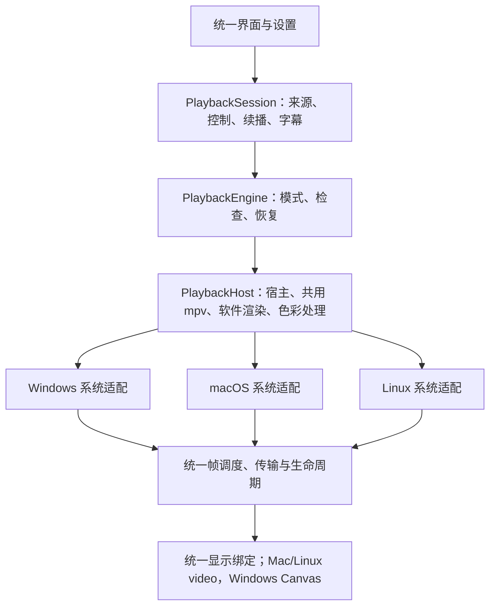

# ADR-0033：统一桌面三平台的播放能力与行为

日期：2026-10-24。

状态：统一实现已落地，Windows 本机及包内验证通过；Mac/Linux 原生 CI 通过，跨平台实机验收待补。

## 接续与实施基线

已获取 `origin/dev` 的 Mac CPU 实现 `e2fdd70a` 及 Intel Mac 运行库修复 `337962af03d303824d8e028aff0fc0217647f11e`，与本地方案文档提交 `45ab5a54` 合并为 `b8a2ae84`，没有文本冲突。实现复用远程新增的共用软件渲染与恢复工作；Mac 原有实测不覆盖此后的共用代码和隔离宿主变化。

2026-10-24 用户补充：未发布的播放设置直接替换，不增加旧字段迁移；接受系统默认字幕字体，不额外捆绑共用字体。外挂 ASS 继续尊重片源声明。

## 目标与决策

采用一套播放引擎、一套产品行为、三套系统适配。同样目的的能力采用同样的入口、结果、失败处理和验收标准；缺失的能力作为补齐项，不固化为长期平台专属行为。

硬件、驱动和操作系统可影响性能、实际硬解及系统集成方式。应用自身的播放模式、恢复规则、显示目标、字幕默认样式和诊断语义由共用层决定。能力探测描述当前设备和运行库的实际状态。

继续保留共用的资源授权、播放会话、续播、音量、轨道、字幕和 HTML 界面。平台底层保留必要的 D3D11/ANGLE、IOSurface/CGL、EGL/GBM/DMA-BUF，以及内存、句柄、FD、窗口和进程桥接实现。

2026-10-26 补充：按用户确认升级 Electron 44.9.3，Mac GPU 改用原始 VideoFrame → MediaStreamTrackGenerator → video，去除正常 Canvas 缓存复制。此变更只替换显示消费者；共用时序、三槽租约、色彩、控制和恢复语义不变。具体前置条件和本机证据见 [接入记录](../reviews/macos-video-consumer-integration-2026-10-26.md)。

2026-10-26 后续：CPU Canvas／video 配对比较后，按用户确认将 Mac CPU 接到相同 video 消费者，使用不透明 RGBX 与私有 IPC 缓冲区转移；仍为软件解码／软件绘制，并保留禁用 GPU 和故障接管。GPU 租约与 CPU 复制信用额度保持不同归还条件，详见 [接入记录](../reviews/macos-cpu-video-integration-2026-10-26.md)。

2026-10-27 Mac CPU 后续：配对实测后按用户确认正式采用私有帧通道，保留原生对齐 scratch 和输出复制，由隔离宿主通过私有 MessagePort 直接交付像素，主进程继续认证绑定、校验元数据、调度和管理两帧信用额度。Mac CPU 的 VideoFrame 改为复制输入，取代上段的紧密缓冲区转移方式；CPU 兼容及自动回退进入 CPU 时均使用此实现，无需实验开关。默认 GPU、Linux 和 Windows 的显示与内存路径保持。最初 M4 配对的 1080p60／4K24 CPU 成本分别下降约 23%／18%，4K 工作集增加约 195MiB，按本次取舍采用；提交前再修复两项帧回收时序问题，最终源码的复核结果另记，范围与恢复检查见 [实测记录](../performance/macos-cpu-private-frame-channel-2026-10-27.md)。

2026-10-27 后续：按用户选择，Linux GPU/CPU 共用 video 消费者并移除旧 Canvas 入口；保留 CPU 自动接管与硬解失败后的 copy/software 解码。默认优先当前输出 GPU 对应的直接硬解。Intel VAAPI 的 DRM FD 隔离修复通过 producer 检查，强制 Intel 消费、NVIDIA 桌面呈现归入非阻塞的系统兼容性边界，不能作为纯 Intel 全链路证明；详见 [Intel 调查记录](../performance/linux-intel-direct-investigation-2026-10-27.md)。CPU 4K60 性能下降为已接受取舍。

2026-10-27 Windows 后续：GPU／CPU 同样接到共用 video，保留 ANGLE／D3D11 共享槽直接渲染、`glFinish` 和默认缩放。CPU 进一步复用 Mac 私有 MessagePort，像素由隔离宿主直达 preload，主进程继续认证、校验元数据及管理两帧信用额度；VideoFrame 复制输入，原生软件绘制不变。两平台共用通道代、时间线配对、退休顺序和故障边界；验收见 [Windows video 接入](../reviews/windows-video-integration-2026-10-27.md)及[私有 CPU 通道](../reviews/windows-cpu-private-frame-channel-2026-10-27.md)。以下早期差异表与实施顺序保留为决策时的记录，当前行为以播放合同为准。

## 能力与行为合同

| 能力 | 记录时的差异 | 统一目标 |
| --- | --- | --- |
| 播放模式 | `linuxPlaybackMode` 仅对 Linux 生效；Windows 还有启动参数，macOS 无独立 CPU 路径 | 三平台同一“自动 / GPU / CPU”设置及生效时机；未发布功能直接采用通用字段，不保留旧字段迁移 |
| CPU 播放 | Windows/Linux 已有，Mac 端正在开发 | 三平台独立软件解码与绘制，使用同一软件渲染核心与显示绑定／像素输入合同；Mac/Linux video，Windows Canvas |
| 故障恢复 | Windows/Linux 有不同状态机与重试范围，macOS 尚未接入 | 共用恢复状态机，统一进度、暂停意图、音量、静音、倍速、选轨、外挂与 AI 字幕恢复 |
| 画面通路检查 | Linux 有固定合成色块自检，其他路径主要依赖错误信号 | 三平台统一检查协议、状态和失败处理；不根据任意影片的黑色内容判定通路损坏 |
| 色彩与 HDR | GPU/CPU 算法不同，Linux GPU 色彩合同仍未完全明确 | HDR/SDR 输入统一转换到 BT.709 primaries / sRGB transfer / RGB full range 的 SDR 目标，使用同一映射规则和视觉误差判据 |
| 默认字幕表现 | 生成字幕硬编码 Windows 字体名，平台可能选择不同替代字体 | 应用生成字幕与默认 SRT 使用系统默认字体；共用样式和合成规则，接受系统字体差异；外挂 ASS/内嵌字体尊重片源声明 |
| 播放信息 | 平台报告的播放模式、硬解变化、通路检查和回退原因不完整 | 统一报告实际解码、实际画面输出、通路检查、回退原因和状态；诊断措辞与错误代码共用 |
| 故障隔离 | Linux 使用 helper；Windows/macOS 原生渲染位于主进程 | 三平台均具备隔离播放宿主及宿主退出/无响应后的受控恢复能力，主界面保持可用 |
| 验收 | 平台脚本与证据格式分散 | 同一媒体/字幕/色彩矩阵、故障用例和结果合同，在各平台真实运行并绑定源码与产物 |

模式语义统一为：

- **自动**：优先探测和使用 GPU；图形初始化、自检或可检测的图形运行故障最多触发一次 CPU 恢复。故障后的当前宿主代保持 CPU；显式重试 GPU 时通过受控重建宿主重新探测，安全处理旧资源。
- **GPU**：明确使用 GPU 画面路径；失败给出统一原因，不静默改成 CPU。
- **CPU**：使用独立软件解码和软件绘制，保持同一套播放控制、字幕及实际显示分辨率规则。
- 媒体、授权、网络、音频错误与页面销毁不作为 GPU 回退依据；不自动换片源或外部播放器。
- 视频解码与画面输出分开报告。硬解失效后仍能在 GPU 路径显示的软件解码，不等同于 CPU 画面回退。
- 模式设置统一在重开影片时应用；需要重建的宿主由共同控制器管理。

2026-10-24 补充：应用主窗口首次显示前的图形故障，由独立、共用的启动保护处理，最多自动重启一次并临时强制软件界面与 CPU 视频。它不改变播放设置或运行中恢复语义；实现与边界见[启动保护记录](../reviews/startup-graphics-recovery-2026-10-24.md)。

CPU/GPU 色彩对齐需要真正一致的转换算法、输入元数据解释、缺省值和输出标记，不能仅改相同的参数名称，或靠整体提亮来匹配。现有 Windows 静态 BT.2390 与 203nit SDR 参考白作为统一工作的已验证起点；CPU 现有 FFmpeg 感知曲线与 Linux 传输标记均需纳入调整和实测。物理 HDR 输出是另外的完整能力，当前统一基线仍是 SDR 输出。

## 目标结构与职责

- **PlaybackSession**：保留资源身份、来源授权、播放语义与业务副作用，不处理原生图形资源。
- **PlaybackEngine**：统一模式选择、可用性、健康检查、结构化故障分类、一次受控恢复、恢复期间的新控制意图及取消；取代 Windows/Linux 各自决定产品行为的回退包装。
- **PlaybackHost**：统一启动、命令、状态、心跳、停止与异常退出合同。共用软件渲染和色彩代码；平台负责隔离进程及系统资源交接。
- **通用内核适配**：`libmpvPlayback.ts` 保留通用命令与状态转换；拆出宿主工厂和生成字幕的选择权/异步确认管理。`MpvCore.initialize` 改为具名配置，共用层传入解码、时序及色彩策略。
- **FramePipeline**：统一画面绑定、单调时钟、时间线、过期帧丢弃、背压、检查与诊断，提供明确的资源生命周期接口。
- **系统适配**：提供资源描述、创建/导入/释放及必要的进程桥接。GPU 资源完成与释放条件继续受实际平台 API 约束；不把显示提交当作 GPU 已释放，也不强制回收状态未知的资源。
- **Renderer/preload**：保留同一显示绑定与 HTML 控件体系；Mac/Linux GPU／CPU 使用 video，Windows 使用 Canvas，原始句柄、FD、地址、来源授权及任意 mpv 命令不进入公共 Renderer API。

Windows/macOS 的隔离宿主先验证跨进程帧资源交接和释放，再推广到正式路径。平台 API 差异由适配层吸收，产品恢复语义保持一致。

## 实施顺序

以下步骤在 Mac 完成推送并整合最新代码后启动；具体文件边界以新基线为准。

1. **统一合同、设置和恢复状态机**：定义共同模式、能力/状态和错误代码，直接替换未发布的 Linux 专属设置，不保留兼容/迁移逻辑，抽取恢复状态机；修复已最小复现的 Linux 回退重复加载，并将相关恢复用例升级为共用合同测试。
2. **整合 Mac CPU 与统一色彩/字幕表现**：复用 Mac 最新实现，提取可移植软件渲染核心；统一尺寸、内存边界、色彩转换及默认字幕规则（采用系统字体）。保留现有无 1080p 人工上限、8192 单边/256MiB 单帧安全边界，具体边界在共用定义中维护。
3. **收敛帧处理与通路检查**：合并协议、时钟、调度、背压、健康检查及诊断，平台资源操作以专用适配接入。保留迟到释放、代际隔离和异常资源有界留存。
4. **补齐隔离宿主**：统一宿主生命周期与异常恢复，完成 Windows/macOS 跨进程资源交接验证，再替换相应正式路径。
5. **清理旧协议与完成验收**：删除原生全屏/焦点、空遮挡命令、空窗口句柄等旧显示后端残留；保留实际需要的可见性、会话/时间线版本和系统全屏事件。更新构建、对应源码、文档及共用验收入口。

## 验收与完成标准

- 三平台运行同一组会话/控制/恢复合同测试，覆盖恢复中更改暂停、跳转、轨道和字幕，以及停止、换片和迟到回调。
- 真实检查自动/GPU/CPU 模式，区分软件解码与软件画面输出；合成自检失败、初始化失败、生产/消费失败、宿主退出及无响应按统一规则处理。
- 使用相同编码、分辨率、帧率、字幕及完整/缺失亮度元数据样本，检查播放、暂停、跳转、底栏、展开、全屏、重开及退出释放。
- 对应用输出使用同一色彩参考与误差门槛，覆盖 SDR full/limited、HDR10、HLG 和 GPU/CPU 切换；同时检查默认字幕布局与片源 ASS 样式。截图不作为物理 HDR 或显示器校准证明。
- 各平台实际运行新的原生构建及包内程序，并绑定源码 SHA、运行库/包摘要、检查结果和未覆盖范围。共用代码改变后，不能只用旧平台结果宣布通过。
- 记录 4K 等代表性负载的速度、延迟、丢帧与资源上界。相同功能采用相同质量与安全规则，性能结果按设备报告。
- 安装包需要带上对应的新运行库及匹配的源码材料；原有本地包和历史验收不追溯为新方案的证据。

完成后将已落地的行为并入 [内置播放合同](../BUILTIN_PLAYBACK.md)、[开发指南](../DEVELOPMENT.md)和对应用户指南；版本变化仍以 CHANGELOG 为唯一来源。本 ADR 保留决策、接续条件与理由，实施状态按实际验证更新。

## 当前实施状态

- [x] 记录用户确认的统一目标、架构方向与接续约定。
- [x] 整合 Mac CPU 及 Intel Mac 运行库修复，记录实施基线。
- [x] 共用自动/GPU/CPU 设置与恢复状态机，移除平台回退包装和旧设置迁移。
- [x] 拆出宿主工厂和生成字幕选择管理，共用具名渲染配置、尺寸及帧内存边界。
- [x] 整合 GPU/CPU 的静态 BT.2390、203nit、BT.709/sRGB/full 输出；CPU 在字幕合成前转换。
- [x] 共用帧绑定、时钟交换、自检和预算；Windows/macOS 增加隔离宿主与资源代际管理，Linux 保留隔离 helper。
- [x] 移除旧窗口句柄、原生焦点/全屏和空遮挡协议，三个平台直接使用 HTML 控件。
- [x] 完成 Windows 本轮包内验证与 4K 性能结果整理，记录 CPU 丢帧边界。
- [x] macOS arm64／Intel 和 Linux 原生 CI 通过；Mac 的跨进程 Mach 资源预检通过。
- [ ] 在 macOS 和 Linux 实机完成相同 Canvas／CPU／包内矩阵。WSL 与原生 CI 不代替桌面实机验收。

Mac 原生构建加入跨进程 IOSurface/Mach 预检：验证生产进程退出后接收方仍可读取并释放资源；预检失败即停止构建。此预检不代表 CGL、Chromium 或显示设备验收已经完成。

本轮实现、回归、安装包摘要和性能边界见[统一验证记录](../reviews/playback-unification-2026-10-24.md)。
