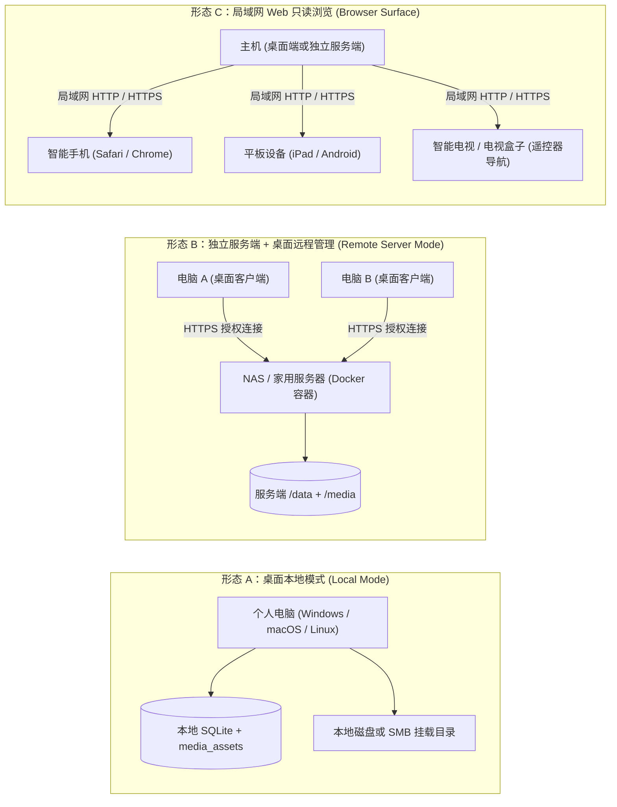

Javdex 支持三种互补的运行与访问形态。你可以根据自身硬件条件（单台电脑 vs 拥有 NAS / 家用服务器）以及使用习惯灵活选择。

---

## 三种运行与访问形态拓扑图

---

## 功能执行位置与能力边界对照表

为了帮助你彻底看懂系统在不同模式下的职责分工，以下是源码级的功能执行位置矩阵：

| 功能模块 | 桌面本地模式 (`local`) | 独立服务端模式 (`remote`) | 局域网 Web 浏览 (`browser`) |
| :--- | :--- | :--- | :--- |
| **主要定位** | 在单台电脑上完整建库、整理与观看 | NAS 常驻扫描与存储，电脑远程管理 | 手机、平板、电视随开随看 |
| **数据库与图片存储** | 本机 `<userData>` 目录 | 服务器 `/data` 卷与挂载目录 | 读取服务端或桌面端共享数据 |
| **定时后台文件扫描** | 仅桌面端打开时运行 | **服务端进程 24 小时后台自动扫描** | 不支持触发扫描 |
| **元数据插件刮削** | 本机沙箱执行 | **由桌面端发起并执行，写回服务端** | 只读，不支持刮削 |
| **辅助浏览器预登录** | 本机打开 Chromium 完成验证 | 本机打开 Chromium，会话保存在本机 | 不支持 |
| **待办中心冲突消解** | 本机界面处理 | **桌面端连接后集中处理** | 只读，不展示待办 |
| **内置 `libmpv` 原生播放** | 本机直接读取文件 | **通过 `PlayGrant` 签名流原画直传** | 使用浏览器原生 `<video>` 播放 |
| **实时 AI 日中字幕** | 本机 GPU / CPU 推理 | **仅在桌面端播放时本机推理** | 不支持 AI 实时字幕 |
| **NFO 导入与导出** | 本机读写 NFO 及其附件 | **桌面端发起，直接写回服务端挂载卷** | 不支持 NFO 导出 |
| **多设备协同** | 单机专属 | **支持多台授权桌面电脑并发查看与修改** | 支持局域网免安装并发访问 |
| **视频画质转码** | ❌ 零转码（直接解码原画） | ❌ 零转码（直接流式传输原画） | ❌ 零转码（浏览器解码原画） |

:::important[同版本强约束]
当你采用“独立服务端 + 桌面远程管理”模式时，**桌面客户端的版本号必须与 Docker 服务端镜像的版本号完全一致**（例如桌面端为 `0.9.0`，服务端也必须为 `0.9.0`）。桌面端向服务端发起除握手外的所有请求均会携带 `x-javdex-app-version` 校验头，版本不匹配时将被服务端安全拒绝。
:::

---

## 哪种方式适合你？

### 推荐选择「桌面本地模式」的情形：
- 你只在一台电脑上管理和观看自己的影片。
- 视频文件存放在电脑的本地硬盘、外接移动硬盘，或者由这台电脑挂载的 NAS 网络共享文件夹中。
- 希望零配置、下载安装包双击即可开始整理。

### 推荐选择「独立服务端 + 桌面应用」的情形：
- 你拥有一台 24 小时开机的 NAS（如群晖、威联通、Unraid、TrueNAS）或家用 Linux 服务器。
- 你有多台电脑（如书房台式机、卧室笔记本），希望连上同一个资料库进行管理、编辑和观影。
- 希望服务器在后台持续监控媒体文件夹变动，而无需整天保持桌面应用开着。

### 推荐配合使用「局域网 Web 浏览」的情形：
- 躺在床上用手机或平板快速挑片。
- 在客厅电视上使用遥控器方向键挑选影片并大屏欣赏。
- 局域网内的家人或朋友免装客户端，直接输入地址即可只读浏览你的影片库。

---

## 如何在本地模式与远程模式之间迁移？

Javdex 支持平滑的双向数据转移，两套系统完全解耦：
1. **从本地电脑迁移到 NAS 服务端**：
   - 部署好 Docker 服务端后，在桌面端“设置 -> 存储 -> 资料库模式”切换为“远程资料库”并完成配对。
   - 随后在“备份与恢复”中直接使用 **“从本机资料库直接导入”** 功能，桌面端会自动打包本机数据库与图片并流式上传给服务端，通过路径映射向导将盘符改写为容器内的挂载路径即可。
2. **两套资料库的独立性**：
   - 本地资料库与远程资料库是两份独立的实例，互不干扰，也不会自动双向同步变动。
   - 迁移操作为覆盖导入，源端资料库在导入后依然完整保留在你的本地电脑上。
