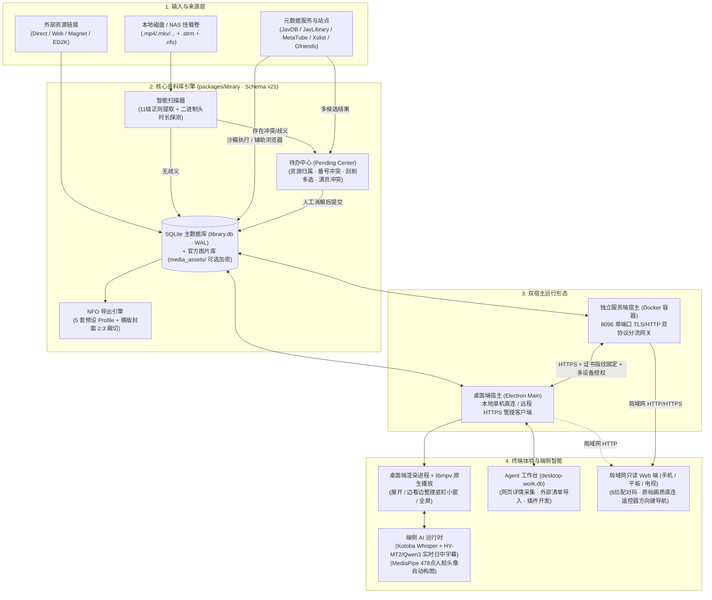

Javdex 是一款以 **番号（Code）** 为核心实体的本地影片管理与资料库系统。它不仅能将散落在不同磁盘或 NAS 目录中的视频文件与外部链接汇聚起来，还能通过刮削、端侧 AI、NFO 双向互通与原生播放引擎，构建一个高度组织化、隐私完全受控的私人数字媒体库。

---

## 核心设计理念：以番号（Code）为中心的资料库

在传统通用媒体服务器（如 Plex、Jellyfin、Emby）中，媒体管理通常以“电影名称”或“剧集集数”为核心，难以契合日本成人影视（JAV）行业高度依赖厂商统一编号（番号）的发行逻辑。

Javdex 在底层架构上将**番号**确立为第一公民（First-Class Entity），并围绕其构建了四大核心支柱：

1. **一部影片，多源聚合（Multi-Resource Binding）**：
   - 库内的一部影片（`videos` 记录）可以同时挂载多个物理或逻辑资源（`video_resources`）。
   - 资源类型涵盖：本地磁盘视频（`.mp4`, `.mkv` 等）、`.strm` 流指针、直接媒体 URL（`direct`）、外部网页链接（`web`）、磁力链接（`magnet`）与电驴链接（`ed2k`）。
   - 系统支持为每个影片自动推选主播放资源（`is_primary`），并在本地文件缺失时优雅降级。
2. **多媒体库与独立配置（Independent Media Libraries）**：
   - 用户可按需创建任意数量的媒体库（如“骑兵库”、“步兵库”、“VR 专库”、“临时待整理库”）。
   - 每个媒体库独立配置监控目录（`media_library_roots`）、定时扫描周期、同番号资源自动合并开关、以及默认刮削插件。
3. **全局实体化的人物与分类体系（Entity Ownership）**：
   - 演员（`actresses`）、片商与发行商（`organizations`）、导演（`directors`）、系列（`series`）均为独立建档实体。
   - 采用 **全局名称所有权机制（Global Name Ownership）**，彻底避免因不同插件返回的别名差异（如艺名、罗马音、中译名）而在库内产生重复混乱的演员记录。
4. **集中式待办确认机制（Pending Center）**：
   - 坚守“不确定时不静默覆写、不武断入库”的原则。无论扫描发现同名冲突、文件名与 NFO 番号不符，还是刮削遇到多个候选，均挂起至“待办中心 (`/pending`)”等待用户确认。

---

## 全链路数据流转全景图

从磁盘上的冷数据文件，到多端流畅浏览与实时 AI 字幕播放，Javdex 的数据流转模型如下：

---

## “本地优先”的真实含义与网络边界

Javdex 倡导并严格践行 **本地优先（Local-First）** 架构。理解这一原则的技术边界，有助于你掌握数据的安全与流向：

### 1. 数据资产 100% 由你掌控
- 你的主资料库（`library.db`）、封面与剧照（`media_assets/`）、播放进度与个人设置，均完整保存在你自己的设备（本地电脑或自建 NAS）上。
- Javdex 官方不设立任何用户中心服务器，不收集你的观影记录、收藏清单或个人媒体资产。

### 2. 区分不同功能的网络请求范围
软件在运行不同功能时的网络通信边界清晰可查：
- **普通扫描与本地播放**：完全离线运行，不产生任何外网网络流量。
- **元数据刮削**：仅在执行刮削时，由客户端或通过你配置的 HTTP 代理访问指定的第三方公网站点（如 JavDB、JavLibrary 等）或你自建的私有 MetaTube 服务端。
- **本地 AI 字幕与人脸检测**：
  - Kotoba Whisper 语音识别、HY-MT2 / Qwen3 本地大模型翻译与 MediaPipe 人脸检测**完全在本机 CPU / GPU 上离线推理**，绝不将视频、音频或字幕文本上传至任何第三方云端。
  - 模型权重只需首次从 Hugging Face 或国内镜像下载一次，后续完全断网可用。
- **云端大模型与 Agent 功能**：
  - 仅当你主动配置了云端大模型服务商（如 OpenAI、Google Gemini、DeepSeek 等）并执行“网页 Agent 采集”、“外部清单导入”或“云端文本翻译”时，系统才会按需将当前任务所需的上下文发送至你指定的 API 服务。

### 3. 不提供转码与内容分发
- Javdex 专注于 **已有合法媒体的管理、组织与播放**。
- Javdex 不提供任何侵权视频资源的托管、下载或 P2P 分发。
- 内置播放器（`libmpv`）与局域网 Web 服务均直接读取原始视频流进行解码， **服务端不执行任何重编码转码（Transcoding）** ，以最大限度保障画质并降低服务器 CPU 负载。
