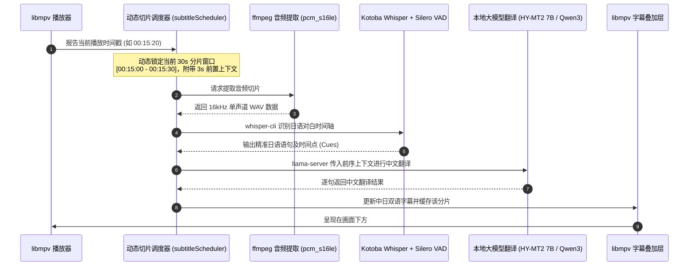

面对没有官方中文字幕的生肉日语影片，Javdex 提供了革命性的**端侧离线实时 AI 字幕系统**。无需等待漫长的全片预先离线转录，而是在播放过程中随着进度实时进行语音识别与大模型翻译，完全保护观影隐私且零云端费用。

---

## 实时 AI 日中字幕是如何工作的？

### 本机字幕与后台生成

- 播放本机影片时自动发现同目录的同名 SRT、ASS，例如 `ABC-123.zh-CN.srt`；播放器中可以刷新、选择或手动加载字幕，并记住明确选择和关闭状态。
- 在影片资源行的“…”菜单中选择“字幕管理”，默认查看“字幕文件”：包含同目录自动发现和已手动关联的字幕，显示完整路径和可用状态。点击“关联字幕文件”可多选 SRT／ASS，不需要播放影片或准备 AI 模型。关联只记录原路径，不复制或移动文件；重启后仍会加载，已有选轨或关闭状态保持不变。
- 切换到“AI 生成”，选择音轨及“日中双语／仅日语”，即可创建后台任务。在侧栏“任务中心 → 字幕”可查看全部进度、暂停、继续或取消；概览会提示生成中、排队及需要处理的任务。
- 关闭播放器不删除任务；播放其他影片时后台生成会等待。开启当前影片的 AI 字幕后，优先生成当前播放位置。退出应用会暂停，重启后手动继续已完成区间之后的工作。
- 完成字幕默认保存到视频所在目录，例如 `ABC-123.zh-ja.ai.ass`。目录不可写、离线或同名文件已存在时显示“生成完成，等待保存”，可以重试或另存／明确替换，不需要重新识别。可另行导出 SRT。
- 移除任务会清理中间结果，保留已保存的字幕。删除正式生成文件需要单独确认；用户已经修改过的文件不会直接删除。
- 后台任务和目录自动发现目前仅适用于本机资源（含本机挂载的共享目录）。远程资料库继续使用播放期间的 AI 字幕和手动导出。

Javdex 的字幕推理流水线在设计上实现了“低延迟、动态调度、失败隔离”：

### 核心架构亮点
1. **播放位置优先调度（Play-Position Priority）**：
   - 系统将整片划分为 `30 秒` 的独立计算单元。调度器**永远优先处理当前播放进度所在的那个 30 秒单元**，随后向后预读计算。
   - 当你在播放器中拖动进度条跳转时（超过 5 秒），调度器会立即中止先前的闲置分片，瞬间将算力聚焦到新跳转的播放位置！
2. **两阶段分离缓存**：
   - 原文识别和翻译分别校验有效性。本机后台任务的分段检查点保存在 `<userData>/subtitle-tasks/`，远程会话继续使用应用缓存目录。切换翻译模型创建新任务时，可复用同一资源、音轨和识别模型的现存原文检查点；移除任务并清理检查点后需要重新识别。
3. **播放绝不中断的故障隔离**：
   - 任何音频提取异常、模型显存不足或推理错误，均被严格限制在后台工作线程中，**绝对不会中断正在进行的视频画面与声音播放**。

---

## 下载、导入与管理本地 AI 模型

前往 **“设置 -> AI 服务 -> 本地模型”**，你可以集中管理所有端侧模型：

### 1. 官方支持的预置模型
- **语音识别组（Speech）**：
  - **`kotoba`（Kotoba Whisper v2.0 GGML）**：针对日语对白进行了深度强化微调，默认搭配 `Silero VAD v6.2.0` 静音过滤。Windows、macOS、Linux 的语音引擎、音频提取工具和 VAD 均从 Javdex Runtime 固定发行按需下载；macOS AI 工具不再占用主应用安装包。首次准备会列出实际下载量，支持续传和校验修复。
- **文本翻译组（Text）**：
  - **`hy-mt2-7b`（HY-MT2 7B GGUF，默认推荐）**：翻译语意通顺自然，对日语俚语与成人影视特定语境理解极佳。
  - **`qwen3`（Qwen3 1.7B GGUF）**：超轻量级翻译模型，适合显存或性能较受限的设备。

### 2. 切换国内镜像与断点续传
- **下载源切换**：在面板中可随时在 `Hugging Face 官方源 (huggingface.co)` 与 `HF-Mirror 国内镜像源 (hf-mirror.com)` 之间切换，国内用户无需代理也能满速下载。
- **可靠断点续传**：下载采用标准 HTTP `Range` 分块断点续传，未完成的 `.part` 文件会自动保留 7 天，遇到网络波动随时可继续下载。
- **完整性校验**：下载完成后，系统会自动比对 SHA-256 哈希值，并在后台运行一段 0.5 秒合成音频冒烟测试，确保模型文件完好无损。

### 3. 离线导入、导出与存储位置迁移
- **离线导入**：如果你的电脑无法联网，可在其他电脑下载好 `.bin` 或 `.gguf` 文件后，点击“导入模型”，系统会自动校验其哈希并激活。
- **导出备份**：支持将安装好的模型连同许可协议一键导出为标准模型包。
- **自定义模型存储路径**：模型权重通常体积较大（2GB ~ 8GB）。在“本地模型 -> 存储位置”中，你可以一键将 `local-ai` 目录整体安全迁移至任意大容量硬盘分区，系统会自动校验并迁移历史数据。

---

## 硬件加速配置与显存预算规则

前往 **“设置 -> AI 服务 -> 本地模型 -> 硬件加速”**：

| 操作系统 | 推荐加速后端 | 技术实现与配置建议 |
| :--- | :--- | :--- |
| **Windows** | **NVIDIA CUDA 12.4** 或 **Vulkan** | 自动模式优先选择已安装的 CUDA 后端；若为 AMD 显卡或 Intel 独显，选择 Vulkan（系统仅枚举 `uma: 0` 的独立显卡）。支持指定具体 GPU 设备。 |
| **macOS** | **Apple Metal** | macOS 系统原生支持，自动调用 M 系列芯片的统一内存与 GPU 执行加速。 |
| **Linux x64** | **NVIDIA CUDA 12.8** 或 **Vulkan** | 按需安装语音、文本 GPU 运行库；支持经检测的独显与硬件核显，保留独立 CPU 回退。需要 glibc 2.38+、GCC 14 C++ 运行库及对应显卡驱动。 |
| **Linux arm64** | **CPU 模式** | 本次未增加 GPU 后端。 |

Linux GPU 支持属于新增构建；已发布的旧 0.9.0 不会因为运行库发布而自动获得该能力。先安装“GPU 加速支持”，再查看所选模型的实际验证结果。双显卡 Linux 会通过 Vulkan 检测组件继续识别核显；只检测到 NVIDIA 不代表完整枚举已完成。

### 显存预算与 CPU 回退

应用为桌面和视频播放预留 2 GiB，并记录本应用推理任务的显存预算；CUDA 和 Vulkan 如果使用同一张卡，会共用预算。Linux 核显还受系统可用内存约束。这是保守估计，并非其他进程显存占用的实时测量。

语音模型需要足够预算加载；文本引擎可以根据预算只将部分层放到 GPU。设备、驱动、加载或显存错误发生时，任务会尝试独立 CPU 引擎，并在模型状态中说明原因。取消、模型文件损坏等错误不会被当作 GPU 故障掩盖。

---

## 在播放器中开启、调节与导出 AI 字幕

在内置播放器展开状态下，展开右侧设置抽屉：
1. **开启字幕**：打开“AI 实时字幕”开关。
2. **显示模式切换**：
   - **`中日双语`**：上方显示中文翻译，下方以 80% 字号显示日语原文，学习与观影兼备。
   - **`仅中文`**：纯中文展示（翻译生成前会短暂显示原文占位）。
   - **`仅日语`**：纯日语听力字幕。
3. **字号调节**：支持 `28 | 34 | 42 | 50 | 60` 五档字号微调。
4. **一键导出字幕文件**：
   - 点击“导出已生成字幕”，可将已生成的片段保存为 **`.srt`** 或 **`.ass`** 文件。
5. **缓存清理与重试**：
   - 片段生成失败时，可在抽屉中点击“重试未完成字幕”。本机后台任务的中间结果在“任务中心 → 字幕”中随任务移除，远程资料库可在播放器中清除本片字幕缓存。

---

## 使用本地或云端模型翻译影片标题与简介

除了实时的视频字幕，Javdex 还支持将影片的日文原版标题与剧情大意翻译为优美的简体中文：

1. 前往 **“设置 -> AI 服务 -> 功能”**。
2. 在 **“文本翻译”** 选项中，你可以选择：
   - **`继承应用默认模型`**：调用你配置的云端服务商（如 DeepSeek、OpenAI、Claude、Gemini 等 API）进行高水准联网翻译。
   - **`本地模型 (HY-MT2 / Qwen3)`**：使用刚才安装的端侧本地大模型完全离线翻译，兼顾隐私与零成本。
3. 在任意影片详情页，点击右上角的 **“翻译资料”**，标题和剧情大纲就会瞬间替换为规范的中文翻译！
