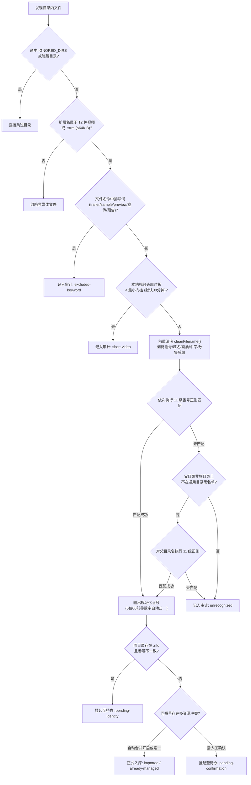

扫描与建库是 Javdex 的数据基石。本篇指南将深入剖析 Javdex 如何在海量文件中准确定位番号、如何过滤无用杂项，以及如何灵活管理同一影片下的多个物理与网络资源。

---

## 多媒体库设计与每库独立配置

Javdex 采用**多媒体库（Media Libraries）**设计，每个媒体库记录在数据库的 `media_libraries` 表中，并由 `media_library_configs` 表控制其专属运行策略：

- **隔离分库**：你可以将视频按照来源或偏好划分为不同库（如“有码 / 步兵”、“VR 专区”、“欧美”、“动漫”等）。各库在侧边栏独立展示，拥有自定义的图标与专属颜色标记。
- **配置项细览**：
  - `auto_scan_enabled`：是否在应用启动或服务端运行时自动定时扫描。
  - `auto_scan_interval_minutes`：后台定时扫描间隔（默认 `1440` 分钟，即每天一次）。
  - `min_import_duration_minutes`：正片最小时长门槛（默认 `30` 分钟）。
  - `auto_merge_same_code_resources`：同一番号多文件是否自动合并为同一影片条目（默认为 `1` 自动合并；关闭时若检测到重复番号将推送至待办中心人工选择）。
  - `auto_import_local_nfo`：扫描时若同目录存在 `.nfo` 是否自动解析入库（默认开启）。
  - `default_video_scraper`：该库专用的默认刮削插件（未指定时继承全局默认插件）。
  - `include_in_home_discovery`：该库的影片是否纳入首页的“随机发现”与近期推荐中。

---

## 支持的文件格式与过滤规则

### 1. 受控视频扩展名（12 种主流格式）
扫描器在扫描目录树时，仅对下列 12 种视频文件及 `.strm` 格式建立索引：
- `.mp4`, `.mkv`, `.avi`, `.wmv`, `.mov`, `.flv`, `.webm`, `.ts`, `.m4v`, `.rmvb`, `.mpg`, `.mpeg`

### 2. 流指针文件（`.strm`）
- Javdex 支持读取体积不超过 `64 KiB` 的 `.strm` 文件。
- 扫描器会跳过以 `#` 开头的注释行，读取首个有效行，并根据内容特征自动归类：
  - **`local`**：相对或绝对本地/NAS 路径。
  - **`direct`**：标准 HTTP / HTTPS 直链媒体流。
  - **`web`**：普通在线网页 URL。
  - **`magnet`**：以 `magnet:?xt=urn:btih:` 开头的磁力链接。
  - **`ed2k`**：以 `ed2k://|file|` 开头的电驴链接。

### 3. 自动忽略的文件夹目录（`IGNORED_DIRS`）
以下目录会被扫描器直接忽略，避免冗余文件进入扫描队列：
- **隐藏与回收站目录**：所有以 `.` 开头的文件夹（如 `.git`, `.actors`, `.javdex-trash`），以及 `$recycle.bin`, `system volume information`, `.trash`, `.trashes`, `@eadir`, `#recycle`, `node_modules`。
- **样片、花絮与字幕目录**：`sample`, `samples`, `extras`, `trailers`, `featurettes`, `behind the scenes`, `deleted scenes`, `interviews`, `scenes`, `shorts`, `sub`, `subs`, `subtitle`, `subtitles`, `extrafanart`, `extrathumbs`, `javdex-samples`。

### 4. 宣传片排除词与最小时长过滤
- **文件名排除关键词（`EXCLUDE_NAME_KEYWORDS`）**：凡是文件名包含 `trailer`, `sample`, `preview`, `宣传`, `预告` 的文件，系统会直接将其标记为 `excluded-keyword` 并跳过。
- **基于纯 JS 二进制文件头解析的时长过滤**：
  - 系统使用纯 JavaScript 二进制流解析器，在不调用任何外部二进制转码工具的前提下，极速读取视频头部的真实时长：
    - MP4 / MOV：解析 `moov -> mvhd` 原生时间戳。
    - MKV / WebM：解析 EBML `Segment -> Info` 时间戳与时长浮点值。
    - AVI：解析 RIFF `avih` 帧率与总帧数。
    - WMV：解析 ASF 属性对象。
    - FLV：解析 AMF0 `onMetaData.duration`。
  - 若解析出的视频时长小于设定的门槛（默认 30 分钟），该文件会被判定为 `short-video` 跳过入库。`.strm` 文件或头部损坏无法解析时长的视频不受此限制。

---

## 番号（Code）自动提取规则详解

提取番号的核心逻辑位于 `packages/library/src/scan/codeParser.ts`，完整的文件扫描与番号提取判定流水线如下：

### 1. 前置文件名噪音清洗（`cleanFilename`）
在执行正则匹配前，扫描器会按顺序清洗文件名：
- 剥离首尾括号块（如 `[4K]`, `(中字)`, `【高清】`）。
- 剥离发布组与站点域名前缀（如 `hhd800.com@`, `sis001`, `javdb`, `javlibrary`, `dmm`）。
- 剥离画质与视频编码标签（如 `1080p`, `4k`, `2160p`, `fhd`, `x264`, `x265`, `hevc`, `uncensored`）。
- 循环剥离末尾的中文字幕标记（如 `-C`, `_C`, `-ch`, `_ch`, `中文字幕`, `中字`）、分段分盘标记（如 `cd1`, `part1`, `disc1`, `_A`）以及破解后缀（`_leak`, `_uc`, `-U`）。

### 2. 11 级番号正则依次匹配流程
清洗后的文本会依次经过以下 11 级正则判定，一旦匹配立即返回规范化的番号：

| 匹配级别 | 目标特征 | 匹配规则示例 | 规范化输出结果 |
| :--- | :--- | :--- | :--- |
| **1. FC2** | FC2 系列私拍 | `FC2-PPV-1234567` 或省略 PPV 的 `FC2-1234567` | 统一规范为 `FC2-PPV-1234567` |
| **2. HEYDOUGA** | 益达视频 | `HEYDOUGA-4017-123` | 保持 `HEYDOUGA-4017-123` |
| **3. 10MUSUME / PACO** | 天然素人 / 太平洋 | `10musume-123123-01`, `pacopacomama-123123-02` | 全大写 `10MUSUME-123123-01` |
| **4. CARIB** | 加勒比系列 | `carib-123123-001`, `caribpr-123123-001` | 统一规范为 `CARIB-123123-001` |
| **5. 1PONDO** | 一本道 | `1pon-123123-001`, `1pondo-123123-001` | 统一规范为 `1PONDO-123123-001` |
| **6. TOKYO-HOT** | 东京热 | `tokyo-hot-n1234`, `tokyo_hot-cz001` | 统一规范为 `TOKYO-HOT-N1234` |
| **7. HEYZO** | HEYZO | `heyzo-1234` | 统一规范为 `HEYZO-1234` |
| **8. T28** | T28 企划 | `t28-123` | 统一规范为 `T28-123` |
| **9. S2M / S2MBD** | S2M 企划 | `s2m-123`, `s2mbd-123` | 全大写 `S2M-123` |
| **10. 数字前缀番号** | 特殊厂商番号 | `300MAAN-123`, `748SP-001` | 提取 `300MAAN-123`（过滤伪前缀） |
| **11. 标准商业番号** | 绝大多数主流番号 | `SSIS-001`, `IPX-123`, `MIDV-001C` | 规范提取，并去除 5 位数字的冗余前导 0（如 `IPX-00123` 自动规范化为 `IPX-123`） |

### 3. 父目录回退匹配机制
如果根据视频文件名没有识别出任何合规番号，扫描器会自动尝试提取**直接父文件夹的名称**。
- **保护性黑名单**：只要父目录名称不是通用的分类名（如 `movies`, `videos`, `jav`, `av`, `downloads`, `media`, `new folder`, `影视`, `视频`, `下载`, `新建文件夹` 等），且不是媒体库根目录本身，就会使用父文件夹名进行二次提取，极大提高了单片单目录结构下的识别成功率。

---

## 多类型资源关联与主资源选举

在 Javdex 中，物理文件只是影片的一种承载“资源（`video_resources`）”：
- **同片多画质/多资源挂载**：例如同一部影片，你可以同时挂载一个 `1080P` 本地文件、一个 `4K` 本地文件，以及一个备用的网盘直链。
- **主资源自动推选规则（`recommendPendingScanPrimaryId`）**：
  当一个影片拥有多个关联资源时，系统自动按照以下权重确定首选主资源（`is_primary = 1`）：
  1. **资源类型优先级**：`local`（本地文件，权重最高） > `direct`（媒体直链） > `web`（网页播放地址） > `magnet`（磁力链接） > `ed2k`（电驴链接）。
  2. **文件体积**：同为本地文件时，优先选择体积更大的高质量文件。
  3. **修改时间**：体积相近时，优先选择最新写入的文件。
  4. **资源 ID**：更早入库的稳定资源。

你可以在影片详情页随时通过资源卡片右侧的菜单，手动将任意资源**“设为主资源”**。

---

## 扫描审计报告、离线盘保护与 `.javdex-trash`

1. **单调状态机审计表（Scan Audit）**：
   - 每次扫描均在数据库创建 `library_scan_runs` 记录，所有发现的文件通过触发器保护的状态机（`collecting` -> `sealed` -> `published`）记录最终去向：
     - `imported`：成功新建入库。
     - `already-managed`：库内已存在，文件无变动。
     - `pending-confirmation`：同一番号存在冲突，挂起至待办。
     - `pending-identity`：文件名与 NFO 番号冲突，挂起至待办。
     - `short-video`：时长小于门槛被跳过。
     - `excluded-keyword`：命中排除关键词被跳过。
     - `unrecognized`：未识别出合规番号。
2. **挂载盘离线保护机制（Offline Root Guard）**：
   - 若扫描时某个媒体库根目录所在的移动硬盘未插入、或 NAS 网络共享无法访问，扫描器会将其标记为 `skippedOfflineRoots`，**绝不静默删除库内的既有视频记录**，避免盘符掉线导致资料库被意外清空。
3. **两阶段本地文件删除账本（`.javdex-trash`）**：
   - 当你在界面上选择“彻底删除影片及本地文件”时，系统不会执行危险的立即硬删除，而是先将文件安全移入媒体库根目录下的 `.javdex-trash/<id>-<basename>`，并在数据库 `pending_local_file_deletions` 记录两阶段状态（`prepared -> committed`），防范误操作和 IO 异常。
