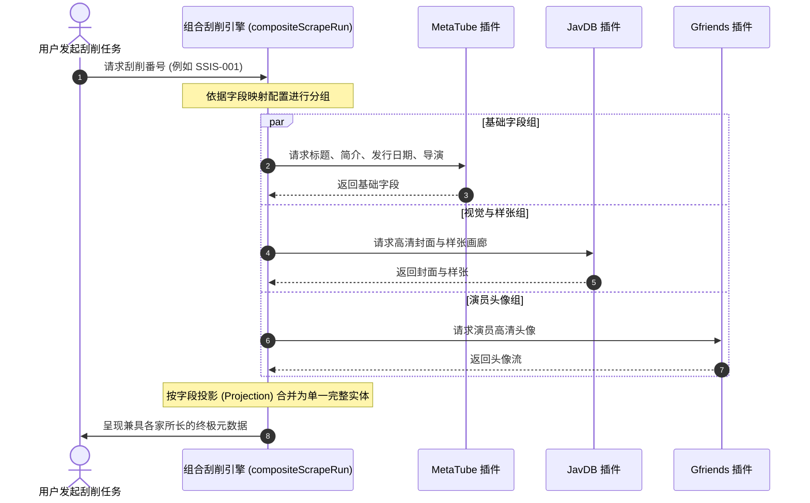

“刮削（Scraping）”是指通过网络元数据插件或本地解析器，将影片番号自动转化为包含封面海报、剧情大意、发行日期、演职人员、标签与高清剧照的精美资料条目的全过程。

---

## 内置刮削源能力对比矩阵

Javdex 在 `apps/desktop/src/main/bundled-plugins/` 中开箱预装了主流的元数据插件：

| 插件名称 | 插件类型 | 预装版本 | 支持字段数 | 核心特性与默认批量延迟 |
| :--- | :--- | :--- | :--- | :--- |
| **`JavDB`** | 影片 (`video`) | `1.2.0` | **全部 15 个字段** | 支持男女演员、评分、样张全覆盖；默认请求延迟 `3000..5000ms`。 |
| **`JavLibrary`** | 影片 (`video`) | `1.1.0` | **13 个字段** | 经典老牌站点，支持 10 分制评分自动按比例折算为 5 分制；默认延迟 `3000..5000ms`。 |
| **`MetaTube`** | 影片 (`video`) | `1.0.4` | **14 个字段** | 声明 `serviceBinding: "metatube"`，直接请求你的私有 MetaTube Server API（无公网爬虫风控）；默认延迟 **`0ms`**。 |
| **`本地 NFO`** | 影片 (`video`) | 宿主原生 | **14 个字段** | 读取本地同名 `.nfo` 及同目录海报/样张/头像图片；默认延迟 **`0ms`**。 |
| **`Xslist`** | 演员 (`actress`) | `1.0.2` | **全部 14 个字段** | 覆盖演员头像、写真集、三围、罩杯、出生日期、别名；默认延迟 `3000..5000ms`。 |
| **`Gfriends`** | 演员 (`actress`) | `1.0.0` | **仅头像 (`avatar`)** | 自动拉取并本地持久化缓存 GitHub / jsDelivr 的 `Filetree.json` 匹配高清头像；默认延迟 **`0ms`**。 |

---

## 单部刮削、手动搜索候选与批量刮削任务

### 1. 单部刮削与手动关键字搜索
- 进入影片详情页，点击右上角 **“重新刮削”**。系统会调用该媒体库配置的默认刮削器。
- 若影片由于番号写法变动未能自动匹配，可点击右上角更多菜单中的 **“手动搜索候选”**：
  - 自由修改搜索番号或关键词。
  - 实时预览第三方站点返回的候选封面与标题。
  - 选择“仅填补空缺字段（`fillEmpty`）”或“覆盖已有字段（`overwrite`）”并提交。

### 2. 批量刮削队列与风控保护
- 在影片列表页按住键盘 `Shift` 键连续多选，或全选后点击底部 **“刮削所选”**。
- **动态防封随机延迟**：除 `MetaTube`、`本地 NFO` 与 `Gfriends` 为本地/私有直连实行 `0ms` 延迟外，针对外部公网站点的批量任务，Javdex 默认在每次请求之间随机休眠 `3000ms ~ 5000ms`（可在“设置 -> 刮削插件”中调整）。
- 批量任务卡片支持实时**暂停、恢复与取消**，且在网络异常时会自动隔离单个失败项，确保整个批次平稳完成。

---

## 创建“组合刮削器”（Composite Scrapers）

不同站点往往各有千秋：有的简介最详细，有的样张最全，有的演员资料最权威。Javdex 独家支持**字段级组合刮削**：

### 如何配置组合刮削器？
1. 前往“设置 -> 刮削插件”，点击顶部的 **“创建组合刮削器”**。
2. 命名该组合器（如 `我的最强刮削组合`）。
3. 在弹出的字段映射矩阵中，为每个字段指定最佳插件（例如：“标题/简介”指定 `MetaTube`，“封面/样张”指定 `JavDB`，“演员”指定 `Xslist`）。
4. 保存后，即可将该组合器设为全局或某个媒体库的默认刮削器。

---

## 接入自建 MetaTube 服务端

MetaTube 是社区优秀的元数据聚合服务。Javdex 内置的 `video/MetaTube` 插件能够与其完美协同：

1. **在设置中绑定服务**：
   - 前往“设置 -> 刮削插件”，找到 `MetaTube` 插件，点击其齿轮配置图标。
   - 填写 MetaTube 服务端完整地址（如 `http://192.168.1.100:8080`）。
   - 若你的 MetaTube 启用了 Token 认证，填入对应的 Bearer API Token（密钥经 Electron `safeStorage` 安全加密保存在本机 `scraper-service-secrets.json` 中）。
2. **连接性验证**：
   - 点击“测试连接”，Javdex 会自动向你的服务端请求 `/`、`/v1/providers` 与 `/v1/db/version`。测试通过后方可保存。
3. **关键参数：`keepFirstCandidate`（仅保留首个候选）**：
   - 如果你的库整理规范，可勾选此项。插件在搜索到结果后将仅保留第一条精确匹配，直接进入详情抓取，跳过多余的候选分支，显著提升刮削速度。

---

## 刮削代理与辅助浏览器预登录 (`requiresPreLogin`)

### 1. 独立网络代理配置
部分元数据站点在国内无法直接访问。前往 **“设置 -> 网络”**：
- **刮削代理（`proxyUrl`）**：填入你的本地 HTTP / HTTPS 代理地址（如 `http://127.0.0.1:7890`）。
- 点击“测试连接”，确认能成功访问外部站点。

### 2. 辅助浏览器与会话预登录
部分插件可能开启了 Cloudflare 人机挑战，或声明了 `requiresPreLogin: true`：
- 当插件需要登录时，Javdex 会自动唤起一个独立的 Chromium 辅助浏览器窗口（`--javdex-scraper-helper`）。
- 你可以在该窗口中手动通过 Cloudflare 盾牌验证或登录你的站点会员账号。
- 完成后点击顶部的“确认登录”，该站点的 Cookie 与会话凭据将被安全保存在本机独立的 Chromium 用户分区（`Partitions/scraper/`）中，供沙箱插件在后续静默复用。
