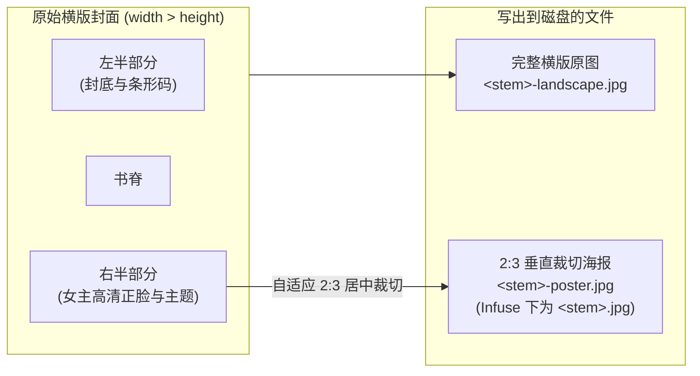

NFO 是媒体库之间交换结构化元数据（XML 格式）的事实标准。无论你是从第三方刮削工具迁入存量资料，还是希望将 Javdex 整理好的资料同步给家庭影音播放系统，Javdex 都能提供端到端的高兼容性支持。

---

## 存量 NFO 与本地图片自动建库

如果你此前使用过主流的 JAV 整理工具，只需将已有目录添加进 Javdex 媒体库，系统就能在扫描时**免联网直接复用存量数据建库**：

### 1. 自动方言识别（Dialect Detection）
Javdex 的 NFO 解析器（`packages/library/src/nfo/nfoArtifactCodec.ts`）内置了方言探测逻辑，无需手动指定来源工具：
- **`mdcx`**：检测到 `<num>` 且包含 `<publisher>`、`<series>` 或 `<originalplot>`。
- **`javsp`**：检测到 `<uniqueid type="num">`。
- **`mdc`**：检测到 `<num>`。
- **`javinizer`**：检测到 `<id>`。

### 2. NFO 文件命名定位优先级
扫描器在定位视频对应的 NFO 文件时，遵循以下确定性顺序：
1. **优先匹配同名文件**：`<视频文件名>.nfo`。若目录下同时存在通用的 `movie.nfo` 但内容有出入，系统会严格优先使用 `<视频文件名>.nfo`。
2. **回退匹配单片目录**：当且仅当该目录下**所有视频/STRM 文件均属于同一个逻辑番号**时，系统才会允许读取 `movie.nfo`。若目录下存在多部不同番号的视频，系统会发出 `ambiguous-movie-nfo` 警告并跳过，绝不发生误挂载。

### 3. 同目录本地图片素材自动摄取
解析 NFO 时，扫描器会自动就地探查并导入匹配的高清图片：
- **封面海报**：`<thumb>` 标签内容、同目录 `<视频名>-poster.*`，或单片目录下的 `poster.*`、`folder.*`、`cover.*`。
- **剧照样张**：`javdex-samples/` 目录内的样张，或 XML `<fanart><thumb>`、`<视频名>-fanart.*` 及 `extrafanart/` 目录下的全部图片。
- **演员头像**：XML `<actor><thumb>` 指定的路径，以及同目录 `.actors/<演员名>.*` 图片。

---

## NFO XML 标签映射参考表

解析器支持严格的安全限制（单文件 $\le 2\text{ MiB}$、XML 深度 $\le 64$、拒绝任何外部实体 `<!ENTITY` 以杜绝 XXE 漏洞），核心映射如下：

| 资料字段 | 优先读取的 XML 标签 | 规范化转换规则 |
| :--- | :--- | :--- |
| **番号 (`code`)** | `<num>` -> `<uniqueid type="num">` -> `<id>` | 自动通过 `normalizeVideoCode` 去除冗余符号与空白 |
| **主标题 (`title`)** | `<title>` -> `<originaltitle>` | 文本清洗与去空 |
| **剧情大意 (`summary`)** | `<plot>` -> `<outline>` -> `<originalplot>` | 保留完整排版换行 |
| **发行日期 (`release_date`)**| `<premiered>` -> `<releasedate>` -> `<release>` | 自动格式化为标准 `YYYY-MM-DD` |
| **制作商 (`maker`)** | `<maker>` -> `<studio>` | 映射至 `organizations` 实体表（`role: maker`） |
| **发行商 (`publisher`)** | `<publisher>` -> `<label>` | 映射至 `organizations` 实体表（`role: publisher`） |
| **系列 (`series`)** | `<series>` -> `<set><name>` -> `<set>` | 映射至 `series` 实体表 |
| **导演 (`director`)** | `<director>` | 映射至 `directors` 实体表 |
| **时长 (`duration`)** | `<runtime>` | 读取分钟数并折算为秒（`minutes * 60`） |
| **评分 (`rating`)** | `<ratings><rating max="M"><value>V</value>` | 自动折算为 0.0 ~ 5.0 分制（`Math.round((V/M) * 50) / 10`） |
| **标签分类 (`tags`)** | `<tag>`, `<genre>` | 大小写去重后写入分类标签表 |
| **演职人员 (`actors`)** | `<actor><name>`, `<gender>`, `<thumb>` | 自动判定男女演员性别，建立关联 |

---

## 5 套导出预设（Export Profiles）对比

当你希望将 Javdex 中整理好的精美资料写出给其他媒体服务器使用时，前往 **“设置 -> 存储 -> 资料导出”**。系统根据各主流软件的解析特性，内置了 5 套量身定制的 Profile：

| 预设 ID | 目标客户端 | 封面文件名 | 评分标签 | 厂商/标签标签 | 缩略图横图 |
| :--- | :--- | :--- | :--- | :--- | :--- |
| **`portable-v1`** | **通用 / Kodi** | `<stem>-poster.jpg` | 完整折算输出 | `<publisher>`, `<tag>`, `<actor><gender>` | 包含 `<thumb aspect="landscape">` |
| **`jellyfin-current`** | **Jellyfin** | `<stem>-poster.jpg` | 标准输出 | 过滤未受控字段，标签使用 `<genre>` | 包含 `<thumb aspect="landscape">` |
| **`emby-kodi-conservative`**| **Emby / Kodi 保守子集** | `<stem>-poster.jpg` | 仅保留基本值 | 标签使用 `<genre>`，剔除可能引起歧义的拓展 XML | 包含 `<thumb aspect="landscape">` |
| **`plex-nfo-1.43.1+`** | **Plex NFO Agent** | `<stem>-poster.jpg` | 仅允许特定类型 | 适配 Plex 1.43.1+ 命名约定 | 不包含横版 thumb 避免冲突 |
| **`infuse-current`** | **Infuse** | **`<stem>.jpg`** | 极简输出 | 纯净标签列表，精准适配 Apple 生态海报格式 | 不包含 thumb |

---

## 横版封面 2:3 智能裁切与写出规范

绝大多数 JAV 官方封面均为宽幅全景大图（包含封底、书脊与封底）。如果直接作为竖版海报展示，两侧会被粗暴截断，视觉效果极差。

Javdex 导出引擎在写出海报时，会自动执行**智能构图几何裁切**：

### 裁切几何规则（`nfoCoverArtwork.ts`）
- 若封面本身即为竖版（`width <= height`），直接输出为海报。
- 若封面为横版全景（`width > height`）：
  - 自动保留完整全景原图输出为 `<stem>-landscape.jpg`。
  - 从横图**右侧正品面**（`x = width - unit * 2`）自适应提取长宽比为 `2:3` 的视窗，输出为符合各类影音海报墙审美的 `<stem>-poster.jpg`。

### 两阶段校验（Plan -> Apply）
在批量写出 NFO 前，系统会进入预览界面展示即将写入和修改的文件清单。只有在确认当前目录哈希未发生外部并发修改后，才会安全执行写入，绝不盲目破坏已有文件。
