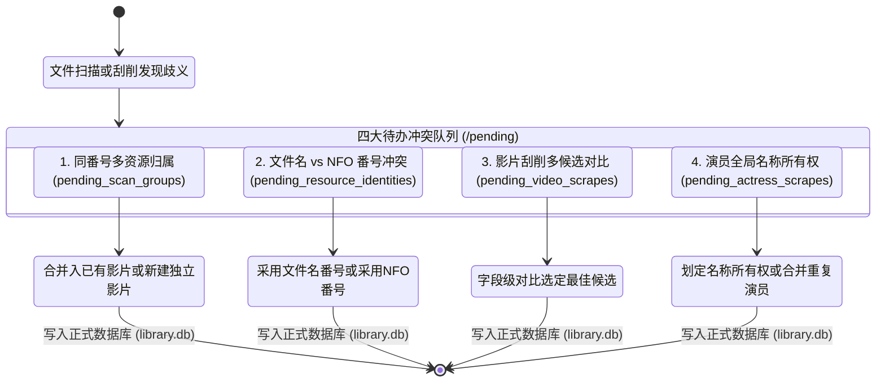

在影片整理过程中，歧义、重名、外部 NFO 与文件名冲突是不可避免的。常规软件往往选择“强行覆盖”或“盲目拆分”，极易导致资料混乱。

Javdex 引入了**待办中心（Pending Center，位于导航栏 `/pending`）**，将所有无法 100% 自动裁决的事项收拢至统一的任务队列中，等待用户集中决策。

---

## 为什么需要“待办中心”？

待办中心的核心原则是：**宁可挂起等待人工拍板，绝不静默张冠李戴**。

---

## 队列一：同番号多资源归属确认 (`pending_scan_groups`)

### 产生原因
当媒体库设置中关闭了“自动合并同番号资源”，或者扫描器发现同一目录下存在多个相同番号的视频（如 `SSIS-001_A.mp4` 与 `SSIS-001_B.mp4`），且无法明确它们是分段文件还是两个不同版本时，资源会被放入此队列。

### 消解操作
在“待办中心 -> 扫描资源”面板中，你会看到按番号聚合的文件组：
- **合并到已有影片**：将这批文件作为新的关联资源挂载到库内已有同番号影片下，并选定主资源。
- **各自新建独立影片**：将它们拆分为独立的影片条目。
- **挑选并丢弃无用文件**：若其中包含损坏文件或低画质副本，可直接勾选丢弃。

---

## 队列二：文件名与本地 NFO 番号冲突 (`pending_resource_identities`)

### 产生原因
如果开启了“读取本地已有的 NFO”，当扫描器发现视频文件的文件名提取出的番号（如 `IPX-123.mp4`）与同目录同名 NFO 文件内的 `<num>` 或 `<id>` 标签值（如 `IPX-456`）不相同时，系统拒绝胡乱入库，直接记录进 `pending_resource_identities` 表。

### 消解操作
在待办面板中会并排展示两项信息：
- **以文件名为准**：丢弃 NFO 内的冲突番号，使用文件名识别的番号新建影片，并可在后续重新联网刮削。
- **以本地 NFO 为准**：采用 NFO 内部记录的番号，并立即触发对该 NFO 全文（标题、简介、演职员）的解析入库。
- **丢弃**：暂时忽略该文件。

---

## 队列三：影片刮削多候选与业务身份冲突 (`pending_video_scrapes`)

### 产生原因
1. **多候选歧义**：从刮削插件返回了多个不同作品的匹配结果（如番号重名或衍生作）。
2. **唯一业务身份冲突**：Javdex 在数据库中为 `(发行商, 番号, 发行日期)` 建立了唯一业务身份索引（`idx_videos_business_identity`）。若刮削返回的元数据与库内已有另一部影片发生冲突，系统会暂存至 `pending_video_scrapes`。

### 消解操作
- **字段级并排对比**：系统会列出各个候选作品的封面缩略图、标题、导演、发行商与发行日期。点击选定你认可的正确版本后提交即可。
- **多来源字段挑选**：若多插件返回不同侧重点的数据，可在预览面板中指定以哪个来源的字段为准。

---

## 队列四：演员名称与别名所有权冲突 (`pending_actress_scrapes`)

### 产生原因
Javdex 对演员名称实行严格的**全局唯一所有权（Global Name Ownership）**。当某次刮削为“演员 A”抓取到中文名、英文名或别名，而该名字在库内已经被“演员 B”所拥有或声明占用时，系统会立即阻断静默关联，将下载的头像及写真暂存至 `.pending_actress_scrapes/` 临时目录，并挂起冲突。

### 三步消解工作流
在“待办中心 -> 演员冲突”页面，提供了清晰的三步引导：
1. **第一步：选定名称归属人**：选择该名字究竟属于哪一位演员。
2. **第二步：核对来源与履历**：查看两位演员的出道日期、出演作品与头像，核查是否为同一人不同时期的艺名。
3. **第三步：预览影响并提交**：
   - **如果确实是两个人（同名/艺名重合）**：将争议别名判给其中一人，另一人放弃该别名。
   - **如果其实是同一个人（曾用名/改名）**：直接点击 **“合并演员”**，系统会将作品、写真、别名自动合并为同一条权威档案，并清理多余的记录。
