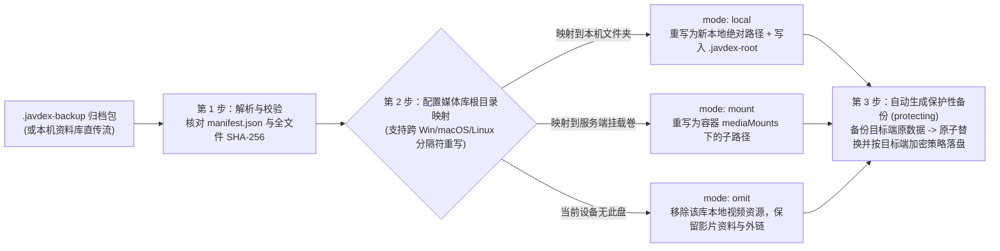

Javdex 提供了平台无关、可验证的资料库备份与迁移机制（`packages/library/src/backup/catalogBackup.ts`）。无论是更换新电脑、在 Windows / macOS / Linux 之间跨系统迁移，还是在桌面本地模式与 NAS Docker 服务端之间双向转移数据，均可通过 `.javdex-backup` 归档包或“从本机资料库直接导入”安全完成。

---

## `.javdex-backup` 备份包包含什么、不包含什么？

`.javdex-backup` 本质上是一个遵循 `formatVersion: 1` 规范的流式 `.tar.gz` 归档包。它在打包时会对数据库进行脱敏净化，并将所有受管图片统一还原为明文，确保跨设备、跨操作系统百分之百可移植：

| 数据与文件类别 | 是否纳入备份 | 源码级处理规则与说明 |
| :--- | :---: | :--- |
| **主资料库 (`catalog/library.db`)** | ✅ **包含** | 使用 SQLite `VACUUM INTO` 生成一致性快照，**自动剥离**远程设备授权凭证（`catalog_writer_credentials` 等）、待办冲突队列（`pending_*`）、进行中的扫描任务以及临时导入账本。 |
| **正式关联图片 (`images/<subdir>/<sha256>.<ext>`)** | ✅ **包含** | 仅打包被影片、演员、分类或清单正式引用的图片（`covers`、`samples`、`avatars`、`avatar_sources`、`actress_gallery`、`playlists`、`classifications`）。**若源端开启了 AES-256-GCM 图片加密，导出时会自动解密还原为明文图片**，并以内容 SHA-256 重命名去重。 |
| **归档校验清单 (`manifest.json`)** | ✅ **包含** | 记录源平台、应用版本、Schema 版本（`21`）、各媒体库名称与根目录列表、影片/演员/清单统计计数，以及 `library.db` 和每张图片的精确字节数与 SHA-256 哈希。 |
| **原始视频文件与 `.strm` 文件** | ❌ **不包含** | 庞大的视频实体文件留在原磁盘中；备份仅保存数据库中的相对路径与根目录映射关系。 |
| **应用与本机配置 (`settings.json` / `this-computer.json`)** | ❌ **不包含** | 刮削规则、代理设置、播放器偏好、防窥开关等本机设置不随资料库备份迁移。 |
| **本机密钥与连接凭据 (`*.secrets.json` / `.media_assets_key`)** | ❌ **不包含** | API Key、MetaTube Token、远程服务端证书指纹与本机图片加密主密钥均严格留在本机。目标端恢复图片时会按目标端自身的加密开关决定是否重新加密。 |
| **本机续播进度与“最近播放”** | ❌ **不包含** | `playback-progress.json` 与最近播放列表仅属于当前电脑，不纳入资料库备份。 |
| **Agent 工作台记录 (`desktop-work.db`) 与自定义插件** | ❌ **不包含** | Agent 会话草稿留在本机；自定义刮削插件可通过 `.avscraper.json` 单独导出分享。 |
| **本地 AI 模型 (`local-ai/`) 与 AI 字幕缓存** | ❌ **不包含** | Kotoba Whisper、HY-MT2 / Qwen3 模型权重与 `ai-subtitle-cache/` 不随备份打包。 |

---

## 创建备份与缺失图片确认机制 (`awaitingImages`)

前往 **“设置 -> 存储 -> 备份与恢复”**，点击 **“创建备份”**：

1. **数据库快照与图片引用盘点**：
   - 导出工作进程首先将当前数据库安全快照至临时工作区，并扫描所有正式表引用的图片路径。
2. **缺失图片确认拦截（`awaitingImages`）**：
   - 如果系统发现数据库记录的某张封面或头像在磁盘 `media_assets/` 中物理缺失，备份任务不会静默生成残缺包，也不会直接报错退出，而是暂停在 **`awaitingImages`** 状态。
   - 界面会明确列出缺失图片的数量与样例路径，由你选择：
     - **“跳过缺失图片并继续导出”**：自动将数据库中指向缺失图片的字段置为 `NULL` 后完成干净打包。
     - **“取消备份”**：先排查或修复图片目录后再重新备份。
3. **流式写出归档**：
   - 确认后，系统生成 `<目录>/javdex-backup-<时间戳>.javdex-backup` 文件。

---

## 三步恢复向导与跨平台路径重映射

当你拿到一份来自其他操作系统或 NAS 的 `.javdex-backup` 归档包时，点击 **“恢复备份”**，系统会启动安全的三步恢复向导：

### 1. 第一步：归档完整性预检 (`inspect`)
- 恢复引擎在解压阶段会严格检查：归档条目数上限、单文件与总解压体积上限（防止压缩炸弹）、拒绝任何符号链接或路径穿越，并对 `catalog/library.db` 及每一张图片逐字节比对 `manifest.json` 中的 SHA-256 哈希。
- 若备份包来自旧版本（但 Schema $\le 21$），恢复引擎会在隔离临时库中自动执行 Schema 迁移并验证外键完整性。

### 2. 第二步：为每个媒体库配置根目录映射 (`rootMappings`)
备份包中记录了源端每个媒体库的原始根目录路径（例如 Windows 上的 `D:\Movies\JAV` 或 NAS 上的 `/media/movies`）。在恢复向导中，你可以为每个原根目录指定三种转换策略之一：

- **`local`（映射到本机目录，仅桌面本地模式可用）**：
  - 选择当前电脑上的新文件夹（如 `/Volumes/SSD/JAV`）。
  - 转换引擎会自动将该根目录下所有视频资源（`video_resources`）与 `.strm` 相对路径的分隔符（`\` $\leftrightarrow$ `/`）重写为目标系统的原生路径格式，并在新目录写入 `.javdex-root` 标记。
- **`mount`（映射到服务端挂载卷，仅远程服务端模式可用）**：
  - 选择服务端 `/config/server.json` 中配置的 `mediaMounts` 挂载名（如 `movies`）及可选的相对子目录，自动将原本机路径重写为容器内的挂载路径。
- **`omit`（忽略此根目录）**：
  - 如果某个媒体库所在的移动硬盘暂未接入或无需在目标端访问本地视频，可选择忽略该根目录。
  - 系统会自动剔除该根目录下的本地文件资源引用，但**完整保留影片的番号、标题、封面、演员与网络外链资料**（变为无本地资源的纯资料条目）。

### 3. 第三步：保护性备份 (`protecting`) 与原子替换
- **自动保护性快照**：在正式覆盖目标端现有的资料库之前，恢复引擎会先进入 **`protecting`** 阶段，自动将目标端当前的数据库与图片完整打包为一份保护性 `.javdex-backup`（桌面端保存在目标备份目录，服务端保存在 `/data/.javdex-restore-backups/`，最多保留最近 3 份）。
- **原子激活**：只有当保护性备份成功落盘后，系统才会将新数据库与图片切换上线。若恢复中途遭遇断电或磁盘已满，原资料库完好无损。

---

## 远程模式专属：一键“从本机资料库直接导入”

如果你此前在个人电脑上使用“桌面本地模式”整理好了资料库，现在刚部署好 Docker 独立服务端，无需手动导出文件再上传：

1. 在桌面端切换至“远程资料库”并完成配对连接。
2. 前往 **“设置 -> 存储 -> 备份与恢复”**，点击 **“从本机资料库直接导入”**。
3. 桌面端会自动读取本机 `<userData>` 下的本地资料库，生成临时归档并通过 HTTPS 流式传输给服务端（支持 `8 MiB` 分块断点续传）。
4. 在弹出的根目录映射向导中，将电脑上的盘符映射为容器的 `mount` 挂载卷路径，确认后即可一键将本机资料库完整克隆至 NAS 服务端，同时**电脑上的原本地资料库依然完整保留**。
