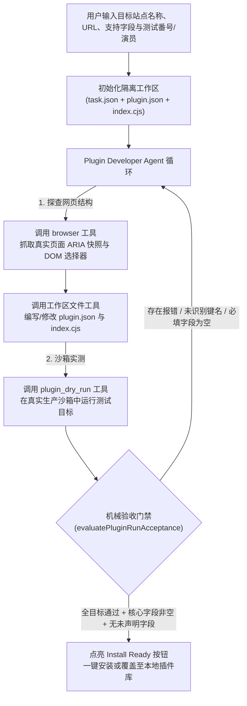

Javdex 的元数据刮削能力建立在完全开放、沙箱隔离的插件体系之上（`apps/desktop/src/main/scrapers/scraperPluginSandbox.ts`）。除了内置的 5 款插件（`JavDB`、`JavLibrary`、`MetaTube`、`Xslist`、`Gfriends`），任何用户都可以通过标准规范编写插件，或直接使用内置的 **“刮削插件开发助手 Agent”** 与外部 **MCP Server** 让大模型自动完成网页探查、代码生成与机械验收。

---

## 插件包结构与导入导出格式

### 1. 运行时目录结构（`plugin.json` + `index.cjs`）
在 `<userData>/scraper_plugins/{video,actress}/<dir>/` 或内置 `bundled-plugins/{video,actress}/<dir>/` 下，每个插件由清单文件 `plugin.json` 与 CommonJS 入口文件 `index.cjs` 组成：

```json
{
  "schemaVersion": 1,
  "kind": "video",
  "name": "JavDB",
  "version": "1.2.0",
  "description": "从 JavDB 抓取影片详情、演员、评分与样张",
  "author": "Javdex",
  "homepage": "https://javdb.com",
  "supportedFields": [
    "title",
    "summary",
    "cover",
    "releaseDate",
    "maker",
    "publisher",
    "series",
    "director",
    "duration",
    "actressesFemale",
    "actressesMale",
    "tags",
    "source",
    "rating",
    "samples"
  ],
  "entry": "index.cjs"
}
```

#### 清单字段约束（`StoredPluginManifest`）：
- **`schemaVersion`**：固定为 `1`。
- **`kind`**：`'video'`（影片刮削器，最多支持上述 15 个字段）或 `'actress'`（演员刮削器，支持 `avatar`, `gallery`, `birthDate`, `nameZh`, `nameEn`, `debutDate`, `heightCm`, `measurements`, `cupSize`, `bloodType`, `zodiac`, `nationality`, `profileSummary`, `aliases` 共 14 个字段）。
- **`entry`**：必须为相对安全文件名（默认 `"index.cjs"`）。
- **`serviceBinding`**（可选）：仅内置 `MetaTube` 插件允许声明 `"metatube"` 以绑定宿主配置的服务端。

### 2. 单文件导入导出包（`<name>.<kind>.avscraper.json`）
在“设置 -> 刮削插件”中点击导出或导入时，系统使用单文件 JSON 封装（`ScraperPluginPackageExport`），内含 `schemaVersion: 1`、`manifest` 元数据以及完整的 `code` 源码字符串。导入时系统会先在沙箱中执行 `validate` 语法与导出契约自检，通过后才落盘激活。

---

## 沙箱运行时与 `ctx` API 完整参考

所有刮削插件均运行在 **`worker_threads` + Node.js `vm.createContext`** 双层隔离沙箱中：
- **安全封锁**：沙箱内显式禁用 `require`（仅允许加载 `cheerio` 或 `cheerio/slim`）、`process`、`fs`、`fetch`、`Buffer`、`WebSocket`、`Function` 构造器及动态 `import()`。
- **超时门禁**：顶层模块加载限时 `1,000ms`；`validate` 校验模式限时 `10,000ms`；`parse` 抓取模式限时 `300,000ms`（5 分钟）。

插件入口 `index.cjs` 必须通过 `module.exports` 导出一个异步函数（或 `{ parse(ctx) }` 对象）：

```javascript
module.exports = async function (ctx) {
  const { code } = ctx.input; // video 插件读取 ctx.input.code；actress 插件读取 ctx.input.mainName, ctx.input.aliases
  const html = await ctx.fetchPage(`https://example.com/search?q=${encodeURIComponent(code)}`, {
    readySelector: '.movie-list',
    timeoutMs: 25000
  });
  const $ = ctx.cheerio.load(html);
  // 解析并返回候选或精确匹配结果...
};
```

### `ctx` 上下文对象完整 API 表

| 属性 / 方法签名 | 适用范围 | 具体行为说明 |
| :--- | :--- | :--- |
| **`ctx.kind`** | 通用 | `'video'` 或 `'actress'`。 |
| **`ctx.pluginName`** | 通用 | 当前插件名称。 |
| **`ctx.proxyUrl`** | 通用 | 用户在“设置 -> 网络”中配置的代理地址（若未配置则为 `undefined`）。 |
| **`ctx.input`** | 通用 | 影片插件为 `{ code: string }`；演员插件为 `{ mainName: string, aliases: string[] }`。 |
| **`ctx.cheerio`** | 通用 | 注入的 `cheerio/slim` 实例，用于解析 HTML DOM。 |
| **`ctx.fetchPage(url, options?)`** | 通用 | 通过受控刮削浏览器拉取渲染后的页面 HTML。支持 `{ readySelector?: string, timeoutMs?: number, settleWhenText?: RegExp }`。 |
| **`ctx.fetchBuffer(url, options?)`** | 通用 | 直接发起 HTTP GET 拉取二进制/文本资源，返回 `{ status, url, headers, bodyText, json() }`。支持配置持久化磁盘缓存 `{ cache: { mode: 'persistent', maxAgeMs, staleIfError } }`（上限 `64 MiB`，保存在 `scraper_resource_cache/`）。 |
| **`ctx.browser`** | 通用 | 交互式无头浏览器控制接口：支持 `.snapshot(url?, opts?)`、`.click(ref)`、`.type(ref, text, submit?)`、`.press(key)`、`.waitForSelector(sel, timeoutMs?)`、`.wait(ms)`、`.inspect(opts?)`、`.html()`、`.url()`。 |
| **`ctx.helpers`** | 通用 | 内置清洗辅助工具集：<br/>- `absoluteUrl(baseUrl, maybeRelative)`<br/>- `normalizeDate(text)`（提取 `YYYY-MM-DD`）<br/>- `normalizeText(text)`（合并多余空白）<br/>- `unique(list)`（数组去重去空） |
| **`ctx.service`** | 仅 `serviceBinding` | 访问宿主配置的私有刮削服务（如 MetaTube）：提供 `.id`、`.baseUrl`、`.keepFirstCandidate` 及 `.getJson(path, { query?, timeoutMs? })`。 |

---

## 使用内置“刮削插件开发助手 Agent”与机械验收门禁

前往 **“设置 -> 刮削插件 -> 开发新插件”**（或编辑现有自定义插件），即可打开内置的 AI 插件开发工作台（`apps/desktop/src/main/services/pluginDevAgent/`）。



### 什么是“机械验收门禁”（`pluginRunAcceptance.ts`）？
为了杜绝大模型“写出看似合理但实际跑不通的代码”，Javdex **不允许 Agent 自己宣布开发完成**，而是由宿主代码对最后一次 `plugin_dry_run` 的真实沙箱输出执行硬性机械校验：
1. **代码未发生事后篡改**：当前工作区的 `plugin.json` 与 `index.cjs` 必须与最近一次 `plugin_dry_run` 执行时的代码完全一致（防止改完代码不跑测试直接交差）。
2. **全部测试目标零报错**：所有测试番号（`videoCodes`）或测试演员（`actresses`）必须全部返回 `ok: true`。
3. **零非法返回字段**：`unrecognizedResultKeys` 必须为空，且插件返回的每个有效字段都已在 `plugin.json` 的 `supportedFields` 中声明。
4. **核心业务字段非空**：
   - `video` 插件若声明了 `title` 或 `cover`，在所有测试番号上必须实际抓取到非空值。
   - `actress` 插件必须至少抓取到一个已声明的非空字段。

只有上述机械断言 100% 通过后，界面右上角的 **“安装插件”** 按钮才会解锁点亮。

---

## 使用外部 MCP Server (`npm run mcp:plugin-dev`)

如果你习惯在 Cursor、Claude Code 或其他支持 MCP（Model Context Protocol）的外部 AI 编程工具中开发插件，Javdex 提供了标准 stdio MCP 服务（`apps/desktop/src/mcp/javdex-plugin-dev-server.ts`）：

```bash
# 通过环境变量指定开发目标并启动 MCP Server
AV_PLUGIN_DEV_KIND=video \
AV_PLUGIN_DEV_SITE_NAME="MySite" \
AV_PLUGIN_DEV_SITE_URL="https://example.com" \
AV_PLUGIN_DEV_SUPPORTED_FIELDS="title,cover,releaseDate,actressesFemale,tags" \
AV_PLUGIN_DEV_TEST_TARGETS="SSIS-001,IPX-123" \
npm run mcp:plugin-dev
```

MCP Server 会向外部客户端暴露与内置 Agent 完全同源的三大核心工具：
- **`plugin_dry_run`**：按生产沙箱运行当前工作区插件，返回 `pluginResult`、`effectiveResult`、`manifestCoverage`、`unrecognizedResultKeys` 及沙箱日志。
- **`browser`**：驱动受控浏览器执行页面导航、点击、输入、等待选择器与 DOM 局部探查。
- **`ask_user`**：当遇到站点多候选歧义或登录验证时，向开发者发起结构化提问。
