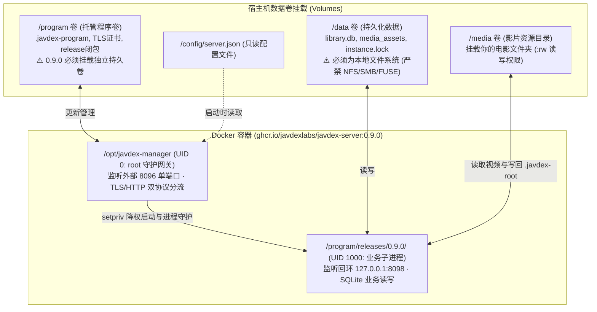

将 Javdex 部署在 NAS（群晖、威联通、Unraid、TrueNAS、极空间、绿联）或常开的家用 Linux 服务器上，可以让服务器 24 小时在后台持续监控文件夹并提供局域网访问，电脑无需整天开机。

`0.9.0` 版本引入了全新的**容器内托管管理器架构**，只需单个 Docker 容器即可提供完整服务与无缝热升级。

---

## 容器架构与三卷模型

Javdex 官方镜像（`ghcr.io/javdexlabs/javdex-server:0.9.0`）内部采用双层进程设计，并严格依赖三个独立的数据卷挂载：



### 为什么 0.9.0 必须挂载 `/program` 卷？
在早期的 0.8.0 版本中，服务程序直接固定在只读镜像内部。从 **0.9.0** 开始，为了支持直接在桌面客户端一键上传 `.javdex-update` 包执行零停机无缝升级，容器管理器需要将可执行程序闭包部署在独立的 `/program` 卷中。**未挂载 `/program` 卷的容器将无法保存升级状态和 TLS 自签名证书**。

---

## 挂载目录与文件系统硬性要求

:::danger[核心安全红线：/data 卷严禁使用网络挂载]
Javdex 在服务端底层使用 SQLite WAL 高性能并发模式。网络文件系统（如 NFS、CIFS、Samba、FUSE、9P 等）在处理底层文件锁（POSIX `flock` / `fcntl`）时存在严重的延迟与不一致缺陷，极易造成数据库死锁或永久性损坏。
源码在启动时通过系统调用 `statfs` 进行了代码级强校验：
- 若检测到 `/data` 所在文件系统为 NFS (`0x6969`)、CIFS (`0xff534d42`)、SMB (`0x517b`)、FUSE (`0x65735546`) 或 9P (`0x1021997`)，**服务将直接报错拒绝启动**！
- `/data` 必须挂载在 NAS 或宿主机的**本地物理磁盘分区**（如 ext4、btrfs、ZFS、APFS、NTFS 等本地存储池）上，且要求至少有 `64 MiB` 的剩余空间。
:::

### 媒体目录权限要求（`:rw` 读写挂载）
- `/media` 下的各个视频目录在 Docker 中必须以读写模式挂载（`:rw`）。
- 扫描器在初次建库时，需要在每个媒体库根目录写入一个微小的 `.javdex-root` 标识文件以追踪设备身份；如果后续需要执行 NFO 导出或文件重命名，同样需要写权限。

### 用户权限匹配（UID / GID）
- 容器内的业务进程默认降权至 UID `1000`、GID `1000`（`node:node`）运行。
- 请确保宿主机上映射到 `/data` 与 `/media` 的文件夹，允许 UID `1000` 进行读写。你也可以通过环境变量 `JAVDEX_SERVER_UID` 与 `JAVDEX_SERVER_GID` 自定义目标用户 ID。

---

## 标准配置范例

建议使用 `docker-compose` 进行编排部署。

### 1. `docker-compose.yml` 配置文件
新建一个目录（如 `/opt/javdex`），创建 `docker-compose.yml`：

```yaml
services:
  javdex:
    image: ghcr.io/javdexlabs/javdex-server:0.9.1
    container_name: javdex-server
    restart: unless-stopped
    stop_grace_period: 150s # 预留充裕时间让容器优雅停服保存数据库
    ports:
      - "8096:8096"
    volumes:
      # 1. 核心数据卷（必须位于本地存储池，严禁 NFS/SMB）
      - ./data:/data
      # 2. 0.9.0 全新程序管理卷（存放业务程序闭包与 TLS 证书）
      - ./program:/program
      # 3. 配置文件目录
      - ./config:/config:ro
      # 4. 你的视频媒体目录（根据实际路径修改，确保拥有读写权限）
      - /volume1/video:/media/movies:rw
    environment:
      # 必填：改为桌面客户端可访问且在 accessHosts 中的 HTTPS 根地址
      - JAVDEX_PUBLIC_URL=https://192.168.1.100:8096
      # 可选：指定宿主机文件所有者 UID/GID
      - JAVDEX_SERVER_UID=1000
      - JAVDEX_SERVER_GID=1000
      # 可选：媒体目录另有组权限时，填写实际附加 GID；空配置不继承管理器组
      # - JAVDEX_SERVER_GROUPS=101,100
      # 首次配置局域网 Web 登录密码（12 ~ 128 位）
      - JAVDEX_WEB_PASSWORD=YourStrongPassword123
```

### 2. `/config/server.json` 配置文件
在 `./config` 目录下创建 `server.json`：

```json
{
  "listenHost": "0.0.0.0",
  "port": 8096,
  "accessHosts": [
    "127.0.0.1",
    "localhost",
    "192.168.1.100",
    "nas.local"
  ],
  "dataDir": "/data",
  "imagesDir": "/data/media_assets",
  "mediaMounts": {
    "movies": "/media/movies"
  },
  "web": {
    "username": "admin"
  }
}
```

#### 关键字段释义：
- **`accessHosts`**（必填）：允许通过 HTTP/HTTPS 访问此服务的主机名或局域网 IP 列表。请务必将你的 NAS 局域网 IP（如 `192.168.1.100`）填入，否则跨设备请求会被反代网关安全拦截。
- **`mediaMounts`**：容器内媒体目录的映射标识字典。将 `movies` 映射至容器路径 `/media/movies`，后续桌面端远程建库时即可直接点选。

---

## 启动容器与健康检查验证

在 `docker-compose.yml` 所在目录执行：

```bash
docker compose up -d
```

### 检查运行日志
查看服务启动日志：
```bash
docker logs -f javdex-server
```
正常情况下，你会看到守护管理器顺利接管、TLS 自签名证书自动生成并输出类似日志：
```text
[manager] Listening on 0.0.0.0:8096 (Dual TLS/HTTP Gateway)
[business] Database initialized at /data/library.db (Schema 21)
[business] Server ready.
```

### 验证健康检查探针
在局域网内任意终端执行验证：
- **环境探针（HTTPS）**：
  ```bash
  curl -k https://192.168.1.100:8096/runtime/v1/info
  ```
  应返回包含 `{"format":1,"runtimeId":"node22-bookworm-v1"}` 的 JSON 响应。
- **存活探针**：
  ```bash
  curl http://192.168.1.100:8096/live
  ```
  应返回 `ok`。
