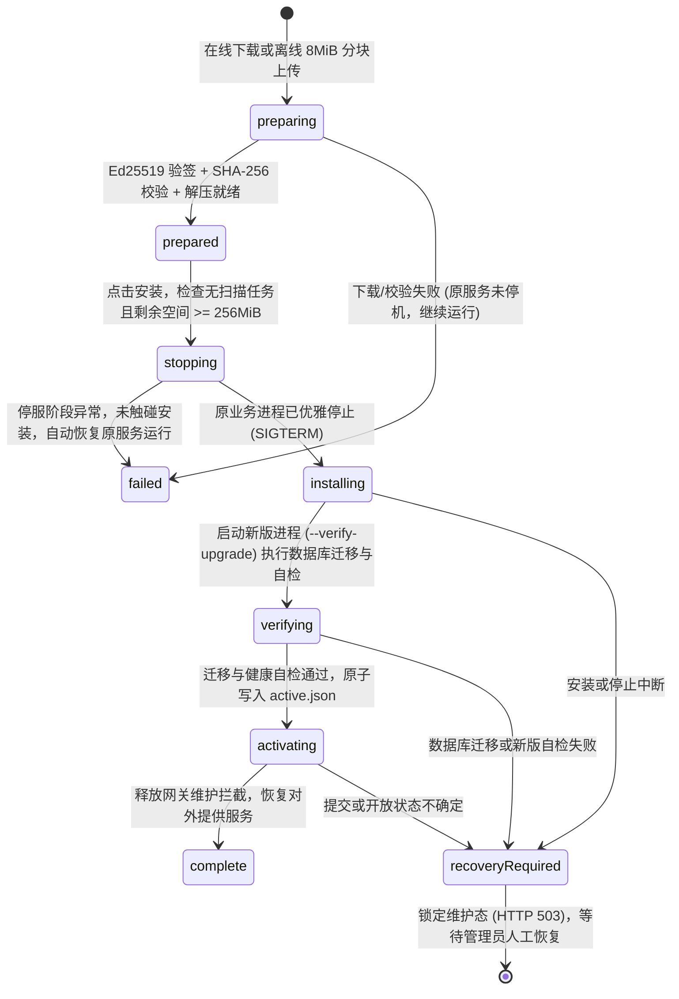

Javdex 独立服务端采用了**两层生命周期分离**的设计：容器基础镜像（`/opt/javdex-manager` 守护网关与 `node22-bookworm-v1` 基础运行环境）保持极简与长效稳定，而核心业务服务（驻留在独立挂载的 `/program` 卷中）支持应用内直接受控升级。

这使得用户无需频繁销毁容器，即可在已授权的桌面管理端一键平滑完成服务端业务版本迭代，或通过更换更高业务版本的 Docker 镜像自动完成升级。

---

## 理解两种服务端更新路径

在日常运维中，服务端更新支持两种互补路径：

| 维度 | 路径一：应用内托管更新（`.javdex-update`） | 路径二：更换更高版本的 Docker 镜像 |
| :--- | :--- | :--- |
| **操作介质** | 官方 Release 签名的 `.javdex-update` 升级包（在线获取或离线上传） | `docker pull ghcr.io/javdexlabs/javdex-server:<version>` |
| **生效范围** | 更新 `/program/releases/<version>` 中的业务代码并切换激活指针 | 同时更新 `/opt/javdex-manager` 守护网关、运行环境与镜像内置种子 `/app` |
| **触发条件** | 桌面客户端版本高于服务端当前业务版本，且 `environmentVersion` 兼容 | 新镜像内置 `/app` 的业务版本严格高于 `/program` 当前版本（同版本或更旧镜像不会降级） |
| **操作终端** | 桌面端 **“设置 -> 存储 -> 资料库模式 -> 服务端更新”** | NAS 命令行、Docker Compose 或容器管理面板 |
| **适用场景** | 运行环境版本（`SERVER_ENVIRONMENT_VERSION = 1`）不变时的常规版本迭代 | 首次从 0.8.0 升级至 0.9.0、Node.js 运行时升级或管理器网关升级 |

:::caution[更新前必须手动备份]
**无论是应用内托管更新还是更换 Docker 镜像，服务端更新均不会自动创建资料库备份！**
升级可能会自动将 `/data/library.db` 迁移至新 Schema（如 Schema 21）。请务必在点击“开始安装”或更换镜像前，先通过桌面端“备份与恢复”导出 `.javdex-backup` 备份包，或停服备份 `/data` 与图片目录。
:::

---

## 方式一：在桌面端执行在线更新或离线断点上传

当你先将桌面客户端升级到新版本（例如 `0.9.0`）并连接至旧版服务端时，前往 **“设置 -> 存储 -> 资料库模式 -> 服务端更新”**。

客户端只允许将服务端更新至**与当前桌面客户端完全一致的目标版本**（`requireTargetVersion` 强校验）：

### 1. 在线拉取准备（Online Prepare）
1. 点击 **“检查并准备更新”**，客户端会向 GitHub Releases API 查询与当前桌面端同版本、同架构（`linux/amd64` 或 `linux/arm64`）的 `.javdex-update` 签名清单。
2. 服务端管理器验证 Ed25519 签名（公钥位于 `/opt/javdex-manager/release-keys.json`）、运行环境兼容性（`node22-bookworm-v1`）及 `/program` 剩余空间（需 $\ge \text{压缩包体积} + \text{解压体积} + 256\text{ MiB}$）。
3. 校验通过后，服务端后台自动下载归档、核对 SHA-256 摘要并解压至 `/program/releases/<version>`，任务状态变为 `prepared`（已就绪）。
4. 点击 **“安装更新”**，即可触发停服切换与数据库迁移验证。

### 2. 离线升级包 8 MiB 分块断点续传（Offline Upload）
对于无法直接连接 GitHub 的内网 NAS，可先在电脑浏览器前往 [下载中心](/Javdex/download/) 下载对应架构的 `Javdex-server-<版本>-linux-<架构>.javdex-update` 单文件包：
1. **文件格式解析**：桌面端自动解析文件头部的 `JVDXUPD1` 8 字节魔数与 Ed25519 签名清单，并向服务端发起 `beginOffline` 请求。
2. **8 MiB 分块流式上传**：桌面端将归档切分为最大 `8 MiB`（`8 * 1024 * 1024` 字节）的数据块，通过同一个 `8096` HTTPS 端口顺序上传并调用 `fsync` 落盘（**无需额外开放独立更新端口**）。
3. **断点续传支持（`resumableUpload`）**：若上传中途网络断开或关闭了桌面端，已上传字节会保存在 `/program/state/jobs/<jobId>/release.tar.gz` 中。重新选择同一个 `.javdex-update` 文件即可直接从上次的 `receivedBytes` 偏移量继续上传。
4. **验签与安装**：分块全部收齐并通过 SHA-256 与文件级清单校验后，状态进入 `prepared`，点击 **“安装更新”** 即可完成升级。

---

## 方式二：什么时候必须更新 Docker 镜像？

应用内 `.javdex-update` 升级包仅更新 `/program` 卷内的业务进程，**不会更新容器内的 `/opt/javdex-manager` 守护管理器或底层系统环境**。在以下情形下，你必须通过更新 Docker 镜像来升级：

1. **首次从 `0.8.0` 升级至 `0.9.0+`**：`0.8.0` 容器不包含托管更新管理器，必须停服备份、挂载 `/program` 卷并拉取 `0.9.0+` 镜像。
2. **运行环境版本提升**：当新版本要求的 `environmentVersion` 高于当前容器管理器的 `SERVER_ENVIRONMENT_VERSION`（当前为 `1`）或 `runtimeId`（`node22-bookworm-v1`）发生变更时，桌面端会明确提示“需要升级 Docker 镜像”。
3. **自动镜像种子升级**：当容器使用更高业务版本的镜像重启时，`/opt/javdex-manager` 会自动检测镜像内置 `/app` 的版本高于 `/program` 当前版本，并在启动时自动执行 `installImage` 升级与迁移验证（每个镜像 SHA-256 仅自动尝试一次，记录在 `/program/state/image-attempts.json`）。

---

## 更新九阶段状态机与 `recoveryRequired` 维护态

服务端更新全流程由 `ServerUpdateManager`（`apps/server/src/updater/updateManager.ts`）严格按照 `UPDATE_PHASES` 九个状态演进：



### 安全边界：为什么 `installing` 之后失败不自动回退？

1. **停服前或 `stopping` 阶段失败（自动恢复原服务）**：
   - 在 `preparing`、`prepared` 或 `stopping` 阶段（即尚未启动新版代码接触 `/data/library.db` 之前），若发生任何错误，管理器会自动重新拉起原有的旧版业务进程，状态记为 `failed`，服务不受影响。
2. **进入 `installing` / `verifying` / `activating` 后失败（锁定 `recoveryRequired`）**：
   - 一旦进入 `installing` 阶段，新版进程可能已经对 `/data/library.db` 执行了不可逆的 SQLite Schema 迁移（如 Schema 19 $\to$ 21）。
   - 如果此时强行用旧版程序重新打开已被部分迁移或升级的数据库，极易造成数据表损坏或静默逻辑错误。
   - 因此，管理器会立即停止业务子进程，将状态持久化为 **`recoveryRequired`**，对外所有业务与 Web 请求统一返回 `503 Service Unavailable（服务端正在升级维护中）`，严禁自动回退。

### `recoveryRequired` 维护态人工恢复步骤

当桌面端或容器日志提示服务端处于 `recoveryRequired` 状态时，请按以下步骤安全恢复：

1. **查看容器日志定位原因**：
   ```bash
   docker logs javdex-server
   ```
   核对是磁盘空间不足、权限错误还是断电中断。
2. **停止容器并保护现场**：
   ```bash
   docker compose stop
   ```
   先将当前的 `/data` 与 `/program` 目录完整复制一份留作现场备份。
3. **选择恢复方向**：
   - **若希望退回升级前的旧版本**：将升级前备份的 `/data` 数据库与图片还原，清理 `/program/state/current.json`（或重建 `/program` 卷），使用旧版本镜像启动。
   - **若已排除环境故障（如清理了磁盘空间、修复了目录权限）并希望完成新版升级**：使用目标新版本的官方 Docker 镜像，配合干净的 `/program` 卷重新启动容器，让新版镜像直接完成数据接管与验证。
