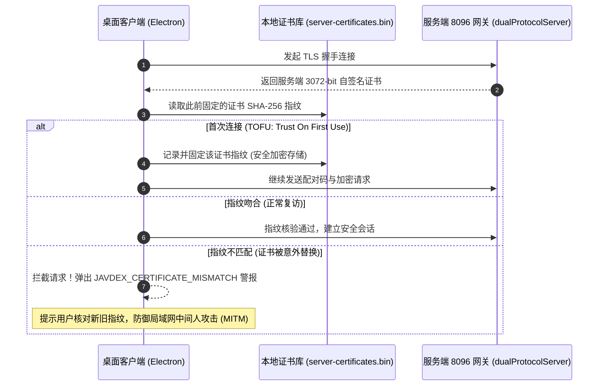

Docker 服务端启动后，你需要使用电脑上的 Javdex 桌面客户端与其连接，以获得对资料库的管理和写入权限。

`0.9.0` 版本全面升级为**基于 TLS 的端到端多可信设备授权协议（Schema 21）**，允许多台电脑并发连接同一服务端，并具备代码级安全的自签名证书固定（Pinning）保护。

---

## 单端口双协议网关机制 (`8096`)

Javdex 服务端在对外暴露的单一端口（默认 `8096`）上实现了创新的**双协议自动探针分流**：

- **HTTPS 表面（`https://<IP>:8096`）**：
  - 专门服务于**桌面客户端**的管理操作、媒体流播放（`PlayGrant`）以及升级包上传。
  - 所有需要修改资料库的 API 必须在 HTTPS 下进行，受 Ed25519 / HMAC-SHA256 令牌鉴权保护。
- **HTTP 表面（`http://<IP>:8096`）**：
  - 专门开放给局域网内的手机、平板与电视**浏览器**进行只读浏览。
  - 网关在检测到明文 HTTP 请求时，会强制拦截所有可能修改数据库的管理接口，确保只读安全性。

---

## 启动与设备授权

要在你的电脑桌面端与 NAS 服务端建立信任连接，需要通过容器内的命令行签发一次性授权配对码：

### 1. 签发一次性授权 Token
在 NAS 宿主机或通过 SSH 终端执行以下命令：

```bash
docker exec javdex-server node /opt/javdex-manager/index.js token --config /config/server.json
```

系统会输出类似如下内容：
```text
一次性配对代码 (10 分钟内有效):
a1b2c3d4e5f6... (64 位十六进制字符)
```

### 2. 在桌面客户端完成首次连接
1. 打开电脑上的 Javdex 桌面客户端。
2. 前往 **“设置 -> 存储 -> 资料库模式”**，点击 **“连接到远程资料库”**。
3. 填入服务端地址与刚刚获取的配对码：
   - **服务地址**：输入完整的 HTTPS 地址，如 `https://192.168.1.100:8096`。
   - **一次性配对码**：粘贴那串 64 位的配对字符。
4. 点击 **“验证并连接”**。
5. 验证成功后，系统会提示需要重启桌面应用。重启后，你的桌面客户端就正式接管了该远程服务端，左下角会显示“已连接远程资料库”状态！

---

## TLS 自签名证书首次信任与指纹固定 (TOFU Pinning)

为了省去为局域网内网 IP 申请公网 SSL 证书的繁琐流程，容器管理器在初次启动时，会自动生成一张 3072 位的 RSA 局域网专用自签名 TLS 证书（`/CN=JavdexUpdater`，有效期 10 年）。



### 首次信任（Trust On First Use）
- 当你的桌面端首次连接该服务端时，会自动提取该证书的 SHA-256 摘要指纹，并加密记录在 `<userData>/server-certificates.bin` 中。
- 在后续的所有通信中，桌面端在发送任何账号或管理令牌前，会强制比对握手证书的指纹。
- **证书变更警告（`JAVDEX_CERTIFICATE_MISMATCH`）**：如果你重建了 `/program` 卷导致证书重新生成，桌面端会立即弹出安全警告，向你展示新旧指纹供核实，核对无误后点击“更新信任指纹”即可恢复正常。

---

## 授权多台可信电脑与撤销设备

在 0.9.0 架构中，一个独立服务端不仅支持一台电脑，还支持**多台个人电脑并发受控管理**：

### 1. 接入第二台或更多电脑
在书房电脑已经连接的情况下，如果你希望笔记本也能协同管理：
1. 再次在服务器上执行 `docker exec ... token` 命令获取新的配对码。
2. 在笔记本电脑的 Javdex 桌面端输入相同的服务地址与新配对码。
3. 笔记本电脑将作为新的独立受信任设备加入 `catalog_writer_credentials` 表中，两台电脑均可查看并编辑库内资料。

### 2. 查看已授权设备与撤销权限
在任意一台已授权电脑的前端界面，前往 **“设置 -> 存储 -> 资料库模式 -> 已授权设备”**：
- 列表中会列出所有当前具有写入权限的电脑主机名、授权日期与设备标识。
- **一键撤销（Revoke）**：
  - 点击非本机设备右侧的 **“撤销授权”** 按钮。
  - 服务端会在数据库中自增纪元栅栏计数器（`writer_epoch = writer_epoch + 1`），使被撤销设备的本地凭据立即失效，并立刻作废该设备所有的播放流令牌。
  - 被撤销的电脑将瞬间丧失对服务端的写入权限，保护资料库安全。
